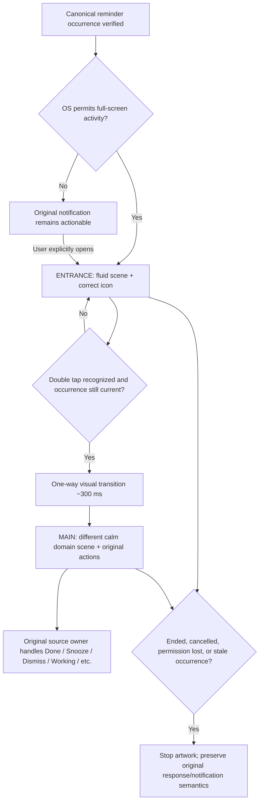

# Backlot RX01 — Premium Fluid Reminder Experience
## Approved creative system + source-stage A contract (2026-11-20)

**Status:** APPROVED VISUAL DIRECTION; RX01-A VISUAL FOUNDATION SOURCE-STAGED ONLY. Not integrated, compiled, tested, installed, signed, accepted or released. Do not imply finished live behavior.

**Authoritative base:** main AND `stable/backlot-ux01-08-ux10-owner-accepted-20261120` are the identical approved baseline commit `abbe88984bac16cfafbd990d9cb00ed54cfdd07e`. This change uses an isolated source branch; do not amend main/stable or integrate UX09.

**Source reference:** user-uploaded five-second multicolour fluid-gradient video. Study its soft diffusion, field movement, smooth chromatic transitions, lack of hard geometric objects. Produce ORIGINAL Backlot visual composition, palettes, icon design, transition rhythms and legible user-facing information; do not claim direct replication of the original wallpaper software or its unknown touch/sensor behavior.

## 1. Founder requirement — binding acceptance target

The reminder **entrance** is a full-screen, expressive fluid-light animated experience, with premium mode-aware microphone, alarm or combined icon. The entrance is **not** the response screen. Only a user double tap on the entrance proceeds to the **main** reminder screen, which uses a different, more controlled and readable premium background. There are three domain-specific art directions, one for Creator, Personal, and single-activity 21-Day Challenge. Preserve every existing authenticated occurrence, Voice/Alarm service, Done/Snooze/dismiss/replay/reschedule, restore ledger, notification action, full-screen permission and device privacy contract. A future physical QA and publisher release gate will follow the founder's explicit 'all done' signal.

### Domain art direction and fixed V1 map

| Domain | Entrance scene | Palette | Motion identity | Main scene |
|---|---|---|---|---|
| Creator | **Pulse Studio** | Cobalt, ultraviolet, electric magenta, cyan accents | Lateral slow fluid field crossings; delicate studio lens glow; never a rapid strobe | **Studio Nocturne** — deep ink/navy/violet layered light; active action contrast |
| Personal | **Living Bloom** | Rose, coral, apricot gold, lavender, aqua glint | Soft breathing diffusion; blossoming warm light without flashing | **Velvet Sanctuary** — plum/pearl muted silk with dark readable text zone |
| 21-Day Challenge | **Rise Core** | Crimson, ember, hot amber/gold, deep violet shadows | Rising warm energy and purpose-built circular light aura | **Ember Command** — charcoal/burgundy/bronze controlled focal lighting |

The **main** scene is not simply the entrance with a translucent overlay; each has distinct saved design tokens and a stronger bottom contrast scrim. Vibrant entrance is reserved for short attentive viewing; the live response actions use calm high-contrast material.

### Icon language

- **Voice:** original premium microphone symbol, glass-metal optical core, halo in domain tint, gentle voice-frequency ornamentation purely decorative. Do not show listening/waveform amplitude as if real microphone input were active.
- **Alarm:** premium clock/alarm bell icon with minute-hand geometry, subtle crown/strike highlight, glow matching the scene; no false countdown or claimed alarm delivery.
- **Voice + Alarm:** balanced paired icons inside one circular optic; only if a domain's real current mode legally represents both, never infer from unrelated modes.
- SVG/vector / native Canvas components preferred; avoid unrelated emoji glyphs or stock art. Icon silhouette must read at small screens, while TalkBack uses a meaningful text label and decorative layers are excluded from focus.
- Central icon, halo and label must avoid screen burn-in and notch/cutouts; typography remains within system safe insets.

## 2. Exact screen states and transition contract

**Critical:** Android may decline full-screen launch (notification permission, FSI eligibility, OEM/background limits). Never launch a background Activity by bypassing platform policy. When the OS declines, the original notification must remain actionable and open a legitimate entrance after the user taps it. A posted notification or visually entered screen is never proof the user acknowledged, heard, completed, or saw the reminder.

- **Entrance phase:** starts when an eligible existing Activity legitimately opens; no initial auto-advance. An animation cycle never advances the screen automatically.
- **Double tap:** within Android gesture thresholds, consumed by a dedicated entry overlay only; a single tap cannot accidentally execute a Done/Snooze action under it. Prompt **DOUBLE TAP TO OPEN**. TalkBack focuses an accessible action that can be activated with its standard double-tap gesture. Avoid an inaccessible gesture-only dead end; assistive switch/keyboard activation of the focused action is allowed as an accessibility equivalent.
- **State ownership:** entry vs main is local UI state bound to a verified **occurrence identifier**, not a stored domain completion or a reminder-schedule mutation. An occurrence change always resets entrance state; stale/invalid occurrence closes or uses original safe fallback. Do not infer from project title or due date.
- **After transition:** main scene is not just a preview. Existing real controls take focus. Back/rotation/process recreation must never auto-complete or fabricate a receipt. Restore the safe visual state only if the same occurrence is still valid.
- **Locked Personal:** do not display private title/notes, selected personal image/companion, or sensitive responses while the existing Keyguard privacy contract denies them. Artwork can show generic type/icon if the current lock-screen policy allows; actions remain protected.
- **Emergency safety:** system Back, timeouts and original notification action controls are not erased by the entrance; a visual overlay is not allowed to indefinitely ring/keep waking device. Existing Voice/Alarm watchdog owns playback stop. The user can always dismiss the system notification through standard OS behavior.

## 3. Three actual Android paths; do not falsely unify scheduling

- **Creator**: `AlarmActivity` and `VoiceReminderActivity` create the current `ReminderCheckInScreen`. Later integration wraps **only** the existing verified content with an entrance/main visual phase; original live task/occurrence gates, Service, Replay and action closures must remain identical.
- **Personal**: `PersonalAlertActivity` currently permits full-screen Alarm only. Voice/Notification uses its existing notification-only policy. Later integration must keep its Keyguard check and separate Done vs Dismiss; never use Creator project receipt identity or grant FSI for Personal Voice.
- **21-Day Challenge**: current `Phase1HabitLiveDelivery` / Voice Service and notifications do not have equivalent automatic full-screen UX. **This is a real architecture gap**, not fixed by adding artwork. Stage RX01-E must design owner-scoped, non-exported, correctly authorized user-opened and eligible Alarm full-screen delivery, with confirmed day status separate from notification and playback. No permission bypass, no fake automatic full-screen guarantee, no new Done receipt source.
- **Domain modes:** determine Voice/Alarm from the verified occurrence owner and mode. Never infer Voice+Alarm from presence of an optional music file alone.

## 4. Audio, design and legacy preference preservation

- The existing audio starts/stops with the existing service/receiver lifecycle, independent of drawing/gesture animation; no extra audio in RX01 V1 and no repeated trigger when switching main. Existing 21-day chosen Piano/Custom/OFF and repeat count remain unchanged.
- Preserve all seven Classic and five Cinematic `V391ReminderScene` IDs and independent Voice/Alarm preference values. Preserve existing opt-in `V394Premiere` and `V407ReminderCompanionPrefs` values. The new RX01 scene entry does not silently overwrite old saved settings.
- Later integration must explicitly decide/implement presentation precedence (new scene enabled vs Premiere vs previous scene). No accidental double-rendering, preference migration or disappearance of legacy scene controls.
- Preserve selected Spark/Mira as an **optional** existing companion preference when main screen hosts it; the new icons are not a substitute for user-selected companion.
- Separate entrance visuals from main controls and from background notification delivery: no Canvas pointer handlers, no hidden shortcuts to completion, no notification token mutation.

## 5. Engineering foundation, platform targets and performance

- Current app: **minSdk 26, targetSdk 36** with existing Compose Canvas/animation dependencies. No new plugin or paid service needed.
- Source-stage A adds **only** `RX01FluidReminderBackdrop.kt`: 3 domains × 2 explicit palette phases, deterministic smooth paths, bounded radial diffuse light, own dark main material, no network/storage/audio/service/Activity callers. Its renderer is an API26-compatible Compose Canvas fallback, not a claim to have integrated an API33 AGSL shader.
- Later stages may evaluate an optional API33+ `RuntimeShader` original liquid-noise warp with visual screenshot comparison and strict fallback. Avoid excessive live blur, large off-screen bitmaps, video loops, and per-frame media decoding.
- No visible flashing, strobing or jitter. Motion follows Animator scale, OS reduced-motion settings where available, lifecycle pause and battery saver; freeze to a designed static frame in low-power mode. On the main screen motion is slower and dimmer than the entrance.
- QA targets (to **measure**, not claim now): smooth UX on representative low-end API26 and Android 15 phones, no jank when ringtone/TTS starts, no animation still burning GPU after screen exit, clean rotation/screen-off behavior, no frame overdraw over critical action controls, sufficiently readable text at large font scales, no excessive battery drain during normal bounded activity lifecycle.

## 6. Sequential source staging — DO NOT integrate before founder says 'all done'

| Stage | Source-only scope | Deliverable |
|---|---|---|
| **RX01-A** | Master spec + independent reusable fluid renderer (three domain entrances and three quieter mains) | **This stage**; no live alert code touched |
| **RX01-B** | Entry scene composition: original mode-aware mic/alarm optic, caption, safe-zone and optional companion plan | Separate isolated source commit |
| **RX01-C** | Dedicated one-way double-tap gate, accessibility equivalence and main-scene transition container | Separate isolated source commit |
| **RX01-D** | Creator and Personal source-owned wiring while preserving existing Service, occurrence verification, Keyguard and action closure | Source-stage only; final tests deferred |
| **RX01-E** | Single-activity 21-Day Challenge live-entry architecture, eligible OS paths and visual wiring | Source-stage only; no FSI bypass |
| **RX01-F** | Settings compatibility, scene/preference precedence, fallback, full screen, lifecycle and theme consistency audit | Final source-stage, then founder review |

Once **all approved source stages and other final changes** are complete and the founder explicitly says **ALL DONE**, perform conflict reconciliation to the frozen approved stable baseline, exhaustive unit / regression / lint / instrumented Android/API26+ / Android15 / screenshot / voice / permission / TTS / keyguard / real-device acceptance and only then generate the final integrated APK. Fix defects inside the isolated candidate, not by modifying stable directly. Do not promote stable / Play until explicit founder signoff.

## 7. Test acceptance requirements (authored, NOT executed)

1. Three visual identities render six separately composed palettes, and MAIN is genuinely different from ENTRANCE.
2. The icon reflects the real verified Voice/Alarm type, with accurate accessibility semantics and no false recording state.
3. The first tap never opens or activates a hidden button. A valid double tap advances exactly once and cannot mark Done or Snooze.
4. Wrong occurrence identity, stale Activity, reboot, restore and duplicate notification cannot open another user's or an old reminder's details.
5. Android FSI denial, blocked notification channel and keyguard do not fabricate delivery; original notification and responses remain functional.
6. No loss of Creator/Personal/Challenge snooze, repeat, playback, custom music, timeout, existing voice modes, privacy, local data or 21-day confirmations.
7. Reduced motion / animation scale OFF / battery saver / low-end hardware freeze or simplify motion while keeping the primary prompt legible.
8. Main text/body/buttons meet legibility/contrast and 48dp minimum targets at 320dp, 200% font, TalkBack and tablets; no false full-screen guarantee.
9. Legacy V391/V394/V407 choices and old challenge v1/v2/v3 state remain intact after upgrade and any rollback.
10. 24h recurrence / one-time / repeated alarms, delayed open, notification action while entrance visible, process recreation, two simultaneous reminders and Android 14+ permission restrictions are tested.
11. Actual Android 15 full-screen tests, screenshots and founder device observation are mandatory; JVM and emulator launch alone are not a premium experience acceptance pass.

**Authoritative claim level:** Source-stage A is not integrated into any live reminder screen. No unit, compile, lint, emulator, physical-device, installer, hosted data, backend, Play release or APK actions were performed for RX01-A. Keep the PR draft and main/stable unchanged.
