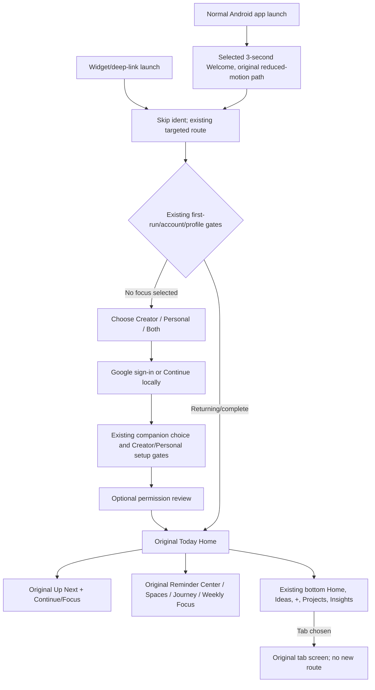

# Backlot UX10B — First run, onboarding, Home and navigation polish

**Prepared:** 2026-11-17
**Status:** SOURCE-STAGED / DRAFT ONLY. No Android/Gradle compile, JVM/CI run, Compose UI, accessibility, visual screenshot, physical APK or release validation.
**Stacked exact parent:** UX10A draft PR #423, head `c9cba45e6d57f1c12df7f153547f6d5f453addf5`.
**Accepted protected stable:** V337 P0 `815ba69775f75b6e5f25bb838c2c17b4f09c203e` unchanged. Its 19 accepted corrective commits across 22 paths are not in the UX stack and remain an explicit final integration gate.
**Founder ordering:** UX10 before UX09. UX09 cloud and multi-device synchronization is intentionally DEFERRED, not done. Do not alter Supabase config, RLS, auth flows, provider costs, private credentials or user/account state here.

## 1. Source-grounded audit

### Actual app paths

- **Launch:** `V131LaunchGate` shows `V401WelcomeExperience` on ordinary starts, then the existing app. External widget/deep-link launches skip the ident. The original particle renderer `V199ParticleWelcome` and three alternate welcome styles already offer static/reduced-motion treatment. Welcome style saving happens separately in `V401WelcomePicker`; preview is silent and does not mutate the selected style. **UX10B deliberately does not modify any of these assets/timers/gates**.
- **First-run owner:** `V393FirstRunPrefs`, `V393FirstRunFocusScreen`, `V23AccountOnboarding`, `V144GuideChoiceGate`, `V393QuickCreatorSetup`, `V402FirstRunPermissionGuide`, `V402PersonalFirstRunGuide`, and legacy five-page `V18CreatorOnboarding` are selected by explicit existing root state gates. Personal-first keeps a real Personal route without demanding Creator profile setup. Existing `rememberSaveable` and stored first-run choices protect against orientation/Activity recreation.
- **Home owner:** current Home is `PTodayScreen` in `V18TodayScreen.kt`, not the separate historical `V133CreatorHome`. Current Home shows header/companion/galleries, optional connected top performers, then Up Next actions, Reminder Center, My Spaces, Progress Journey and Weekly Focus. The ordering has already been deliberately prioritized; UX10B does not move or duplicate those blocks.
- **Bottom navigation owner:** `PBottomNav` in `FrameByNavinV101BApp.kt` has original Home/Ideas/center-project-create/Projects/Insights destinations; Calendar remains its existing distinct screen route and Quick Actions shortcut. The original implementation could shrink Projects and Insights labels to **6.5sp** at high font scales, conflicting with UX10A's readable 10sp floor and still risking truncation. Its measured navigation clearance is `V197BottomNavigationClearance` and must survive any item-height adjustment.

### Design decision

- Show nav labels at readable **10sp minimum only when physical width/font scale fit**. When not, switch to existing iconic navigation with explicit full semantics label (and active state), not squeezed 6.5sp labels. The large center + remains the original project composer.
- Use a real responsive layout for Home's Continue Work and Focus buttons. They retain existing `phase3-home-continue`/`phase3-home-focus` tags and original callbacks; stack into full-width actions when phone width is below 360dp or system font scale is >=1.35. Preserve original Focus haptic in call site.
- First-run Creator choice groups become one column under the same responsive thresholds instead of tiny fixed 55dp two-column choices; otherwise remain two columns with unchanged `onSelected` callbacks. Use 64dp minimum choice targets and readable 13sp names/18sp line height. Refrain from showing BOTH as visually preselected before a user has chosen a first-run focus.
- Optional Android permission page reflows its **review** controls at large text/narrow widths. All requests continue to require explicit clicks, allow optional choices and retain original conservative readiness text.
- Personal guide keeps the original three-page explanations, Spark/Mira companion from saved preference, voice narration toggle and skip controls. Increase action accessibility and standardize page margins, no new voice service.
- Account entry retains existing Google credential, username, local entry and returning-account callbacks; update copy to accurately distinguish **selected cloud backup coverage** from **complete two-device sync**, which is deferred to UX09. No auth/server behavior changed.
- Legacy existing five-page Creator onboarding remains reachable for accounts with incomplete profile and retains primary/secondary mode, platform, production style, goals, weekly target and original owner save; visual polish never advances the page or silently saves.

## 2. Exact staged Kotlin implementation

| Path | Changes | Intentionally protected |
|---|---|---|
| `ui/UX10BPresentationPolicy.kt` NEW | Pure responsive thresholds / whether nav labels fit at minimum 10sp | No record state or persisted preferences |
| `ui/UX10BHomeActionsUi.kt` NEW | Readable adaptive Home buttons with original exact test tags and explicit TalkBack labels | Source callback owner, project state and reminder scheduler unchanged |
| `ui/FrameByNavinV101BApp.kt` | PBottomNav item readable text-or-icon policy; full accessible tab description, 56dp minimum nav targets; small header/empty-state typography | Original tab destinations, create, Back and P0 overlays unchanged |
| `ui/V18TodayScreen.kt` | Home uses original callbacks through adaptive action UI, UX10A gutter and 10sp minimum for 28 formerly tiny labels; muted Weekly Focus border | Existing Home section order, actual project list/Up Next and original haptics |
| `ui/V393FirstRunQuickStart.kt` | Equal-weight focus cards (no false BOTH highlight), readable responsive choices and common gutters | Original first-run prefs, valid Creator profile, saved selections |
| `ui/V402FirstRunPermissionGuide.kt` | Responsive stacked/nonstacked permission details and same Review controls, 56dp Continue | No auto-grant, no new permission, no alarm setting |
| `ui/V402PersonalFirstRunGuide.kt` | Tokenized typography/gutter, 56dp Next, 48dp Skip | Original Personal-first choice, 3 slides, voice and companion |
| `ui/V18CreatorOnboarding.kt` | 9 sub-10sp labels to 10sp, common gutter, quieter unselected permission row with visible ready indicator | All 5-page onboarding data and validation untouched |
| `ui/V23AccountOnboarding.kt` | Common visual margins/action targets and honest cloud coverage language | Existing Google/token/username/local/recovery handlers unchanged |
| `app/src/test/java/com/framebynavin/app/ui/UX10BPresentationPolicyTest.kt` NEW | Six authored, **NOT EXECUTED** responsive policy tests | Source tests are not physical UI/accessibility proof |
| `docs/qa/UX10B_FIRST_RUN_HOME_NAV_CERTIFICATION_AFTER_UX10.md` | 40 deferred UX and P0/device checks | Documentation only |

Current substage **source-staged** rather than compiled/CI tested. No changes to `V401WelcomeCollection`, `V199ParticleWelcome`, `V131LaunchGate`, `V393FirstRunPrefs`, `V197BottomNavigationClearance`, Creator/Personal data stores, Android manifest or cloud config.

## 3. Actual flow and controls

There is **no new first-run writer, forced sign-in, paid AI provider, cloud auto-sync or permission request**. The UI is presentation-only beyond the original callbacks.

## 4. Privacy, accessibility, limitations and next phase

- **Nav accessibility:** icon-only in insufficient width needs full TalkBack label/selected state and >=48dp target; the source was wired to explicit semantics but **this has not been physically tested**. Normal-size labels stay legible at >=10sp. Tablet navigation should show words.
- **Home readability:** previously 28 sub-10sp labels were raised, and primary actions stack. Their expanded layout may push content further down, but original scroll and dynamic `V197BottomNavigationClearance` should still protect the last action. **Verification pending** at 320dp and 200% font.
- **First-run focus:** all three pathways remain equally valid, original first-run preference saved only after onChoose succeeds in root. Quick setup fields are original `rememberSaveable`, not rewritten by display.
- **Permissions:** displaying Ready does not mean Android alarm delivery guaranteed; P0 delivery/recovery remains the source owner. Different devices can have different permission states even with the same Google account.
- **Legacy UX:** original Creator five-page and Account Google flow remain. Actual auth/provider connectivity at the currently configured Supabase project is **outside this UX10B visual stage** and subject to UX09 separately.
- **Welcome & characters:** art assets/saved styles/Spark/Mira untouched. No claim of new animation or device-validated reduced-motion output.
- **Important known blocker:** UX08B timeline false-empty decode gap, UX08D/E weekly typed-load health, UX08C reward celebration physical timing, UX08F Skip owner mutation race, V337 P0 protective delta reconciliation and UX09 sync are still open.
- **Next UX10C:** project composer, stages, Content Workspace, Idea Vault, drafts/autosave and source-safe layouts. Audit source owners before resizing or moving any writer controls.

## 5. Test and release agreement after UX09 deferral

The founder's preference remains one consolidated full QA campaign rather than repeated intermediate tests. Because UX09 was deferred *behind* UX10, **finishing UX10 does not make the complete ten-point feature set or device synchronization release-ready**. At UX10 completion, prepare candidate integration and explicit decision whether to do an interim non-sync stable build under full P0/device gating. For the all-feature release, UX09 must still pass its own architecture, RLS, two-device acceptance and final integration gates. No merges or releases are authorized by a UX10 draft.

**Current verdict:** UX10B source-only with six authored unexecuted tests and forty deferred QA checks, awaiting exact PR diff/ancestry review.
