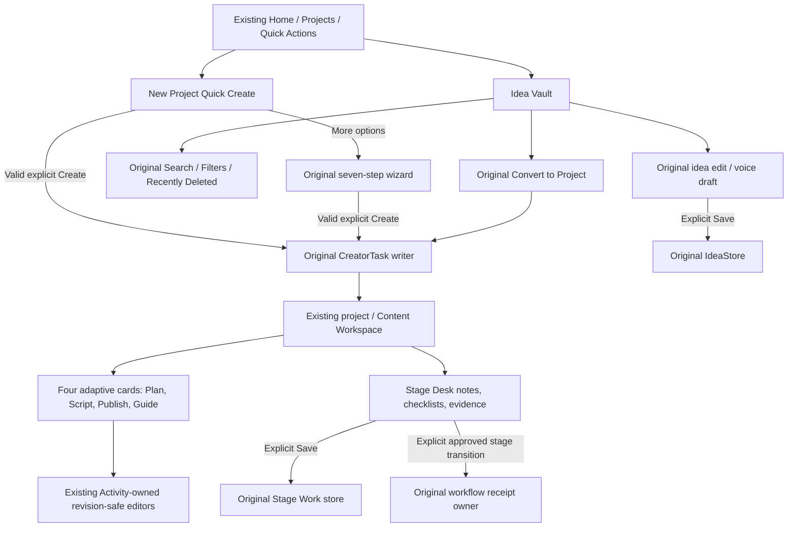

# Backlot UX10C — Creator Projects, workflow stages, Idea Vault & Content Workspace visual consistency

**Date:** 2026-11-17
**Stage:** SOURCE-STAGED DRAFT ONLY — no Kotlin/Compose compile, JVM/CI, instrumentation, emulator, owner physical acceptance, signed APK, merge, production release or stable promotion.
**Exact stacked parent:** UX10B draft PR #424, HEAD `9ddfe99fb1e63c145c53ba325cc7cfbc61a4773f`.
**Protected owner stable:** V337 P0 `815ba69775f75b6e5f25bb838c2c17b4f09c203e`, unchanged. Accepted 19-commit/22-path P0 corrective delta outside UX branch requires explicit final integration.
**Founder ordering:** UX10 first; UX09 multi-device sync deferred, *not* complete. No new backend/RLS/credential/snapshot/account change or paid service authorized.
**Founder workflow:** source-stage individual visual packages and regression-test specifications, then an approved consolidated integration/build/CI/Android/physical campaign. A draft PR is not an APK.

## 1. Source-of-truth audit / design judgment

The Creator production workspace already has distinct data owners and revision-safe flows. Our goal is to remove inconsistent visual chrome **without** inventing a parallel workspace, bypassing save confirmations or treating a stage checklist as publication.

| Surface inspected | Existing real owner | What UX10C can change | Forbidden without separate authority |
|---|---|---|---|
| New Project / Quick Create and advanced wizard | `V20NewProjectWizard`, `V173ProjectUiMetrics`, original `onCreate`, validation and date/time pickers | Shared minimum 56dp primary CTAs, quiet unselected cards, clear high-contrast red active step, consistent gutters | Project status write, Creator category/profile default, due date / reminder validation, schedule action, voice setting |
| Existing Project notes | `V175ProjectNotesField` and original editor callback | Shared surface shape/hairline | Mutate notes content, replace draft store, lose save/restore |
| Stage Desk | `CW3StageDesk`, `CreatorStageWork`, revision and journal stores | Shared stage header and material card density | Mark Stage Approved on opening notes, claim tracked focus time, auto-publish or change evidence owner |
| Workspace hub | `V19ContentWorkspaceAlpha6Hub` original four Plan/Script/Publish/Guide routes + `V405WorkspaceOverviewPolicy` | Make tool cards 1 column on narrow/large-font and 2 columns on normal screens, reduce card borders | Change stage transition or output publication, lose original onOpenProject/onOpenScript/onOpenPublish/onOpenBlueprint destinations |
| Plan / Script / Publish Studios | `V19ContentWorkspaceAlpha3Ui.kt`, Alpha4, Alpha5 and `ContentWorkspaceActivity` save/revision owners | Lift sub-10sp display labels and calm neutral strokes | Change callbacks, saved revisions, workspace duplication guard, output deliverable/cut/publish receipts, media references |
| Legacy Workspace editor | `V19ContentWorkspaceDialog` | Improve undersized presentation copy and default checklist button label | Alter legacy revision contract or old-user access to editor |
| Status and history | `V405CurrentStageGlance`, `V405OutputFacts`, `V405StageApprovalHistory` | Harmonize density/eyebrow typography | Conflate saved Done with externally verified publish, mint false stage receipts |
| Idea Vault / advanced filters | `V09IdeaVaultScreen`, `V150IdeaVaultPolish`, original `CreatorIdea`, `IdeaVaultStore` | Flow-wrapped category/status/voice/momentum badges, less truncation, 10sp minimum text, adaptive action rows | Change draft/voice recording, convert/archive/restore semantics, ID linkage, deleted-item retention |
| Idea edit actions | `V227IdeaEditorActionFooter` | 56dp save/cancel tap targets consistent with UX10A | Save automatically on Cancel, lose staged voice recording, overwrite original idea draft |
| Workspace footer across editors | `WorkspaceAdaptiveFrame`, `WorkspaceAdaptiveSaveActions` | Common 56dp minimum buttons and quiet radius while preserving small-font stacking | Implicit save or close on navigation, double-use system insets |

**Key product choice:** use established `BacklotUX10Tokens` and pre-existing `V173ProjectUiMetrics` rather than building a new design system or duplicated Creator data owner. Active/selected/error surfaces keep visible semantic contrast; only neutral borders become quieter.

### Existing stage/draft invariants must survive

- **Draft save is not stage approval.** Stage notes, checklist and research references have independent original save controls. Stage transitions require the original explicit approval path, real task identity and revision validation.
- **One Creator project, many work surfaces:** Plan, Script, Publish, Guide, Stage Desk, Output Craft and Learning all reference one canonical `CreatorTask` / workspace, not copied portfolios or shadow draft stores.
- **Original media ownership:** source links, image/voice files and original metadata must remain attached to the original IDs. Visual-only status badges must not imply external upload/verification.
- **Original Idea Vault ownership:** opening an idea, archive, restore or convert must operate on the original durable idea/project IDs. Merely viewing an idea card does not create an idea, complete a stage or earn new XP.
- **Reminder/permission boundary:** editing Creator due dates or voice settings belongs only to original wizard/editor owners. UX10C touches no Android AlarmManager, notification tokens or Snooze.
- **History truth:** completed Creator task status, recorded stage approval and saved publish receipt are three different statuses. None alone is proof that YouTube/Instagram published the item externally.

## 2. UX10C exact source changes

### Adaptive Workspace hub

`UX10CWorkspacePresentationPolicy.kt` is pure: use 1 tool per row under 380dp or fontScale >= 1.3, otherwise 2 columns. It always describes exactly four original tools. In `V19ContentWorkspaceAlpha6Ui.kt`, one original-order list of `UX10CWorkspaceTool` items yields either layout without copying action handlers, preserving **Plan, Script, Publish, Guide** routes, original buttons, Stage notes, Creative Board, Output Craft, Learning and Stage approvals.

The same hub now uses calm, visually coherent neutral cards, retained red primary action and 56dp main CTA. Tool-card summaries can span two lines rather than immediately truncating. This is a presentation reflow only; it does **not** change the original percentage, stage receipt or publication count calculations.

### Project wizard and stage editor

`V173ProjectUiMetrics` now uses UX10's existing 48dp minimum touch and 56dp preferred action target. Its 62dp review-row target remains. `V20NewProjectWizard` preserves the quick and seven-step advanced paths, original validation, real date/time and voice choices, and actual original save callback; unselected panels have quiet outlines while active progress retains red semantic emphasis. `V175ProjectNotesField` and `CW3StageDesk` align note/stage materials with same restrained surfaces, without changing editable state, revisions or evidence references.

`WorkspaceAdaptiveFrame`, `WorkspaceAdaptiveSaveActions` and `V227IdeaEditorActionFooter` retain original IME/safe-inset and 1-column versus paired primary/secondary action behavior but guarantee a 56dp visual minimum for editor actions. No save callback changed.

### Idea Vault

`V09IdeaVaultUi.kt` retains every original search/filter/chip, deleted-items view, idea editor, original voice recorder, status, project-link navigation, archive and convert callback. The saved idea card now uses wrapping badge/action layouts, 10sp minimum status labels, two-line metadata and visible opportunity emphasis. The original `ux05-open-linked-project` tag stays. Other under-10sp editor/support labels are lifted to the shared typography role, neutral borders softened. `V150IdeaVaultPolish` advanced filters keep their original controls.

### Plan / Script / Publish / history

`V19ContentWorkspaceAlpha3Ui.kt`, `Alpha4Ui.kt`, `Alpha5Ui.kt`, and `V19ContentWorkspaceUi.kt` use the common >=10sp eyebrow and quiet neutral borders. `V20WorkflowIntelligenceUi.kt` neutral borders are softened. `V405WorkspaceSections.kt` normalizes read-only stage/material history rhythm and labels. **ContentWorkspaceActivity and all actual save / revision / project-stage writer code are untouched.**

This stage changes presentation only. Enlarging labels can expose poor fixed-size layouts on actual handsets; do **not** call it fully visually certified before 320dp/200% font/tablet screenshots. When a compact surface clips, the fix is responsive layout, not reverting labels to 7–9sp.

## 3. Source change register (19 intended files total)

| Category | Paths |
|---|---|
| NEW pure policy | `ui/UX10CWorkspacePresentationPolicy.kt` |
| Existing Creator presentation | `ui/V173ProjectUiMetrics.kt`, `ui/WorkspaceAdaptiveFrame.kt`, `ui/V227IdeaEditorActionFooter.kt`, `ui/V20NewProjectWizard.kt`, `ui/V175ProjectDetailsUi.kt`, `ui/CW3StageDesk.kt` |
| Existing Idea Vault | `ui/V09IdeaVaultUi.kt`, `ui/V150IdeaVaultPolish.kt` |
| Existing Content Workspace | `ui/V19ContentWorkspaceUi.kt`, `ui/V19ContentWorkspaceAlpha3Ui.kt`, `ui/V19ContentWorkspaceAlpha4Ui.kt`, `ui/V19ContentWorkspaceAlpha5Ui.kt`, `ui/V19ContentWorkspaceAlpha6Ui.kt`, `ui/V405WorkspaceSections.kt`, `ui/V20WorkflowIntelligenceUi.kt` |
| NEW source tests | `app/src/test/java/com/framebynavin/app/ui/UX10CWorkspacePresentationPolicyTest.kt` — seven unexecuted cases |
| Documents | This file; `docs/qa/UX10C_PROJECT_IDEA_WORKSPACE_CERTIFICATION_AFTER_UX10.md` — forty deferred scenarios |

**Protected by untouched file scope:** `ContentWorkspaceActivity.kt`, all `CreatorViewModel`/data/workflow/Idea/Stage/Script/Draft stores, Creator rewards, Original Reminder scheduler, Personal/Challenge/Space stores, Supabase/cloud config, Manifest, backup/restore, stable and main.

## 4. User-facing navigation flow, source-owned

UX10C changes no arrow/writer, only layout around these existing controls.

## 5. Known limitations, roadmap and release gating

- Need actual Compose compile, 320dp and 200% font testing, TalkBack focus semantics, tablet portrait/landscape, IME with draft forms, and real screenshots in both themes. Source-staged `FlowRow` idea cards must be validated in actual app builds. The original state and action IDs can still race with device lifecycle or drafts until real tests.
- Some specialized media editing/visual composition surfaces and image/voice asset pickers need further shared-screen inspection during UX10F before release. UX10C covers main editor shell and the canonical Plan/Script/Publish/Stage/Idea screens, not a promise that every feature was visually certified.
- Original Creative Board / Output Craft / Learning work surfaces are not rearchitected; the Workspace hub continues to route to them. Their deep editing constraints remain original and are included in deferred QA.
- P0 data safety: V337 accepted 19-commit/22-path corrective lineage missing from this stacked visual branch; do not merge or release until explicitly reconciled. No changes to Android full-screen alert readiness, Snooze, ledger, recover/restore or cloud sync.
- UX09 remains postponed and incomplete. Full automatic cross-device sync cannot be claimed from a visual Creator stage.
- **Next:** UX10D Personal / My Spaces / Challenges / Personal and Creator Reminders visual polish, with stricter protection around privacy, voice, audio playback, permissions, focus and lockscreen alert actions; then UX10E and UX10F. Only after the agreed integrated source review, real tests, P0 reconciliation, APK proof and founder approval may promotion be considered.

**Verdict:** UX10C source-staging candidate; seven new tests authored, none executed. Await exact PR diff + scope verification.
