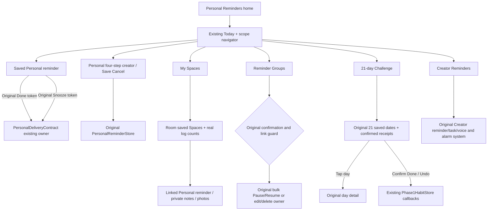

# Backlot UX10D — Personal, My Spaces, Challenges and Reminder presentation

**Date:** 2026-11-17.
**STATUS:** SOURCE-STAGED / DRAFT ONLY. **No Kotlin/Compose compilation, Gradle/JVM/CI, Android instrumentation, screenshots, real-device testing, merged code, APK or release.**
**Exact parent:** UX10C draft PR #425 at `04d3dfae46e6f2b9280ee4775cd89066dcf2c1d6`.
**Protected owner-stable baseline:** V337 P0 `815ba69775f75b6e5f25bb838c2c17b4f09c203e`; no modifications. The accepted V337 corrective lineage (19 commits / 22 paths) remains outside cumulative UX ancestry and must be reconciled before integrated Android certification.
**Founder-approved order:** UX10 first, UX09 later. Multi-device data synchronization, cloud project cutover and server work remain DEFERRED, not implemented or silently approved. One consolidated full test campaign after the agreed source stages; no premature PASS.

## 1. What was actually inspected

Distinct sources exist. UX10D does **not** pretend that one universal timeline or Challenge database already owns all Personal data.

| Surface | Existing source owner | Preservation rule |
|---|---|---|
| Personal Reminder home/editor and today's source response | `V2232PersonalReminderHub`, PersonalReminderStore, original `onRespond(PersonalDeliveryContract.ACTION_DONE / ACTION_SNOOZE)` | Real response token flow, original busy gating, reminder ID/notes, paused/needs-attention distinctions unchanged |
| Creator reminder center / project reminders | `V157ReminderCenterUi`, `V101BReminderUi`, Creator project/task and alert policy | Existing selection/pause/reschedule/voice/alert safety retained |
| Cross-workspace reminder navigator and Personal four-step composer | `BacklotReminderHubChrome`, `V406ReminderExperienceUi` | Original Creator/Personal route callbacks, source counts, step order and validation unchanged |
| Personal reminder purpose/Save/Cancel and routine previews | `V274PersonalPurposeUi`, `V2271PersonalEditorFooter`, `UX07BPersonalRhythmUi`, `V295UniversalPersonalRoutines` | Original saved purpose/selected option, draft, repeat, voice/music, save/cancel unchanged |
| My Spaces, links, private notes and activity | `V289PersonalSpacesScreen`, `UX07CSpacePresentation`, original Room/Space stores | Space ID, archived flag, actual log counts, links, notes, local recovery, privacy all unchanged |
| Space photo journal | `V290PersonalPhotoSection` and existing V290 private photo files/journal | Private app storage, metadata-stripping, interrupted-photo recovery and delete confirmation untouched |
| Saved Reminder Groups | `V298ReminderGroupsScreen` and original FC13 bulk guard/action confirmation | Same edit/delete, Pause All/Resume All, stale-link/loaded/read-error checks and real Personal reminder IDs |
| Single activity / 21-day Challenge | `Phase1HabitSharedUi`, `Phase1HabitStore`, current-day confirmations, original day selection callback | Never infer Done from opening a day. Do not backdate, auto-complete, fabricate streaks or schedule an alert by viewing |
| Earlier/legacy multi-day Challenges | `V297ChallengeScreen` and V297 store | Preserve 21-day dates, optional per-day activity edit, export/import, confirmed status and archive/undo semantics |

**Critical distinction:** the actual immersive full-screen reminder/Challenge alert UI, `PersonalAlertActivity`, `PersonalPlaybackService`, snooze/rearm/delivery ledger, alarm receivers and Android 15 full-screen readiness remain owned by existing P0 code. This package intentionally **does not** edit them or claim the requested cinematic effects/voice playback have been physically validated.

## 2. Product decisions

- **One shared visual grammar:** keep Director's Cut REC-red and supported Backlot Light appearance, existing design tokens, selected/attention/focus outlines. Neutral cards receive calmer 0.75dp hairlines. Do not globally remove high-contrast warnings, selected filters, destructive controls or active alerts.
- **Responsive Personal response actions:** existing Done and Snooze are now offered as 56dp+ buttons, with a 1-column stack on phones under 380dp or system fontScale >=1.35; original `onRespond(ACTION_DONE/ACTION_SNOOZE)` callbacks and `v288-row-done/v288-row-snooze` tags preserved. No change to Snooze duration/policy/alarms.
- **Responsive group actions:** Edit, Delete, Pause All, Resume All use original enabled guards, pending confirmation callbacks, linked-ID validation and tags. On small/high-font screens they are 1-per-row rather than two cramped columns; full width otherwise remains paired. No bulk change on display.
- **Truthful My Spaces progress:** three separate counts (real manual entries, last-7-day active days, linked reminder count or unavailable) now stack vertically under 400dp or large fonts. None are recalculated, linked Done is not equated with Space check-ins and notes/photos are not fake activity.
- **21-day calendar:** the existing one-activity Challenge grid now uses 4 columns under 480dp or accessibility fontScale >=1.35, seven on sufficiently wide layouts. Dates remain original 1..21, with the same status and `onDaySelected` callback. Incomplete last row remains evenly sized. The day control includes an accessible announcement of confirmed/unconfirmed/today status. Original current-day Done/Undo/optional Snooze/Pause actions get 56dp minimum targets, retaining source callbacks. The earlier V297 21-day/day-activity screen retains its original stored day edits, but Previous/Next adapt to narrow text settings.
- **Personal purpose and editor:** purpose selector expands from 148dp to 220dp cards at large text without modifying selected `PersonalPurpose`; Save/Cancel remain one-per-row at compact sizes with existing `V2271PersonalFooterPolicy` and larger 56dp targets.
- **Private Photo Journal and Spaces:** simplify neutral chrome; keep photo-local-only disclosure, interrupted recovery and manual delete intact. No new cloud uploads, media mutation or paid service. Space names can wrap instead of clipping in header.
- **Creator reminder parity:** active/selected card edges stay visibly red, normal reminder surfaces use calm neutral borders, count labels have >=10sp support and original buttons remain at 56dp where touched. Original Creator project voice/music selection and Android delivery methods remain untouched.
- **Progress/navigation continuity:** cross-workspace reminder tabs remain the same original Personal vs Creator destinations, with full readable 56dp min tabs; four-step Personal composer order remains Purpose/Schedule/Alert/Review and cannot skip ahead through these visual changes.

## 3. Exact staged source files

**17 production UI/policy paths:**
1. NEW `ui/UX10DPersonalPresentationPolicy.kt`: pure viewport rules for three Space metrics, responses, Challenge grid/legacy day nav, purpose card width.
2. NEW `ui/UX10DPersonalActionUi.kt`: read-only Composable wrappers for original Done/Snooze, Challenge previous/next, and group Edit/Delete/Pause/Resume callbacks with original tags.
3. `ui/UX07CSpacePresentation.kt`: actual-source metrics 1- or 3-column, calm Space card stroke/typography, original Space ID/status.
4. `ui/Phase1HabitSharedUi.kt`: existing current single-activity Challenge's day-grid reflow, accessible day description, 56dp actions, calm inactive borders, strong featured/active states.
5. `ui/V2232PersonalReminderHub.kt`: responsive original Personal Done/Snooze controls, differentiated attention/neutral borders, shared page gutter.
6. `ui/V297ChallengeScreen.kt`: older Challenge Previous/Next 1- or 2-column controls, 56dp create/save/Done actions, calmer inactive cards.
7. `ui/V298ReminderGroupsScreen.kt`: responsive original four group actions with unchanged guards, 56dp create/link, neutral strokes.
8. `ui/BacklotReminderHubChrome.kt`: 56dp Personal/Creator tabs, quieter inactive border, active accent retained.
9. `ui/V406ReminderExperienceUi.kt`: 72dp scope cards with two-line labels, readable four-step navigation and strong current-step border.
10. `ui/V274PersonalPurposeUi.kt`: adaptive purpose card width / 104dp min, selected and inactive semantic borders.
11. `ui/V2271PersonalEditorFooter.kt`: 56dp original Save/Cancel and standard radius; original callback enabled rules intact.
12. `ui/V289PersonalSpacesScreen.kt`: header can wrap, quiet neutral panels, shared gutter; notes/photo controls unchanged.
13. `ui/V290PersonalPhotoSection.kt`: quiet private photo card, 56dp Add control; sensitive storage/access remains original.
14. `ui/V295UniversalPersonalRoutines.kt`: original routine suggestions/source previews, calmer card border and larger create target.
15. `ui/V157ReminderCenterUi.kt`: Creator reminder list/count/card neutral strokes, active/selected border preserved, min sizes and tiny label correction.
16. `ui/V101BReminderUi.kt`: original Creator project/reminder editor presentation-only border and typography treatment, no writer changes.
17. `ui/UX07BPersonalRhythmUi.kt`: original Personal recurring/reminder destinations with 48dp+ action targets and 56dp previews.

**1 new test file:** `app/src/test/java/com/framebynavin/app/ui/UX10DPersonalPresentationPolicyTest.kt`, **10 source tests authored, 0 executed**.

**2 documents:** This source-audit/implementation record and `docs/qa/UX10D_PERSONAL_REMINDER_CHALLENGE_CERTIFICATION_AFTER_UX10.md` (40 scenarios, not executed).

## 4. User workflow retained

Only the visual rows, sizes, selected states and responsive composition are different. No new database, account sync, Personal XP award, alarm, notification worker, source data mutation or backup/restore has been introduced.

## 5. Open risks / deferred certification requirements

- **Compile and physical behavior unknown:** no Gradle/Compose tests or screenshots were run. Phone 320/393dp, 200% font, tablet, Android edge/IME inset, TalkBack and alternate theme all require actual visual test evidence. Source-level assertions do not prove reachable buttons.
- The same Challenge grid contains 21 dates even when shown as 4 columns; grid shape is no longer a calendar week at compact widths. Its button descriptions must explain the actual date/status, and owner should verify reading order with TalkBack. Present code says Challenge day index + state; day detail presents actual date.
- The unchanged full-screen cinematic reminder themes and playback are **not** physically certified. Voice repeat/music, Challenge parity, notification token validation and original V337 snooze/ledger/rearm paths remain final P0 checks.
- Active/selected borders must remain discoverable in dark/light with high contrast and reduced motion. Quiet borders must never hide a destructive/edit affordance.
- Current Personal cloud snapshot coverage is incomplete for single-activity Challenges and photos; UX10D does not pretend to implement or fix UX09. Existing local-only/export and private photo notices must stay truthful.
- Some deep Personal dialogs, reminder specialty pickers, group/Spaces advanced settings and visual galleries are not individually screenshot-certified by this subset. UX10F audits cross-screen coverage, with remaining density fixes before final build.
- Accepted V337 P0 corrective delta (19 commits / 22 paths) still lies outside cumulative UX branch. Separate approved reconciliation before full Android testing; V337 stable/main remain untouched.

**Next:** UX10E Settings, Insights, widget/notification-center and offline/loading/error design; then UX10F global consistency/source integration and eventual founder-gated release decision. UX09 remains postponed.
