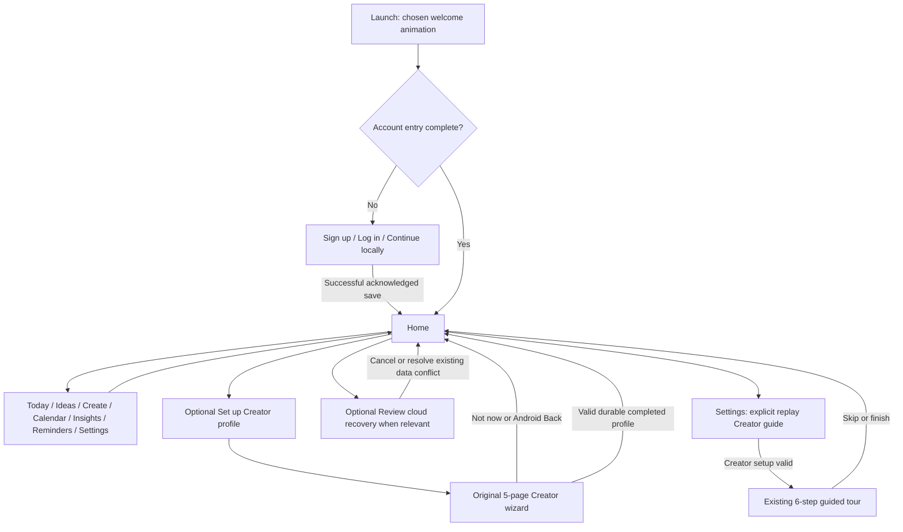

# Backlot 1.0 Recovery — first-run navigation and reminder appearance

Date: 2026-11-22
Owner authorization: "ok bro go ahead. continue"
**Current state: SOURCE STAGED; NOT COMPILED / NOT DEVICE TESTED / NOT APK-BUILT / NOT MERGED.**

## Provenance and isolation
- Reproduce/repair against the exact user-tested signed owner-preview source SHA `0971dc6cfa7750726f33f08cdc08cedac2ffd485` (Backlot 1.0 / versionCode 338).
- Isolated branch: `feature/backlot-v1-recovery-onboarding-reminder-looks-20261122`.
- Stable `main` remains at `abbe88984bac16cfafbd990d9cb00ed54cfdd07e` at this review.
- The previous green Kotlin/JVM/lint/API35 startup smoke evidence belongs to the old source and does **NOT** certify this repair branch.
- **No CI, Gradle, compilation, emulator, APK, stable merge, database migration or hosted data write performed while these fixes are staged.**
- Preserve Backlot public name, versionName 1.0, internal code 338 for this source stage; a later installable candidate must consider monotonic versionCode above already-installed 338 if required and signing/package compatibility.

## Confirmed root causes
1. Previous root Compose UI composed Home beneath multiple full-screen first-run gates, including auto route to five-page Creator wizard for any tab not TODAY, project composer/Quick Capture or Creator Reminders. A Personal-ready user did not necessarily have a complete Creator profile.
2. A separate guided Creator tour automatically restarted from saved tour-version state and could draw over Home; transient state was saved across Activity recreation.
3. Returning Google user with incomplete local Creator profile could be intercepted by the cloud recovery gate or mandatory companion choice; even if the user reached Home, later navigation could re-trigger Creator setup.
4. RX02 Appearance showed a "MAIN SCREEN & OLDER LOOKS" button opening V391 UI with "CINEMATIC COLLECTION", "CLASSIC COLLECTION", V394 Premiere controls. The gallery applied only to entrance and did not provide a matching modern MAIN preview.
5. App launch-only smoke never exercised new/returning account paths or Home navigation. It could pass despite major UX regressions.

## Repaired source routing

### Source changes
- `FrameByNavinV101BApp.kt`: only account gate remains mandatory. Creator setup, cloud recovery and guide are user-initiated; no tab or reminder click is an onboarding trigger. Removed first-run Compose effect that wrote UX02 flags and legacy auto-intercepts. Tour and setup request flags are transient; cannot restore as unwanted overlays after restart. Explicit Creator guide replay requires completed Creator setup, otherwise shows explanation without changing tour version.
- `BacklotV1RecoveryRoutePolicy.kt`: minimal pure route contract. `BacklotV1RecoveryRoutePolicyTest.kt` stages assertions for incomplete Personal-first accounts, explicit setup requests, completed users and cancellation.
- `V18TodayScreen.kt`: compact optional Home Creator setup and cloud-work review prompts; without actual callback, no inert setup button in isolated previews. Existing positional parameters preserved.
- `V23ProfileAccountUi.kt`: "FINISH CREATOR SETUP" visible only when Creator profile incomplete; existing complete-profile editor untouched.
- `V18CreatorOnboarding.kt`: opt-in "NOT NOW" close; five existing pages, validation, permission actions and durable profile write stay owned by original code.
- `V20DriveRecoveryGate.kt` unchanged: important manual conflict resolution remains available from Home when a returning account has incomplete local setup. No silent "start new" action.
- `RX02ReminderAppearanceSettings.kt`: one domain selector for Creator, Personal and 21-Day; entrance gallery/built-in and preview retained; **new MAIN preview** uses real `RX01FluidReminderBackdrop` MAIN phase for each domain. Rejected old Looks section removed. Existing companion-on-live-alerts toggle moved into this screen, not deleted. Old disabled Challenge view can opt back into modern entrance separately from FSI permission.
- `V391ReminderSceneEngine.kt`: removed obsolete `V391ReminderSceneSettings()` UI entirely; old enum/preference parsing retained in source only to avoid destructive migration of saved values.
- `ReminderCheckInScreen.kt`, `PersonalAlertActivity.kt`: remove V394 Premiere presentation call and old V391 rendered backgrounds; modern RX01 MAIN is used for valid and safe fallbacks. Old Creator particle introduction no longer used in the direct-content fallback. Original response callbacks untouched.
- `VoiceReminderActivity.kt`, `AlarmActivity.kt`: current authenticated Creator reminder occurrence uses the existing RX01 entrance/main gate regardless of stored old scene preference. Existing Voice/Alarm service, timers, acknowledgement, Snooze, reschedule and notification fallback unaffected.
- `V144SettingsHub.kt`, `V404SettingsIndex.kt`: remove old look marketing/click destinations and display modern labels.
- `BacklotV1RecoveryAppearanceUiTest.kt`: staged emulator-only UI checks confirm Classic/Cinematic selectors absent and new main palette previews and companion setting accessible.
- Historical V401 welcome opening picker is **a separate appearance feature**; not deleted or migrated by the removal of rejected reminder collections, to avoid silently overwriting a saved welcome selection without a specific design decision.

## Controlled acceptance gate — must pass before a new owner-preview APK
1. **Source provenance:** compare this branch to tested APK SHA; no unintended edits in cloud backend, settings storage, database, migrations, alarm services/receivers, notifications, user data or workflow shortcuts.
2. **Focused compile/unit/lint:** compile the affected Kotlin sources. Run the two new regression classes and directly affected tests first. Rerun broader dependent checks only if source changes invalidate prior evidence, but the existing old-build results DO NOT certify this branch.
3. **First-run local device:** Welcome -> Continue locally -> Home; Today, Ideas, Create, Calendar, Insights, Project composer, Personal and Creator Reminders, Settings, Profile and Back work without any automatic Creator setup, companion gate or guided tour.
4. **New Google user:** Welcome -> Sign up -> Credential Manager -> valid new-identity claim -> Home. Cancellation, network failure and name conflict show usable error and Back, never false session success.
5. **Returning Google user:** Welcome -> Log in -> recognized profile -> Home, without unrelated new-user setup. Existing cloud conflict offers an optional visible review, not silent overwrite. Verify identity and local data persistence after process death.
6. **Creator setup:** New Home/Profile "Set up" opens original five-page wizard; NOT NOW and system Back preserve current projects and settings; finish requires valid profile, persists atomically, then normal navigation and relaunch do not reenter wizard.
7. **Tour and permissions:** No auto tour; explicit Replay works only for complete Creator profile and can skip/end; permissions accessible via Settings and old delivery entitlements unchanged.
8. **Appearance:** No "MAIN SCREEN & OLDER LOOKS", "CINEMATIC COLLECTION" or "CLASSIC COLLECTION" anywhere in Reminder Appearance. For Creator, Personal and Challenge, inspect Entrance (Pulse Studio/Living Bloom/Rise Core) and MAIN (Studio Nocturne/Velvet Sanctuary/Ember Command). Gallery import/preview/clear remains local, safely locked behind existing privacy. Companion toggle persists.
9. **Real reminder lifecycle:** All 3 domains Voice/Alarm/21-day: entrance one tap vs double tap, valid occurrence, keyguard privacy, main response buttons and callbacks, Snooze, repeat, music/voice, stale token handling, background exit, FSI denial notification fallback and correct challenge-day truth. Long-idle Personal reminder P0 remains separately open.
10. **Hardware/UI:** Capture screenshots for each navigation step and reminder phase on physical phone and tablet, small 320–360dp, 2x font, accessibility focus/TalkBack, landscape/insets, large media/motion, reduced motion and battery saver.
11. **Release identity:** after full QA, verify actual `com.framebynavin.app` owner-preview APK, label Backlot, versionName 1.0, monotonic internal versionCode relative to installed owner APK, matching signing cert and data-safe update. Lab package `com.framebynavin.app.lab` never upgrades the original. Never prompt user to uninstall stable or erase data.
12. **Founder gate:** source review first; one coordinated integration QA/build at founder's "done bro start next steps and give apk" or equally explicit final authorization. No production stable merge or Play rollout without separate approval.

## Honest current status
- P0 first-run loop repair: **SOURCE IMPLEMENTED, not validated.**
- P1 rejected reminder collections removal: **SOURCE IMPLEMENTED, not validated.**
- P2 modern main scene integration/preview: **SOURCE IMPLEMENTED, not validated.**
- P3 targeted JVM/UI regression test definitions: **SOURCE STAGED, not run.**
- E2E Android sign-in, navigation screenshots and overnight reminders: **PENDING**.
- APK: **NOT BUILT** on this recovery branch.

## Additional source-hardening pass — follow-up "continue"

Status: **SOURCE STAGED ONLY**. Founder asked to continue the approved recovery; no Gradle/CI/APK run.

### Root-cause closure beyond the first stage
- `CreatorOsSettingsStore.completeAccountEntry(connectedDisplayName)`: account-completion marker and previously missing local display name now commit in one SharedPreferences transaction. Existing explicit Creator display name is preserved; no Creator profile-mode, goal or platform values are rewritten. Failed commit keeps the account gate closed.
- `FrameByNavinV101BApp.kt`: Google callback returns actual local-commit success to authentication; local continuation also checks the same durable write. Both display an explicit retry message rather than pretending an unsaved route completed.
- `V23AccountOnboarding.kt`: returning-account success is dependent on the callback's Boolean result. In a local-save failure case, its error is preserved, and a retry action reattempts the local completion; blank Google Client ID is a visible configuration error rather than a silently ignored button. Usernames are still claimed through the existing backend and are never simulated.
- `UX11PremiumAccountEntry.kt`: returning screen shows a recoverable error and **RETRY OPENING BACKLOT** instead of an unending spinner when local completion fails. Existing Google credential process and data remain untouched.
- `BacklotV1RecoveryNavigationJourneyUiTest.kt`: staged a real MainActivity emulator-only test for Welcome → local account → every Creator navigation tab → explicitly requested Creator setup → Not now → Activity recreation → Home without replayed setup. Its runner MUST clear the disposable Lab package before the single test; never execute on an owner's production package.
- `BacklotV1RecoveryAccountUiTest.kt`: staged synthetic isolated returning-profile retry/error and optional Creator setup cancel UI tests. No account/network/database calls.
- All prior P1 legacy removal and P2 native entrance/main rendering stages remain in place.

### Focused acceptance matrix to execute only at final gate
| Case | Expected | Evidence needed |
|---|---|---|
| Local account first save | Account gate exits only after durable account commit | Android emulator UI journey + process recreation |
| Returning Google existing account | No new mandatory Creator wizard or endless spinner | Disposable Google test identity, Cloud local cache & device test |
| Google credential cancelled/network unavailable | Back/error works, no false completed session | Physical/controlled test account |
| Missing Google client configuration | Explicit error and local continuation | Targeted UI/diagnostics |
| Profile claim succeeded; local commit failed | Error and retry, never stuck on spinner | Fault-injection / isolated device test |
| Home tabs | Every destination reachable without re-triggered setup | New Activity navigation test |
| Home/Profile Creator setup | Explicit invocation only, NOT NOW leaves data unchanged | New UI tests, actual on-device state |
| Saved account after process recreation | Remains signed-in or local as selected; no repeated wizard | Activity recreation/force-stop testing |
| Legacy reminder scene preferences | Historical keys retained, but rejected UI unavailable | Settings UI test and upgraded-instance test |
| 3 live reminder domains | Approved main scene + preserved action/occurrence state | Real emulator alerts/physical device, no fabricated receipt |
| Overnight Personal Voice P0 | Genuine delivery/Snooze/auto retry after idle | Physical-device evidence (still OPEN) |

### Gate policy
- Older 1.0 APK's successful tests belong to its frozen source, **not** this repaired branch.
- Stage all fixes and reviewed test cases before running CI. After explicit founder authorization, compile **once** on isolated Lab candidate, apply targeted fixes and rerun only invalidated checks, then perform final cumulative UX/device verification before any owner-preview APK.
- Do not reset saved owner data to "fix" login. Cloud conflict resolution remains an explicit owner choice. Never merge stable, deploy hosted UX09 or change signing without separate approval.

## Source-integration closure — next "continue" review (2026-11-22)

**Stage: SOURCE REVIEWED AND STAGED, NOT COMPILED / NOT CERTIFIED.** The founder has not authorized the final cumulative tests or replacement APK.

### Findings and direct patches
- **Compile preflight:** `PersonalAlertActivity.kt` now imports `RX01FluidReminderBackdrop` and `RX01SurfacePhase` after replacing the old renderer. This was a concrete missing-import risk in the staged source; only a real compiler can confirm the full module.
- **Real navigation selector:** The actual Home bottom bar uses **Projects** (not "Create") and did not have a root `backlot-bottom-nav` test tag. The live bar now exposes the tag, and the emulator journey test uses accessible names (Home, Ideas, Projects, Insights) instead of invented text.
- **All-access Settings route:** The root journey UI test now traverses Home overflow → Settings → Appearance & sound → Reminder appearance → Back to Home and verifies that Creator onboarding and the rejected old collections do not intercept it.
- **Actual account-gate dismissal:** The root test asserts that the account selection screen is absent after local continuation and Home returns, not merely that Home has been composed underneath an unwanted overlay.
- **Compatibility appearance entry:** Legacy `RX01ReminderSceneSettings()` now delegates to `RX02ReminderAppearanceSettings()`. A dormant old entry path cannot offer a switch back to rejected Classic/Cinematic/Premiere screens. Challenge full-screen alarm permission controls remain independent.
- **Cloud recovery prompt recency:** The optional Home cloud-work review recomputes when account identity revision changes, not only when unrelated Creator setup flags change. It continues to require explicit owner review and never silently restores.
- **Welcome recreation:** `V131LaunchGate` saves the completed welcome flag across Activity recreation; a fresh normal app launch still shows the selected premium opening, while widget/deep-link entry is immediate.
- **Existing safety retained:** no direct changes to reminder scheduling, TTS engine, voice/music services, occurrence tokens, Google credential storage, cloud schemas, backup/restore, hosted resources, main or the owner installation.

### Approval-dependent execution sequence
1. **At final founder authorization only**, freeze this source SHA. Confirm package/label/version and no surprise changes to main or hosted cloud.
2. Run **one isolated Kotlin compile** first. Any compiler failure → smallest affected-source correction and targeted compilation only. The previous APK's green results belong to a different SHA.
3. Run targeted new JVM route contracts and impacted policy tests; only expand test scope based on changed dependencies and for final integration certification. Keep passing artifacts tied to their source SHA.
4. On a disposable emulator, launch with a fresh local account and **execute** `BacklotV1RecoveryNavigationJourneyUiTest` and account/appearance UI tests, plus failure-injection/returning-identity paths using synthetic approved accounts only. Capture screenshot and action traces.
5. Check real audio/reminder domain flows: Creator Voice/Alarm; Personal Voice/Alarm; 21-Day Reminder; entrance single-tap/double-tap, main buttons, token validation, music/speech, permissions and notification fallback. Do not mistake screenshot-only tests for response-delivery certification.
6. If all gates pass, build **same-package signed owner preview** with monotonic internal versionCode (installed preview may be 338; choose higher if necessary), versionName **1.0**, installed label **Backlot**. Verify package identity, public owner signer, SHA256 and actual install/upgrade eligibility, then request physical phone acceptance.
7. Only after satisfactory founder physical tests propose stable-promotion approval. **No auto merge, Play upload, hosted Supabase changes, owner-data reset or forced uninstall.**

### Known residual scope
- The old source renderer and preference class implementations may remain compiled as compatibility internals, but no approved user-facing picker or normal live Creator/Personal route should select them. Literal removal of obsolete compiled types requires a separate call-site audit and compile evidence; **do not claim binary-level removal**.
- Built-in new Main scenes and preview are integrated; gallery media customizes the **entrance only**, not the Main scene.
- Challenge full-screen delivery remains permission/owner opt-in; an off-state is not silently changed. The new appearance page includes an explicit enable option.
- Login visuals, premium motion, device-specific insets and long-idle Personal reliability still require *actual* screen/device acceptance, not only source review.
