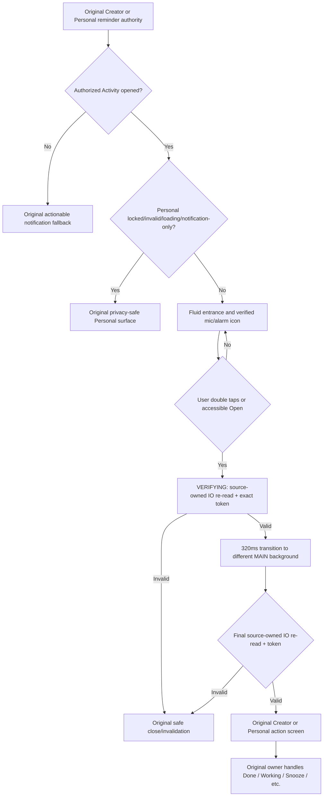

# Backlot RX01-D — Creator and Personal live reminder visual wiring

**Status (2026-11-20): SOURCE-STAGED ONLY; no Kotlin compilation, lint, CI, emulator, physical-device acceptance, APK or stable promotion.** This is a stacked source branch awaiting founder **ALL DONE**. No app, notification, backend, cloud, schema, permission, AndroidManifest, security secret, production data or stable/main deployment changed.

## 1. Exact ancestry and approved scope

- Protected stable and main: `abbe88984bac16cfafbd990d9cb00ed54cfdd07e`.
- RX01-A PR #448: three fluid Entrance themes and genuinely different three Main backgrounds.
- RX01-B PR #449: native premium verified mic/alarm/combined optic and generic readable labels.
- RX01-C PR #450: standalone one-way ENTRANCE -> EXITING -> MAIN gate with an accessible double-tap equivalent.
- This stage **RX01-D** stacks on #450, adding Creator/Personal existing-Activity wiring and strengthening its gate to async owner-store verification. No merge to main/stable.

## 2. Exact implementation and canonical owners

### Creator Voice and Alarm

`AlarmActivity` and `VoiceReminderActivity` still:
- Verify the original Task + durable `ReminderOccurrenceStore` token before setting any UI, attach the same `ReminderSurfaceRegistry` entry and preserve the original `onResume` TaskStore revalidation.
- Keep their original ringing/voice foreground Service, watchdog, notification action token, fallback notification, Stage Done/Working/Snooze/Pause/Reschedule/Dismiss, Voice Replay, time pickers and Activity finish semantics.

**Change:** Existing `ReminderCheckInScreen` is now placed inside `RX01CreatorLiveAlert`, with genuine Creator domain and actual Alarm or Voice mode. The new host re-reads `TaskStore` on IO on double-tap and again when the ~320ms fade ends, then checks `ReminderOccurrenceStore.matches` against the same token. A missing/changed/stale occurrence closes the Activity instead of exposing controls.

`ReminderCheckInScreen(rx01MainBackdrop=true)` retains the existing action column and callback identity while suppressing **only within this host** the older V195 particle entrance, legacy V391 background and separate V394 Premiere presentation. Its background is transparent so the new Studio Nocturne MAIN gradient is visible. The old renderer remains callable with its previous default argument `false` for other contexts, demos and previews.

### Personal

`PersonalAlertActivity` still:
- Reads original `PersonalReminderStore` with acknowledgement race retry, waits for exact `PersonalAlertPresentationPolicy.READY`, blocks response while the phone is locked, and retains the canonical `PersonalDeliveryCoordinator.apply` response transaction.
- Uses existing `PersonalAlertSurfaceRegistry`, playback-stop handling, error, Done/Snooze/Dismiss distinctions and user-opened notification routes.
- Sets `showWhenLocked/turnScreenOn` **only when** the existing full-screen Alarm visual flag is present; there is no newly granted full-screen Voice entitlement.

**Change:** Only if **unlocked, READY, non-invalid, and Voice/Alarm** the original Personal UI is wrapped by `RX01PersonalLiveAlert`. It re-reads canonical Personal store on IO, checks current mode, pending scheduled occurrence and `READY` exact token before and after transition. On invalidation the current `reminder` is cleared before showing any fallback, preventing stale private title exposure.

Locked, loading, invalid and notification-only Personal surfaces remain the original branch, with their generic messages and safe actions; they are never shown under the vibrant entrance. `V2233PersonalAlertScreen(rx01MainBackdrop=true)` retains its original buttons and body but omits the legacy background/opt-in Premiere *only in the new visual mode*, allowing Velvet Sanctuary MAIN to show behind the existing content.

### Gate refinement required for correct live ownership

The previously staged `RX01ReminderExperienceGate` accepts **`suspend () -> Boolean`** owner validation (rather than a synchronous, potentially stale snapshot). It now has `ENTRANCE -> VERIFYING -> EXITING -> MAIN` phases:
- A valid touch double-tap, TalkBack Open action or keyboard activation requests a **single** IO verification.
- During VERIFYING, no ordinary touch gate or main action exists; duplicate transitions do not start.
- After verification passes, the original 320ms fade runs, followed by a **second** canonical read and token verification.
- Only then is `mainContent()` composed. On any failure, owner invalid/fallback handling is invoked; no local Done/Snooze/acknowledgement receipt is created.
- On Activity recreation `remember(occurrenceKey)` restarts ENTRANCE rather than restoring a possibly stale previously accepted MAIN.

## 3. Founder-visible flow

## 4. Existing feature and privacy contract

- The two main-screen visual variants use distinct RX01-A palettes; no legacy V391 Canvas is drawn over them. The existing Creator/Personal text, note, schedule, action and companion placement remain unchanged within their original source-owned screen.
- **Legacy V394 Premiere precedence is PROVISIONAL and source-staged:** the RX01 wrapped live alert takes precedence over opt-in Premiere for these callers. Existing saved Premiere and Classic/Cinematic settings are **not overwritten or migrated**. RX01-F must explicitly resolve settings UX, opt-in/rollback and visual precedence before final certification.
- Creator notification/full-screen launches, Android 14+ platform FSI limits and permission tests have **not** been modified. Personal Voice still remains notification-only for automatic delivery and may show entrance if the user explicitly opens the same existing eligible Activity. Challenge is not connected here; RX01-E remains required.
- Existing Voice/Alarm audio starts through its original service before or independent of this visual entry. The 320ms transition never restarts playback. An original watchdog may stop audio/close an unanswered Activity even if the user stays on the animated entrance, preserving the pre-existing safety limit; do not claim the entrance makes a ringtone last indefinitely.
- The Personal Main presenter can contain original personal title/details **only after unlocking and canonical double verification**; no private content is displayed on the entrance, and no new access is granted to locked notification requests.
- All original Done, Snooze, Pause, Reschedule, Replay, Dismiss etc. callbacks remain exactly the same functions as before. No ad/monetization, external animation plugin, subscription, database writer, cloud feature or new permissions are introduced.

## 5. Changed source paths in RX01-D (reviewable)

1. `app/src/main/java/com/framebynavin/app/reminders/RX01ReminderExperienceGate.kt` — suspending owner check + VERIFYING state.
2. `app/src/main/java/com/framebynavin/app/reminders/RX01CreatorLiveAlert.kt` — new Creator owner bridge.
3. `app/src/main/java/com/framebynavin/app/reminders/AlarmActivity.kt` — wrap original content with actual validated Creator Alarm.
4. `app/src/main/java/com/framebynavin/app/reminders/VoiceReminderActivity.kt` — wrap original content with actual validated Creator Voice.
5. `app/src/main/java/com/framebynavin/app/reminders/ReminderCheckInScreen.kt` — optional transparent source-backed MAIN presenter, preserving default Legacy route.
6. `app/src/main/java/com/framebynavin/app/personal/RX01PersonalLiveAlert.kt` — new Personal owner bridge, ready token checks.
7. `app/src/main/java/com/framebynavin/app/personal/PersonalAlertActivity.kt` — only unlocked READY Voice/Alarm gets the visual gate; privacy-safe original routes preserved.
8. `docs/design/RX01C_DOUBLE_TAP_ENTRY_TRANSITION_SOURCE_STAGE_20261120.md` — reconciled async contract.
9. This document.

## 6. Mandatory gates **after founder ALL DONE** — NOT RUN

- Full Kotlin compile for Compose/Activities, full JVM unit tests and lint, Android 15 emulator install/launch, instrumentation and user physical QA.
- Single tap, double-tap, TalkBack/Switch access, Enter/Space and rapid repeat; no hidden button clicks, no duplicated response/notifications or automatic completion.
- Creator actual old and newly created tasks, modes, SMART/CLASSIC stages, original alarms/voice repeats, replay, pause/reschedule/dismiss, watchdog timeout and Android alarm token races.
- Personal unlocked/locked transitions, FSI-denied/user-opened Voice, WAITING->READY race, alarm/notification, invalid/rotated token, deleted/paused while entering, restored data, account change and all original Done/Snooze/Dismiss receipts.
- Safe 320dp/393dp/tablet layout, 100–200% font, portrait/landscape, TalkBack, Animator scale zero, battery saver, DND and native interruption behavior.
- Verify actual MAIN background remains visible behind Creator/Personal content, no double art layers or action-colour contrast regressions.
- Gate cancellation race on Activity finish while IO is pending, two simultaneous reminders, saved notification deep links and a slow/corrupt DataStore read.
- RX01-F needs to formalize old V394 Premiere choice priority and potential old-UI fallback for existing users.
- Test and review Challenge separately in RX01-E; **no automatic Challenge full-screen claim at this stage**.

**No APK from this branch is certified or ready to install.** A passing static source diff is not a successful Android runtime test. Preserve original approved stable and main unchanged. Next RX01-E, then RX01-F, then founder ALL DONE -> consolidated integration/testing/release candidate.
