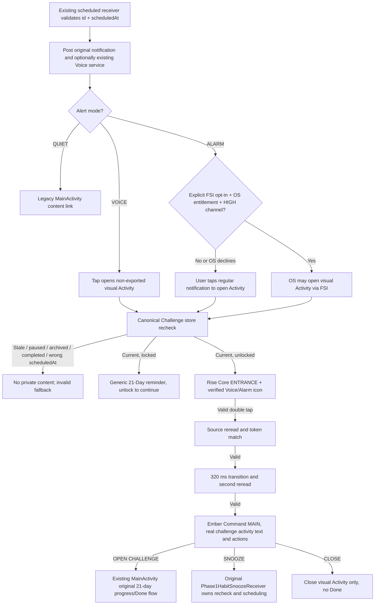

# Backlot RX01-E — 21-Day Challenge premium live visual presentation

**Stage:** SOURCE-STAGED; **NOT** compiled, tested or integrated into stable.  
**Approved founder workflow:** Source-stage sequentially, then perform integration, unit/Android/physical testing and APK generation **only after “ALL DONE.”**  
**Date:** 2026-11-20.  
**Based on:** RX01-D draft PR #451 exact head `7964445156ec552c5e83e1788c00d16126397320`, stacked on RX01-A/B/C. Stable/main remain at `abbe88984bac16cfafbd990d9cb00ed54cfdd07e`. **UX09 excluded.**

## 1. Existing verified architecture — why this stage is different

The single-activity 21-Day Challenge has a separate `Phase1HabitStore`/v3 codec, `Phase1HabitAlarmReceiver`, `Phase1HabitVoiceService`, notification channel and `Phase1HabitSnoozeReceiver` compared with Creator and Personal reminders.

- Available alert modes: `QUIET`, `ALARM`, `VOICE`.
- Real notification for an exact scheduled occurrence already offers `SNOOZE 10m`; snoozing is validated and persisted through the original receiver/store, and it re-arms delivery without creating a Done receipt.
- `Phase1HabitStore.confirmToday` and `confirmSelectedDay` are the only established explicit day-completion APIs. Voice playback (repeats, local custom or Piano backing music) is separate from confirmation.
- An old notification opened `MainActivity` through `ACTION_OPEN_PERSONAL` and `backlot-habit://open/<id>`. That direct challenge link remains the next step via **OPEN CHALLENGE** in the new main reminder screen.

## 2. Exact UX result staged

| Challenge mode | Notification launch | Automatic full-screen | Premium scene |
|---|---|---|---|
| **ALARM** | Existing notification now opens new non-exported RX01 Activity when tapped | **Only** if owner explicitly enables alarm full-screen option, existing HIGH channel remains eligible, platform permission is granted, and Android chooses to present it | Rise Core ENTRANCE → verified double tap → Ember Command MAIN |
| **VOICE** | Existing notification opens same visual Activity on explicit user tap | **Never requested** automatically by this change | Rise Core ENTRANCE, voice icon, distinct MAIN |
| **QUIET** | Original MainActivity challenge deep link remains unchanged | Never requested | No disruptive cinematic Activity; quiet notification stays quiet |

On the new main screen the user can choose **OPEN CHALLENGE**, **SNOOZE 10 MIN** or **CLOSE REMINDER SCREEN**. The true Challenge page remains the only surface that can explicitly confirm today's activity. The new screen **does not add a Done button** and does not count notification opening, double tap or snooze as progress.

### Source-level behavior

## 3. Changed files (RX01-E only)

1. `app/src/main/java/com/framebynavin/app/personal/RX01ChallengePresentationPolicy.kt`: exact ALARM/VOICE/QUIET presentation matrix; user full-screen opt-in saved **false** by default; API34+ `canUseFullScreenIntent` check and actual existing Alarm channel importance; no permissions changed.
2. `app/src/main/java/com/framebynavin/app/personal/RX01ChallengeAlertActivity.kt`: new non-exported UI presenter; verifies saved identity/schedule/active 21-day occurrence on background thread; enforces generic locked/loading/invalid presentation; uses existing RX01-C double-tap gate and RX01-A/B imagery; rechecks canonical Challenge before/after transition. Main opens original Challenge destination or requests original receiver's Snooze without treating dispatch as success.
3. `app/src/main/java/com/framebynavin/app/personal/Phase1HabitLiveDelivery.kt`: only within existing `Phase1HabitNotification.build`, use the new explicit visual Activity `contentIntent` for actual ALARM/VOICE occurrences; keep legacy `MainActivity` open for QUIET or no scheduledAt; keep original Snooze broadcast action, Voice service startup and channel/recovery/notification IDs. Only an opted-in, OS-eligible ALARM receives `NotificationCompat.Builder.setFullScreenIntent`.
4. `app/src/main/AndroidManifest.xml`: register precisely one new non-exported, exclude-from-recents Activity. Manifest's previous `USE_FULL_SCREEN_INTENT` declaration is unchanged; no new permissions.
5. This product/engineering acceptance note.

## 4. Security and reliability invariants

- The new Activity is **android:exported=false** and is launched only through explicit application-owned `PendingIntent`. User-opened and eligible FSI intents have distinct request codes/data so the locked-screen launch flag is **never added** to the ordinary notification content intent.
- Validate challenge ID format, real epoch-millis scheduledAt, saved alert kind, actual notification occurrence matching `Phase1HabitOccurrencePolicy.current`, `!paused`, `!archived`, day not confirmed. The gate re-loads the actual store on IO at double tap and before MAIN, and rejects changed content/receipts.
- Locked mode is generic regardless of an initially validated activity; it cannot reveal activity, notes or stored privacy-sensitive details and has no Done/Snooze actions. Only the eligible FSI ALARM may call `setShowWhenLocked`/`setTurnScreenOn`; it **still does not bypass unlocking**.
- Quiet and Voice never request FSI, background `startActivity`, or an unapproved Android permission. Disallowed OS full-screen behavior simply leaves a normal actionable notification.
- Do not create an independent AlarmManager, new reminder recurrence, new voice/music player, new Challenge Store writer, new completion receipt, or an automatic success screen.
- `SNOOZE 10 MIN` delivers the exact pre-existing `Phase1HabitSnoozeReceiver` action/ID/instant payload. The receiver remains the sole persistence/recurrence owner; the UI does not claim a completed snooze merely because its request was sent.
- All prior single-activity 21-day v1/v2/v3 exports and old legacy V297 per-day challenge data, plus all source confirmation/note, linked Space/Group, custom URI, repeat count, alert interval and recovery policy remain unchanged.
- Android 14+ installs can lack FSI permission. The opt-in is intentionally OFF until RX01-F provides a reviewed user settings control and consent explanations; no surprise auto-full-screen for existing users.
- The existing Voice service is unaffected by the entrance animation: voice/music repeat count and duration remain under the original playback service; visual double tap neither restarts nor stops it.

## 5. Known gaps / post-ALL-DONE test gates

**No runtime claims are authorized from source staging.** The following must be verified on the integrated candidate before any release:
- New Kotlin Compose Activity/ContentIntent/manifest source compilation; all existing unit, lint and AndroidTest checks.
- FSI API26/Android 14/15/16: manifest permission, notification permission, Alarm high channel, opt-in OFF/ON, FSI granted/revoked, foreground vs locked vs already-unlocked, OS heads-up fallback, Play declaration/policy appropriateness. User must authorize FSI in Settings; do not claim it is automatically allowed by Play.
- Voice only offers user-opened Activity and continues legitimate saved TTS/background music; no second TTS trigger on double tap.
- Quiet stays private/quiet and routes to original 21-day page.
- Verify exact same scheduledAt, stale notification after Snooze, paused/archived/deleted/confirmed/moved date/time, day 21/end boundary, DST, reboot and data recovery. No stale activity or old Done receipt.
- Test notification action Snooze and new main Snooze with 10 min, rearm, cancellation and voice service stop; no duplicate next-day schedule or falsely reported success.
- Test lock-screen privacy and focus changes including secure/biometric keyguard; private activity title never leaks before unlock.
- Test the double-tap single/duplicate/keyboard/TalkBack behavior and ensure main action controls only exist after both canonical checks.
- Scene contrast at 320dp, 200% text, 21-day activity up to 200 chars, low power/animator off, inactive lifecycle, notification trampoline restrictions and screen orientation.
- Actual Android emulator and physical-device evidence must be recorded after consolidated integration; no source stage by itself is release certified.

## 6. RX01-F follow-up

Expose **explicit Alarm full-screen opt-in** with current Android entitlement and a truthful explanation of permission/OS limits in Settings. Formalize animation preference precedence against saved V391 scenes, V394 Premiere and companions across all three domains; add a safe opt-out. Verify no old Settings value gets overwritten. Freeze and report conflicts before founder says ALL DONE.

**No PR merge, no stable update, no APK, no hosted data operations or UX09 activation is authorized by this source stage.**
