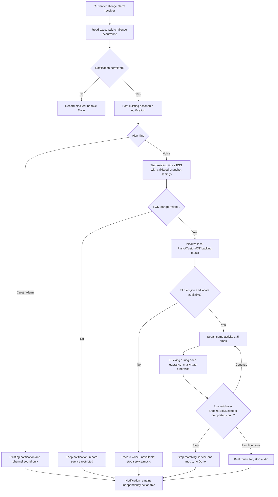

# Backlot UX06D — Challenge Voice, Background Music and Lossless V3 Archive Contract

**Date:** 2026-11-17
**Stage:** UX06D source-staged implementation. **No compilation, CI, emulator, APK, performance profiling, real-device tests, merges or releases executed.**
**Stacked parent:** UX06C draft PR #406, exact head `5355ece419828ecc45a7f71c36c6c6838a634b00`.
**Protected owner-tested baseline:** `stable/backlot-v337-premiere-owner-testing-20261114`, unchanged.

## 1. Goal and explicit limits

Give Backlot's **current single-activity 21-day Challenge** an optional local Voice music experience similar to Creator/Personal without rewriting challenge completion, recurrence, notification IDs or legacy V297 plans.

- Voice: selectable **1–5 announcements**, 5/10/15/30/60-second gaps, Piano/Custom/No Music, local file choice and sample-only preview.
- Existing challenged saved in v1/v2 must retain **three spoken announcements, five-second gaps, no backing music** until explicitly edited.
- New challenge starts with Off alert (no schedule); when Voice is selected during new creation, the visible music preference begins as Soft Piano and can be changed to CUSTOM or OFF before Save. No media permission or alarm starts merely from selecting a preference.
- Quiet/Alarm/Off are unchanged: music settings may be retained in the record but **never played** outside Voice. The 21-day Alarm remains Android notification-channel sound with existing behavior and no new full-screen default.
- Voice audio never marks a challenge day Done, claims a completion receipt or creates additional occurrences. Android's normal notification and snooze remain independent.

**Not included:** 21-day full-screen/Premiere live mode, custom Alarm tone, paid TTS providers, cross-device custom-music file copying, system-audio-focus takeover, voice-cloning, additional cloud service, design changes to Creator or Personal sound.

## 2. V3 data and backward compatibility

Owner record `Phase1HabitChallenge` **appends**:
- `voiceMusicMode: ReminderMusicMode` default OFF
- `voiceMusicUri: String` default empty
- `voiceRepeatCount: Int` default 3
- `voiceRepeatGapMillis: Long` default 5000

`checked()` enforces:
- Repeat 1..5; gap one of 5000, 10000, 15000, 30000, 60000 milliseconds.
- `ReminderMusicChoice(mode, uri).checked()` requires CUSTOM references to use a local authorized `content://` URI, max 2048 characters and no line breaks.
- The old schedule, id, 21-day bounds, timezone, confirmations/notes and snooze validation remain untouched.

`Phase1HabitCodec` changes `VERSION` from 2 to **3**:
- v3 writes all four fields alongside original records and keeps SHA-256 over the entire JSON items array.
- v1/v2 decode uses *explicit historical fallback* OFF/empty/3/5000 and does not upgrade the old owner's music without consent.
- Unknown v4+, invalid enum, missing v3 fields, corrupt checksum and malformed URI fail closed; no destructive reset.
- A v3 archive is intentionally rejected by older v1/v2 readers rather than silently losing new sound preferences. Owner rollback/downgrade to old APK therefore requires care; do not promise backward-read compatibility.
- No new table, DB, external directory, network, storage permission, audio-file upload or separate cloud backup. Existing Challenge export/import/owner inverse uses the same Phase1HabitCodec and keeps all completion receipt timestamps intact.

`Phase1HabitStore.updateProgress` refuses indirect changes of these preferences from ordinary Done, Undo, note, link or Snooze mutations. Only the existing `editReviewed` path accepts them, with full old Challenge snapshot equality and archived guard; old completion receipts are never recomputed.

`Phase1HabitManagementPolicy.reviewedEdit` copies audio choices only when an owner explicitly saves Edit and still protects start-date/receipt constraints; `Phase1HabitManagementCoordinator` stops an old Voice service/notification if active audio settings change, then reconciles alarms and reports any scheduling/cleanup warning after durable save.

## 3. Owner UI and local music access

Existing `CreateHabitReview` and `Phase1HabitEditDialog` now show `V406ChallengeVoiceSettings` **only if** selected alert kind is Voice, using:
- 1–5 count choices, 5/10/15/30/60 gap chips.
- Reused `V273ReminderMusicPicker` for original in-app Piano sample, Android SAF `OpenDocument(audio/*)`, persistable read grant, Custom music fallback, Voice+Music preview, Stop preview and automatic lifecycle cleanup.
- `allowSetCreatorDefault = false` *always*. Challenge choices never bulk-change Creator projects or Personal reminders.
- A selected Custom file stays as an authorized URI, not copied audio bytes. After deletion/move/revocation or restore on another device, `ReminderBackingMusic` falls back to local Piano. The app does not claim that a device-local music selection automatically syncs.
- A preview uses only the existing built-in sample speech line, not the private challenge activity title.
- Newly created challenge writes music settings only after the existing validated `store.create` callback. Existing edit writes only after `manager.edit` completes the snapshot-guarded commit. Edit Cancel/Close does not write the chosen music or repeat count.
- Any previous v1/v2 challenge entering Edit starts with OFF, three announcements and five-second gap, never newly enabled Piano.

## 4. Live delivery

Source `Phase1HabitAlarmReceiver` already checks exact current identity and due time before posting. It now passes saved, checked choice values into **internal** `Phase1HabitVoiceService` Intent extras; no notification title/action token or AlarmManager identity changes.

Foreground voice service:
- Reconstructs count/gap with canonical bounded `Phase1HabitVoicePlaybackPolicy`; invalid music extras fail OFF rather than playing arbitrary URLs.
- Reuses `ReminderBackingMusic`, including local Piano/CUSTOM/OFF, volume fading/ducking and safe custom URI failure fallback.
- Preserves the exact existing spoken sentence `It's time for {activity}`, notification text and fixed primary service ID; no new permission.
- Uses a dynamic watchdog large enough for five full 45-second sentences, four 60-second gaps and a small tail. The watchdog is only a safety bound, not guaranteed delivery length.
- Dedupe of completed utterance indices; stale TTS initialization/error callbacks cannot stop or claim evidence for the next service generation.
- `stopChallenge` for edit/archive/delete and `stopMatching` for a Snooze stop the active music immediately, along with speech. `onDestroy` cancels handler work, TTS and local MediaPlayer/Piano.
- No new audible retry, auto-Done, new challenge receipt, false audio-heard claim or notification dismissal.

## 5. Privacy, policy and recovery

- No full-screen challenge activation or title exposure behind keyguard; existing notification channel privacy and 21-day response UI unchanged.
- CUSTOM URI must be a SAF-picked content URI with persisted read permission. File bytes stay on device, not inside Phase1HabitCodec, cloud, other accounts or backup.
- System battery/DND/FGS restrictions still apply; successful save or foreground-start request is not proof of actual speech output. Posted notification is a separate observed stage.
- v3 archive codec participates in existing Challenge store checksums, owner-reviewed import and local recovery copy; v1/v2 decode is lossless.
- Old v2 apps cannot read v3 saved items; this is a **release/rollback migration gate** that must be included in final UX10 certification. V337 remains unchanged until approved integration.
- Changing currently active Voice preferences stops an old audible playback after a durable edit, without fabricating a response. Interrupted preview is not a missed reminder.
- The legacy `V297Challenge` 21-activity manual plan and its import/export remain untouched.

## 6. Source scope and deferred verification

Production changes:
1. `personal/Phase1HabitPolicy.kt`
2. `personal/Phase1HabitCodec.kt`
3. `personal/Phase1HabitStore.kt`
4. `personal/Phase1HabitManagementPolicy.kt`
5. `personal/Phase1HabitManagementCoordinator.kt`
6. `personal/Phase1HabitVoicePlaybackPolicy.kt`
7. `personal/Phase1HabitLiveDelivery.kt`
8. `ui/Phase1HabitSharedUi.kt`
9. `ui/Phase1HabitLocalStoreReview.kt`
10. `ui/Phase1HabitManagementDialogs.kt`
11. `ui/V406ChallengeVoiceSettings.kt`

Deferred unit test updates:
- `personal/Phase1HabitCodecTest.kt`: v3 round-trip, v2 Voice default-off restore, invalid fields/unknown future version.
- `personal/Phase1HabitVoicePlaybackPolicyTest.kt`: 1..5 count, dynamic watchdog and 60-second interval.
- `personal/Phase1HabitManagementPolicyTest.kt`: Voice preference edits preserve exact dates, notes, links and receipts.

**Do not state that these tests passed.** Owner's explicit instruction is one consolidated build/QA/physical campaign after UX10. The complete certification scenarios are maintained in `docs/qa/UX06D_VOICE_MUSIC_PARITY_CERTIFICATION_AFTER_UX10.md`.

## 7. Known unverified risks

- On-device TTS initialization, audio ducking, Bluetooth/output route, low battery, concurrent Creator/Personal speech, notification channel settings and DND behavior require actual device testing.
- Android SAF music URI grants and backup/restore across separate phones need negative tests. Music file contents do not travel with serialized settings.
- v3 downgrade is intentionally fail-closed and needs a tested rollback policy for release, not a silent file-format downgrade.
- Challenge sound remains notification-based for Alarm; cinematic Challenge full-screen remains out of scope (UX06E only with explicit OS/privacy validation).
- Compose editor preview in constrained dialog height and 200% font needs physical validation; no visual/interaction certification has occurred.
- The foreground service still depends on the pre-existing receiver-to-service snapshot; a race between an edit and already-dispatched service start is a residual timing concern to certify. Do not claim absolute exactly-once audio delivery.

**Current stage:** UX06D source-staged, not compiled, test-run, certified, merged or released. Next UX06E source stage after review.
