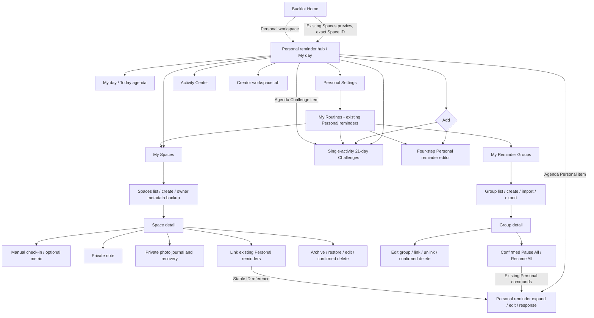

# Backlot UX07A — Personal source truth, navigation and action inventory

**Audited:** 2026-11-17. **Stage:** UX07A DOCS-ONLY / SOURCE-AUDITED; not implemented as a Personal UI change, compiled, instrumented, physically tested, merged or released.
**Source parent:** UX06F draft PR #409, head `528f22334beb83f6c0a39199699c2ea216329b5e`.
**Protected stable:** accepted V337 P0 source `815ba69775f75b6e5f25bb838c2c17b4f09c203e`. Neither stable nor `main` is changed by this stage.
**Scope rule:** preserve existing source owners and every meaningful action; future UX07B–F are separate, still-draft source packages. Single consolidated certification after UX10.

## 1. Actual screen/navigation map — code-backed

**Source-backed nuance:** `V340HomeSpacesEntry.kt` carries an exact Space ID into the existing Personal + My Spaces route; stale/removed IDs show a notice rather than selecting a different Space. `V2232PersonalReminderHub.kt` has its own Today/Settings state, and `V337UnifiedPersonalAgenda.kt` *projects* Personal reminders and current challenges together; it does not create an additional reminder record or Android alarm.

## 2. Existing action contract, by screen

### A. Personal Hub — `ui/V2232PersonalReminderHub.kt`

| Surface | Actual user action(s) | Writer and required result |
|---|---|---|
| Toolbar | Back/close; Activity Center; Today↔Settings; Add menu | Navigation only; no saved Done or alarm mutation |
| Tab header | Personal / Creator switch | Existing workspace route, different canonical stores |
| Add menu | New Personal reminder; 21-day Challenges | Existing four-step editor or Challenge manager, never auto-save |
| My Day | Today, Next 7 Days, Needs Action, All focus + old scope selector; show-all from exact Activity focus | Read-only `V337UnifiedPersonalAgenda` / old `V285` projections; filter/selection reset on scope changes |
| Reminder row | Expand, Edit, Pause/Resume, request Delete, explicit Done/Snooze/Dismiss where eligible | Existing `PersonalReminderCommands`/`PersonalDeliveryCoordinator` and occurrence/token checks |
| Selection mode | Select visible, Deselect shown, Clear, Delete selected, cancel/confirm | Ticket/snapshot-checked explicit Personal-only deletion; no challenges silently included |
| Empty/permission/error | Add reminder, view blocked notifications, open Personal Settings | No automatic Done or successful delivery claims |
| Settings | Follow-up on/off + interval and Android notification permission; My Routines links | Follow-up setting is existing owner, off by default and quiet hours are already implemented |
| Deep links | Exact Personal reminder, exact challenge, Home-selected Space | Focuses real record or safely reports stale; no inferred response |
| Personal editor | Purpose → Schedule → Alert → Review; cancel/back, validation and save | Original Personal reminder owner; UX06B allows previously visited backward step only |
| 21-day manager | Explicit day confirmation, undo, edit, alert health, archive/restore, history, snooze | Separate `Phase1HabitStore`, v3 codec from UX06D, no automatic completion |

**Critical:** The current `V288PersonalTodayCard.kt` uses existing confirmed receipts and routes real Done/Snooze commands; its counters are not a new Space check-in log.

### B. My Routines — `ui/V295UniversalPersonalRoutines.kt`

- Existing CTA **NEW ROUTINE REMINDER** → original Personal reminder editor.
- Existing saved recurring reminders → original Edit reminder.
- Links **MY 21-DAY CHALLENGES**, **MY REMINDER GROUPS**, **MY SPACES · NOTES & PHOTOS**.
- **Truthful labeling:** currently a curated view of existing recurring Personal reminders; it is not a separate freely composable routine engine. UX07 must not advertise new streak/automation behavior until there is actual source implementation.

### C. My Spaces — `ui/V289PersonalSpacesScreen.kt`, `ui/V290PersonalPhotoSection.kt`

| Area | Visible controls and UX | Owner or safety boundary |
|---|---|---|
| Spaces list/header | Back, create (+), local metadata backup, empty-state Create Space, select Space, New Space | `V289SpacesDatabase` + owner-supplied stable IDs; first visit doesn't silently import/remake other records |
| Create Space | Choose a suggested type, name, optional goal, Create/Cancel | `V289PersonalSpacePolicy`, validates names/goal; local only, no linked reminders/photos added |
| Space detail header | Back to list, Edit name/goal, More→Delete request, Archive/Restore | Original Room owner; Delete requires explicit confirmation and photo preflight |
| Activity progress | Log Progress, note, optional numeric measurement toggle/value, Save/Cancel | Writes MANUAL entries only; measurement bounded by `V292SpaceMetricSuggestions` |
| Summary/activity | Logs, active days last 7, recorded activity/metric history | `V289SpaceProgressPolicy` currently excludes notes from progress, does not fabricate Done |
| Linked reminders | Link existing, edit linked reminder, unlink stale/valid link, view real next occurrence and confirmed Done count | Link is an ID relation, not reminder copy; ordinary link/unlink doesn't reschedule |
| Notes | Add Note, show more/less notes, save/cancel | Source-tagged NOTE entries are not check-in or metric/confirmed-Done receipts |
| Photo journal | Add from photo picker, optional note, **SAVE ON DEVICE**, Cancel, view timeline/pair comparison, request Delete private copy | App-private JPEG bytes, bounded transforms and metadata stripping, separate photo row; no cloud media upload |
| Interrupted photos | Recover or Discard pending file; separate confirmation; delete/cleanup safeguards | `V290InterruptedPhotoRecovery` validates IDs, filenames, timestamps and source ownership; never silent discard |
| Space deletion | Confirm/Cancel; cannot delete while saved/interrupted photos remain | `V289SpacesRepository.deleteSpaceAfterOwnerConfirmation` rechecks existing photo rows; original Personal reminders survive |
| Owner metadata backup | Export selected file / choose local file / preview verified merge / confirm Merge Safely or Cancel | Versioned SHA-256 **plaintext metadata only**, not photo JPEGs or reminders; imported Done receipts are rejected |

**Existing Space types** (from `V289PersonalSpacePolicy`): Skin Care, Fitness, Reading, Editing, Game Development, Gaming and Custom. Broader future suggested templates (e.g. Rest/Relationships/Nutrition) are **proposed**, not already stored enum values and must not be introduced with an unreviewed migration.

**Existing photo comparison** displays selected baseline/comparison without inferring any outcome, result or diagnosis. Default comparison language must remain nonclinical.

### D. Reminder Groups — `ui/V298ReminderGroupsScreen.kt`

- List: Back, New Reminder Group, choose a group, Export My Groups, Import Group Backup.
- Group creation/edit: Name, icon and color, Save/Cancel. Members are *IDs of existing Personal reminders* stored in `V298ReminderGroupStore`.
- Detail: Edit Group, Delete Group with confirmation, **Link An Existing Reminder**, Edit linked Personal reminder, Unlink.
- **IMPORTANT:** **PAUSE ALL** and **RESUME ALL** are real, confirmed bulk mutations by `FC13ReminderGroupCommands.setAllPaused` on actual linked Personal reminders; reminders may also belong to other groups. They must remain visible/functional with explicit scope explanation and no duplicated reminder records.
- Empty and missing-link states are shown; confirmation blocks unsafe bulk action when links are stale; group progress uses verified Personal Done receipts (`FC13ReminderGroupProgress`).
- Group export/import is a device-only JSON of IDs/metadata, **not a complete reminder backup**; existing canonical reminder store is unchanged by normal group creation/edit/unlink/deletion.

### E. Progress Journey (cross-cutting) — `ui/V282ProgressJourneyUi.kt`

- Month/week change, day selection, recorded milestones, project/idea navigation.
- **Include personal completions** is private and OFF by default; the UI explicitly notes Personal history is not necessarily in Personal backup exports.
- UX07 may supply links or an *honest read-only* projection, not silently turn personal history on in a shared Creator visualization.

## 3. Authoritative data / side-effect matrix

| Owner | Storage | Writes authorized by | Never infer |
|---|---|---|---|
| Personal reminders | `PersonalReminderStore` (Personal DataStore) | Personal editor, owner commands and token-checked response coordinator | Notified/viewed = Done |
| Personal Done history | `PersonalCompletionJournal` via store/coordinator | Accepted exact personal DONE receipt only, stable key `reminderId:occurrenceMillis` | Snooze/Dismiss/notes = Done |
| Current 21-day | `Phase1HabitStore` + `Phase1HabitCodec` v3 | Challenge Create/Edit/Day Done/Undo/Archive and original scheduler | Notification, Voice start, animation = Done |
| Legacy V297 | Historical separate challenge owner | Existing historical app flow only | Automatically migrated to current 21-day |
| Space metadata | `V289SpacesDatabase` Room v2 | `V289SpacesRepository` and verified metadata merge | Replaced by cloud login or JSON backup |
| Space manual activity and note | `personal_space_entries` | Explicit manual log/note | Note = physical check-in, Space entry = Personal Done |
| Space links | `personal_space_reminder_links` | Explicit link/unlink, validated Personal reminder ID | Linked reminder duplicated or rescheduled |
| Space photos | Private JPEG files + `personal_space_photos` Room rows | `V290PhotoJournal` + guarded owner recovery/cleanup | File is in export/cloud/cross-device backup |
| Reminder Groups | `V298ReminderGroupStore` DataStore | Group CRUD/link changes, explicit import | Group deletion deletes reminders |
| Group Pause/Resume | `FC13ReminderGroupCommands`→Personal owner | Explicit confirmed bulk command, stale-link checks | Group mutation is always read-only |
| Today/Agenda/Progress views | `V337UnifiedPersonalAgenda`, `V288PersonalTodayCard`, `V289SpaceProgressPolicy` | Read-only projections | Delivery implies evidence or duplicate receipt |
| Scene/companion | V391/V394/V407 local prefs | User settings opt-in | Alert art affects scheduler or completion |
| Future cloud sync | UX09 is separate approved stage | No writer in UX07A | Connected login = two-device parity |

## 4. Read-only alignment, uncovered UX opportunities and risks

**A1 — Personal Home hierarchy [P1, UX07B]:** My Day and My Routines are meaningful but distributed across Today, Settings and My Spaces. Improve visual hierarchy and shortcuts without removing the current navigation or its hooks. Do not claim current Home lacks Spaces access: `V340HomeSpacesEntry` already supports it.

**A2 — Space progress integrity [P1, UX07C/E]:** Current Space summary counts MANUAL non-note entries; linked Personal Done is calculated separately from `PersonalCompletionJournal`. Space Room repository currently **rejects manufacturing CONFIRMED_REMINDER_DONE entries**; a merged UX view must keep distinct source tags and avoid copying receipts into the Room table. A linked-reminder aggregate may include historical Done receipts from before a link was created; present it as "linked reminders' confirmed Done history" rather than achievements performed *inside this Space*, or design a separately approved temporal filter.

**A3 — Photo and metadata recovery [P0 preservation]:** V290 photos are sanitized app-private bytes; V289 owner export is plaintext metadata only. UX07 must never imply a Space/photo backup covers the other, or silently enable cloud upload. Retain explicit recovery/discard actions and current deletion preflight.

**A4 — Group controls [P0 preservation]:** Group link/unlink and deletion don't alter original reminders, but confirmed Pause All/Resume All intentionally do. Any redesign that groups these under "organize only" hides critical behaviour. Keep confirmation, conflict/status text and bulk-command audit.

**A5 — Error/empty-state truth [P1 UX07B/C]:** Some Space detail child loads catch errors and temporarily set empty UI state while showing an error. A polished state model should distinguish loading/none/unavailable rather than suggesting zero saved entries or photos on read failure; do not silently replace underlying DB contents.

**A6 — Template expansion [P2 scope gate]:** Existing Space types are persisted enum names. Any new enum, mapping, icon key or managed template must be additive/backward compatible; no silent "improvement" changes to records.

**A7 — Progress Journey privacy [P1]:** Personal completion overlay is OFF by default. Keep it OFF and require owner opt-in; never render Space names/photos in notification/lockscreen/Creator analytics.

**A8 — P0 integration [P0 blocker]:** UX06F draft #409 and accepted V337 P0 stable still differ by an independent 19-commit lineage. The targeted Snooze fix is staged but full P0 ledger/restore/test reconciliation remains required before post-UX10 certification.

## 5. Source examination and verification limits

Read on the actual UX06F head: `V2232PersonalReminderHub`, `V288PersonalTodayCard`, `V295UniversalPersonalRoutines`, `V289PersonalSpacesScreen`, `V290PersonalPhotoSection`, `V298ReminderGroupsScreen`, `V340HomeSpacesEntry`, `V282ProgressJourneyUi`, `V337UnifiedPersonalAgenda`, `V289PersonalSpacePolicy`, `V289SpaceProgressPolicy`, `V289SpacesDatabase`, `V289SpacesMetadataCodec`, `V289SpacesMetadataRecovery`, `V290SpacePhotos`, `V290PrivatePhotoFiles`, `V290InterruptedPhotoRecovery`, `V298ReminderGroupStore`, `FC13ReminderGroupOperations`, `PersonalCompletionJournal`. Source identifiers/tags above are derived from these files.

No compilation, CI, instrumented tests, emulator, TalkBack, capture/physical device testing, backup recovery exercise, mutation of user data, backend operations, APK, merge or release performed. This inventory does not assert that every control is bug-free. Additional source-level call-site inspections remain part of future implementation patches.

**UX07A exit:** canonical owners and meaningful controls inventoried; preservation/risk ledger identified; UX07B may design within those boundaries, without assuming runtime verification.
