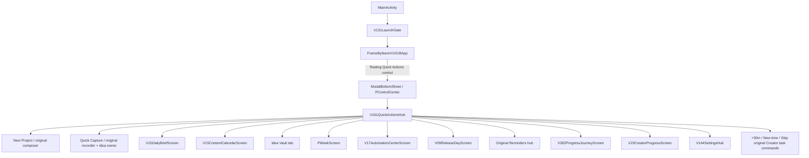

# Backlot UX08A — Quick Actions, Progress, Rewards, Brief & Calendar source-truth audit

**Audited:** 2026-11-17  
**State:** UX08A documentation/source-inspection stage only. **No code modified, compilation, test, APK, merge, or release.**
**Exact parent:** UX07F draft PR #416, HEAD `ad8f39ea57ed5ca11b2c359cf5abdc0938220138`.
**Protected owner-accepted P0 stable:** `815ba69775f75b6e5f25bb838c2c17b4f09c203e`, unchanged.
**Approval sequencing:** source-stage UX08A–F, UX09 and UX10, then one consolidated certification, with V337 P0 accepted-delta reconciliation and explicit founder release gate.

## 1. Real navigation entry and each Quick Actions control

**Actual app call chain, source verified:**

All callbacks originate at `ui/FrameByNavinV101BApp.kt` (Quick Actions bottom sheet around lines 1086–1113), pass through its `PControlCenter` shim (around lines 1597–1640) and end in `ui/V161QuickActionsHubUi.kt` (roughly lines 36–160). This is an actual routing chain, **not** a proposed separate navigation graph.

| Current visible control | Existing tag / source | Actual callback and destination | Side effects, protections |
|---|---|---|---|
| Floating Quick Actions control | Root app `FrameByNavinV101BApp` | Opens full `ModalBottomSheet(skipPartiallyExpanded=true)` | UI state only; don't replace with a nested router |
| New Project | `quick-action-new-project` | `onNewProject` → close sheet, `openComposer()` | Existing wizard owns writes; opening is not an achievement |
| Quick Capture | `quick-action-quick-capture` | Close sheet, `showQuickCapture=true` | Original capture/idea owner; do not mint XP for opening |
| Overdue project: +30 min | Inline `AssistChip` | `vm::publishLate` → `CreatorViewModel.publishLate(id,30)` | **Real** deadline change, may refresh/adjust alarms; not a cosmetic snooze |
| Overdue project: New time | Inline `AssistChip` | `pPickDateTime` → `vm.rescheduleDeadline(id,time)` | Real Creator due time and alert change, must validate future time and confirmation |
| Overdue project: Skip | Inline `AssistChip` | `vm::skipTask` | Real task status change + reminder cancellation; retain explicit scope/undo review |
| Daily Brief | `quick-action-daily-brief` | `POverlay.DAILY_BRIEF` → `V15DailyBriefScreen` | Read-only task/weekly-plan summary; project/calendar deep links |
| Idea Vault | `quick-action-idea-vault` | Set `PTab.IDEAS` | Existing idea owner; ready-to-produce count is read-only |
| Content Calendar | `quick-action-content-calendar` | `POverlay.CALENDAR` → `V15ContentCalendarScreen` | Project/weekly occurrence visualization; opening must not schedule |
| Weekly Plan | `quick-action-weekly-plan` | `POverlay.WEEK` → `PWeekScreen` | Original enable/edit/save/delete/refresh/reset controls, with real schedule writes |
| Automation | `quick-action-automation` | `POverlay.AUTOMATION` → `V17AutomationCenterScreen` | Original background planning settings, not just a link list |
| Trending Moment | `quick-action-trending-moment` | `POverlay.RELEASE` → `V09ReleaseDayScreen` | Existing launch `vm.createReleaseBurst` owns production mutations |
| Reminders | `quick-action-reminders` | `showReminders=true` | Existing Creator & Personal owner UI; not a duplicate alarm |
| Progress Journey | `quick-action-progress-journey` | `POverlay.PROGRESS_JOURNEY` → `V282ProgressJourneyScreen` | Read-only provenance; projects/ideas links, Personal overlay opt-in |
| Creator Progress | `quick-action-creator-progress` | `POverlay.CREATOR_PROGRESS` → `V23CreatorProgressScreen` | Read-only original ledger/level/achievement presentation |
| Settings | `quick-action-settings` | `POverlay.SETTINGS` → `V144SettingsHub` | Original Account/Preferences/Permissions destinations |

**Scope nuance:** Existing Quick Actions is a **bottom sheet** with `heightIn(max = 730.dp)`, a vertical scroll, two responsive main controls (single column at width <350dp or font scale ≥1.35), up to four displayed overdue Creator projects and horizontally scrollable inline project-action chips. UX08F must preserve every current action and safely accommodate 320dp/200% text. `Skip` and `+30 min` already mutate real tasks, so reorganization must not turn them into an accidental tap.

## 2. Authoritative progress, awards and animation pathways

### Progress Journey — read-only event projection

- `ui/V282ProgressJourneyUi.kt` combines actual Creator tasks, ideas and `data/CreatorWorkflowTimelineStore.kt` events through `ProgressJourneyEngine.build`. Its month/week/journey filters, selected-day events and project/idea deep links are already implemented; don't create another timeline DB.
- Creator timeline event keys are deduplicated in `data/ProgressJourneyEngine.kt`, and its `onDay`/`activeDays` functions group by the display zone.
- `includePersonal` is locally `rememberSaveable { false }` by default; only when enabled does `PersonalReminderStore.completionHistoryFlow` project accepted Done receipts as generic **"Personal reminder completed"** without titles. **Subtle privacy review**: `rememberSaveable` can restore the prior choice after activity restoration; don't promise it resets to OFF on every navigation/configuration/process resurrection until tested.
- **Important read-error finding:** `V282ProgressJourneyScreen` currently loads the timeline via `withContext(IO) { store.loadAll() }` without explicit UI-level failure state; furthermore `CreatorWorkflowTimelineStore.load(taskId)` uses `runCatching { decode(...) }.getOrDefault(emptyList())`. A corrupt timeline section may **silently look empty** rather than `Unavailable`. A presentation-only change cannot completely distinguish that without an approved read/diagnostics policy; do not claim fixed by a prettier empty state.

### Creator reward owner and celebration

- `data/CreatorRewards.kt` `CreatorRewardStore` is the original DataStore-backed ledger `creator_rewards_v21` with stable `eventKey`. `record(entry)` inserts once inside original Creator transaction/mutex only when key is absent.
- Current event types: `IDEA_DAILY_CAPTURE`, `IDEA_CONVERTED`, `PROJECT_STAGE_COMPLETED`, `PROJECT_PUBLISHED`, `POST_PUBLISH_COMPLETED`. Their keys include `idea-day:<localDate>`, `idea-converted:<ideaId>`, `stage:<projectId>:<stageId>`, `published:<projectId>` and `post-publish:<checkpointId>`. No generic screen-visit XP exists.
- `data/CreatorRewardReconciliation.kt` corrects existing publisher evidence without re-crediting an old event; it keeps historical unrelated rewards and accepts explicit committed stage evidence only.
- `data/CreatorViewModel.kt` `recordReward(entry)` enqueues a reward **only after `rewardStore.record(entry)` returns true**. In-memory `rewardFeedbackQueue` holds at most four eventKeys and ignores duplicates; it has `consumeRewardFeedback`.
- Root app currently displays `V22RewardToast` and `V127RewardAura`; a `LaunchedEffect(reward.eventKey)` dismisses feedback after ~2,200 ms. For stages, `V2284StageCelebrationPolicy.confirmedStageKey(vm.rewardFeedback)` gates `V127StageCompletionPulse` to `PROJECT_STAGE_COMPLETED` with a stage key; it respects Android animation scale=0.
- **Important:** the current stage pulse is a check/ring graphic; the owner's approved **selected companion celebration for ~3 seconds** is **not implemented by UX08A** and must not be represented as shipped. UX08C should consume only new-owner feedback, preserve original haptic/reduced-motion handling, not replay on recompose/import/startup, avoid reminder-screen blocking and not add an unapproved personal rewards ledger.
- **Ledger import risk to review:** `CreatorRewardStore.decode` falls back to `PROJECT_STAGE_COMPLETED` if an unrecognized serialized `type` is encountered. That is not evidence of a real finished stage and must not be promoted into stage celebration or silently recredited. Source validation/compatibility review before any replay-driven UI is a P0 scope guard.
- Creator Progress `ui/V22CreatorRewardsUi.kt` and `data/CreatorRewardsV22.kt` already surface levels, streak-like weekly momentum, achievements, traits and recent rewards; avoid duplicate progress state or unexplained XP backfill.

### Personal progress is a separate private owner

- `PersonalCompletionJournal`: confirmed exact user Personal `DONE` receipts only.
- `Phase1HabitChallenge.confirmations`: original day-target receipts; flexible catch-up timestamp remains actual confirmation time.
- `V289SpacesDatabase`: manual Space activity/note rows and guarded private photo rows.
- UX07E adds **read-only** Personal/Challenge seven-day context. Do not conflate with Creator XP. Any new Personal reward persistence or XP policy is **separately founder-gated**; companion animation may respond to verified owner events only after an approved policy.

## 3. Daily Brief and Content Calendar owners

| Surface | Exact sources | Confirmed current behaviour |
|---|---|---|
| `V15DailyBriefScreen` | `CreatorDailyBriefEngine.build(tasks,weeklySlots)` | Focus recommendation from ranked active tasks, active/due-today/overdue counts, real project reminders in next 24h, context nudges, first six items of upcoming seven-day calendar |
| `V15ContentCalendarScreen` | `CreatorContentCalendarEngine.upcoming(tasks,weeklySlots,daysAhead=14)` | Original rolling 14-day date chips, grouped days, completed project status, plus separate recent overdue Creator projects |
| `CreatorContentCalendarEngine` | Creator tasks and `WeeklyScheduleEngine.upcomingOccurrences` | Weekly occurrence key excluded when already represented by saved project, project vs weekly-plan source retained, sorted by actual due time, no new project created by projection |
| `CreatorCalendarNavigationPolicy` | Existing project/weekly dates | Original date selection/overdue filtering; preserve selected state and saved project/weekly deep link split |

Potential source errors and time-zone rollover need clear presentation; no new remote summary calls, paid AI service, duplicate scheduled project or silent deadline edits.

## 4. Verified scope and explicit limits

Reviewed actual source on `ad8f39ea57ed5ca11b2c359cf5abdc0938220138`: `FrameByNavinV101BApp.kt`, `V161QuickActionsHubUi.kt`, `V282ProgressJourneyUi.kt`, `V282ProgressHomeStrip.kt`, `ProgressJourneyEngine.kt`, `CreatorWorkflowTimelineStore.kt`, `CreatorViewModel.kt`, `CreatorRewards.kt`, `CreatorRewardReconciliation.kt`, `CreatorRewardsV22.kt`, `V22CreatorRewardsUi.kt`, `V2284StageCelebrationPolicy.kt`, `V127MotionUi.kt`, `V217LiveCompanionCharacter.kt`, `V15ContextUi.kt`, `CreatorDailyBrief.kt`, `CreatorContentCalendar.kt`, `CreatorCalendarNavigationPolicy.kt` (names/routing), plus UX07F approved handoff. References here describe source, not runtime observations.

**No tests were run.** No Kotlin compilation, no app data touched and no actual Android UI screenshots/animations validated. The current audit is a protection/implementation guide, **not** a build signoff.

## 5. UX08A verdict / next source owner

UX08A **documentation/source inventory** is complete when this report and UX08B brief are recorded and scope-verified in draft. Before UX08B code work, inspect `ProgressJourneyEngine` event build edge cases and caller error handling and preserve all original navigation. Source-changes, schema migration, finance, privacy/public sharing and production promotion remain separately gated. Continue exact parent ancestry, not stable/main.
