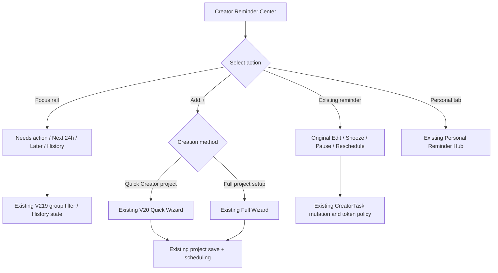
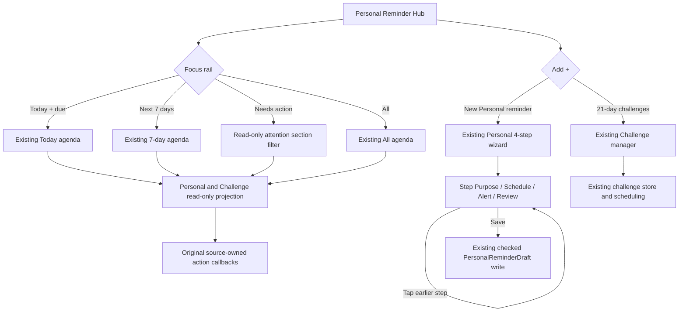

# Backlot UX06B — Reminder Center Navigation & Progressive Composer (Source Package)

**Date:** 2026-11-17  
**Stage:** UX06B — source-staged UI navigation/composer improvements.  
**Verification:** implementation-level static source review only. No compilation, Gradle, tests, APK, emulator, physical certification, merge or release.  
**Parent:** UX06A implementation draft PR #404, head e0ba5bf6eb5d2e2f5fa5ce31049efd9d4f597a9f.  
**Protected source:** physically owner-approved `stable/backlot-v337-premiere-owner-testing-20261114`; untouched.

## Product intent and design boundary

Backlot reminders are several different attention workflows, not one flat task table. UX06B makes navigation and reminder creation **feel like one consistent system**, without converting records or inventing a combined canonical database.

**Read-only sources and authorized destination:**
- Creator: existing `ReminderCenterPolicy.grouped(CreatorTask)`, CreatorTask editor and Project Pulse (all actions remain Creator).
- Personal: `V337UnifiedPersonalAgenda` projection from existing PersonalReminderStore and 21-day Phase1HabitStore (no change to either store).
- Challenge: remains separately editable and completable in Phase1HabitLocalStoreReview.
- Ideas: remains in Idea Vault, with its existing lightweight reminder picker and owner actions. No new Idea source was inserted into Creator or Personal.
- Activity history: current Activity Center remains its current owner and displays only documented receipts; no event table was duplicated.

**Scope honesty:** This package delivers **shared navigation components and owner-domain shortcuts**, not a fully aggregated cross-domain 'All Reminders' feed. A true cross-domain feed requires a separate privacy/error/read-only adapter gate before production. Do not claim all four domains have already been combined into one view.

## What changed in source

### 1. Shared UX06B presentation components

File: `app/src/main/java/com/framebynavin/app/ui/V406ReminderExperienceUi.kt`

- `V406ReminderScopeNavigator`: compact horizontal focus/attention tiles with label, factual count (or 'VIEW' when no count can be honestly supplied), selected style, and host-owned navigation callbacks. It does not call a store, schedule an alarm or record any response.
- `V406PersonalComposerProgress`: four-step accessible navigation strip; completed earlier steps can be revisited without losing Compose field state, but no button can skip future step validation.

### 2. Creator: glanceable choices + existing creation modes

File: `ui/V157ReminderCenterUi.kt`

- Replaced redundant static three-number counters with tappable read-only tiles: **Needs action**, **Next 24h**, **Later** and **History**. Counts project from Creator groups and respect an active search query.
- Selecting an overview tile clears bulk selection, exits an exact task-only Activity deep-link focus and uses the original `V219ReminderHubFilter` / `historyOpen` owner state. Search input remains the owner's deliberate filter.
- All original filter chips, search, empty-state, overdue/paused groups, long-press selection, safe turn-off dialog, pause, reschedule, snooze and response actions are **preserved**.
- Toolbar Add now exposes **Quick Creator project** and **Full project setup** rather than silently using one route for both. Both point to the *existing* Creator project composer. This does not create standalone Personal reminders or replace CreatorTask.

Files `ui/V131PolishUi.kt` and `ui/FrameByNavinV101BApp.kt` pass through `onQuickNew` to the existing `openComposer(quick = true)` and original `openComposer()` routing. The existing V20 Quick New Project Wizard retains source-of-truth creation/validation.

### 3. Personal + Challenge: focus without rewriting source records

File: `ui/V2232PersonalReminderHub.kt`

- Added read-only **Today + due**, **Next 7 days**, **Needs action**, **All** shortcuts computed with the existing `V337UnifiedPersonalAgenda.groups` and its source-namespaced Personal/Challenge IDs. An activity with alert Off is not falsely counted as an active reminder.
- The Today and Next 7 Days values deliberately include attention-needed items because the existing agenda scope always retains those items. The label **Today + due** reflects this existing policy.
- New `personalAttentionOnly` is a saveable **UI filter**, not a stored reminder action; it displays only existing `PersonalAgendaSection.NEEDS_ATTENTION` entries. No new 'missed' or 'seen' state is inferred.
- Switching a scope clears hidden bulk-selection tokens; exact Personal/Challenge notification deep links reset the attention-only filter. Source owner callback for Personal Done/Snooze continues to validate pending occurrence token.
- Existing scope chips TODAY / NEXT 7 DAYS / ALL, Groups, Spaces, delivery health, challenge entries, select/delete, edit, pause, undo, archive/restore, permissions and activity links remain reachable.
- Toolbar + now offers **New Personal reminder** (existing four-step Personal editor) and **21-day challenges** (existing challenge management). No fake Quick Personal creation route was added.
- The Personal four-step composer replaces a passive text label with `V406PersonalComposerProgress`. Tapping any prior step returns to it, never skips validation forward, and does not schedule until the pre-existing checked draft is actually saved.

## Source-level flowcharts

### Creator

### Personal/Challenge

## Preservation & privacy

- No new source of truth, no duplicated alarm, no fake `CreatorTask` for a Personal reminder, no mutations in the new shared components.
- All direct completion, explicit Snooze, staged Creator Done, archive/delete, stage and notification validation remain in their authoritative stores.
- Existing notification destination IDs keep precedence over UI filters. A changed filter must not leave hidden bulk-delete consent.
- No new Runtime/Manifest permissions, remote API or data collection; no change to App ID, TaskStore schema, Phase1HabitStore, Personal DataStore, Creator history or audio assets.
- No change to original Creator quick creation validations, Personal recurrence and preview/review, or challenge completion policy.
- Motion, type scale, border removal and scene art must wait for planned UX06C/UX10 rather than introducing conflicting style systems here.

## Limitations and next work

1. **No global four-domain merged timeline yet.** That would need explicit loading/error/privilege rules and read-only projection identity checks; do not hide a failed Personal store read behind a zero count.
2. **Creator rail + original filter chips coexist** deliberately for compatibility and test-tag preservation. UX10 can evaluate reducing redundant visible chrome after real-device usability review, without removing essential filters.
3. New Creator creation menu adds one selection step but exposes existing Quick/Full options. Review tap efficiency and TalkBack on a compact phone post-UX10.
4. Personal's guided four-step editor is still the sole create owner. A true title+time one-tap Personal Quick Add would require a distinct validated quick draft and confirmation policy. Do not claim it was implemented here.
5. 21-day alert music and theme parity remain UX06D; no changes to audio or full-screen delivery were made.

**Next:** UX06C curated cinematic scene foundations after founder continuation, with fallback to Classic seven-scene saved IDs and safe reduced-motion/performance behavior.
