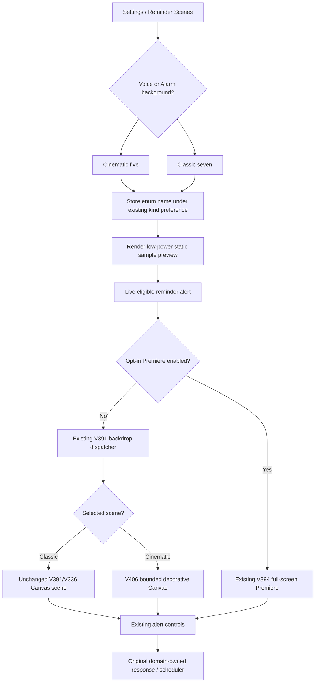

# Backlot UX06C — Curated Cinematic Reminder Scene System

**Date:** 2026-11-17
**Status:** SOURCE STAGED; not compiled, emulator-verified, device-certified, merged or released.
**Exact parent:** UX06B draft PR #405 at a81baf0b6cd01758de599e868ce958d918252064.
**Protected stable:** stable/backlot-v337-premiere-owner-testing-20261114 unchanged.

## Product goal

Give Backlot's Personal and Creator Voice and Alarm alerts five polished, original cinematic identities with *zero* influence on alarm scheduling, full-screen permissions, user response actions, audio, privacy controls or owner data. Maintain all seven existing Classic scene selections and all stored enum identities. No automated theme switch is performed on upgrade.

## Source changes

1. `app/src/main/java/com/framebynavin/app/reminders/V406CinematicReminderScenes.kt`
   - Five original native Compose Canvas visuals (no borrowed raster assets, network images, WebViews, bitmap-based buttons or decorative click handlers).
   - `V406CinematicScenes.curated` and `classic` define display collections; the Classic list retains all seven original IDs.
   - `V406CinematicReminderBackdrop` renders only decorative shapes at bounded counts with motion frozen under Android disabled animation **or** battery saver.
2. `app/src/main/java/com/framebynavin/app/reminders/V391ReminderSceneEngine.kt`
   - Append five enum values to the existing `V391ReminderScene` without renaming or reordering any old value.
   - Existing `V391ReminderScenePrefs` remains the sole preference owner. Voice and Alarm still independently persist `scene.name` in the pre-existing `backlot_reminder_scenes_v391` preferences. Default remains DIRECTOR for absent/unknown values.
   - Delegate the new five values to V406; all seven Classic values still run through their original rendering branches.
   - Revise the existing settings preview/selection surface to group **Cinematic Collection** (five) and **Classic Collection** (seven), preserving old V391 test tags and adding selected-state semantics.
   - Explain that V394 Premiere is a separate existing opt-in *full-screen presentation*, and that it takes priority while enabled. Changing a background selection does not enable/disable Premiere.

## Curated scenes — intended motion, art and restraint

| New persistent enum ID | Display name | Visual identity | Motion behavior | Safe/low-power |
|---|---|---|---|---|
| CINEMATIC_APERTURE | Aperture | Six amber/copper iris blades over black/wine, concentric optical edge | bounded gentle iris rotation/opening | fixed aperture, 6 blades |
| PERSONAL_SUNRISE | Personal Sunrise | Warm peach sun, horizon reflection and mist above dark-plum ambience | subtle sunrise float/haze | fixed sun and 2 horizon lines |
| ATMOSPHERIC_PARTICLES | Atmospheric Particles | Blue-grey ambient dust and occasional warm motes on indigo-black | deterministic shimmer and gentle drift | 20 static motes rather than 68 |
| PROJECTOR_LIGHT | Projector Light | Gold projector cone, muted film-gate accents, quiet dark canvas | four slow oscillating beams | 2 fixed cones |
| GLOWING_RINGS | Glowing Rings | Red-pink concentric arcs over burgundy-black, controlled soft core | rotating arcs at bounded speed | 3 frozen arcs |

Scene art concentrates in the upper ~50% of a normal portrait alert; the bottom fades into dark, stabilizing contrast around response buttons. Even when a scene is animated, it has **no** pointer input and cannot trigger Done, Snooze, Dismiss, Pause, navigation, sound or recognition. There are no fake audio amplitude measurements.

**Palette consistency:** Backlot Director's Cut's black/burgundy remains the visual baseline; alternative scene colors use controlled restrained accents. White/ivory alert typography and existing action-button palettes are unchanged. This package does not approve independent visual design systems for each reminder source.

## Actual integration and current limitations

- Both Creator classic full-screen and Personal unlocked, valid full-screen already call `V391ReminderBackdrop`; they therefore receive the five curated scenes without new Activity, alarm or permission changes.
- The current legacy V195 Creator intro still needs explicit user reveal; UX06C affects the backdrop after that transition. UX06E can refine reveal semantics without hijacking alert responses.
- When `V394PremierePrefs.enabled(kind)` is true, eligible Creator and Personal reminders use the existing Premiere presentation instead. The new setting explains this priority to avoid silent art mismatch.
- Voice vs Alarm theme choices remain independently persisted, shared across Creator and Personal. They are **not** individual reminder records and do not change on a per-project basis in UX06C.
- Current 21-day Challenge Voice has no equivalent full-screen live alert background, and Challenge Premiere remains sample-only. **This UX06C package does not falsely enable a Challenge full-screen screen.** Parity work belongs to UX06D/E with OS/privacy approval.
- Idea reminders stay quiet actionable notifications; no new full-screen alert animation is forced onto them.
- The setting screen renders a *lightweight static preview* for the five new scenes; a live alert animates only if animation is enabled and battery saver is off.
- No changes were made to seven Classic rendering paths, their enum values, persisted keys, V394 Premiere switch keys, Creator/Personal UI action callbacks, on-device audio, TaskStore, PersonalReminderStore, Phase1HabitStore, Idea Vault, AndroidManifest, alarms, notification receivers, projects, completion receipts, analytics, cloud sync, backup or business logic.

## Flowchart — scene selection

## Regression and safety design decisions

1. **No scene migration**: old stored V391 enum names are parsed exactly as before. Do not convert DIRECTOR to CINEMATIC_APERTURE or rename the existing selection.
2. **No scheduler rebuild**: selecting a theme is a preference-only write. The current alert content, action token and background services remain unaffected.
3. **No extra permissions or cloud costs**: all art is local Compose Canvas.
4. **Full-screen/privacy rules remain inherited**: Personal locked states still hide private titles and response actions. Canvas must never draw user content behind a keyguard.
5. **Motion and battery safety**: static drawing on animation disabled or low power; dynamic renderer caps geometry count, no motion is required to reveal any action.
6. **Performance evidence pending**: no FPS, jank, thermal, GPU, battery, small-screen or TalkBack instrumentation has been run here. Final certification after UX10 must validate these outcomes, not merely the source's intent.
7. **Classic/Premiere coordination**: on-device UX should make it obvious Premiere overrides the background when enabled. Changing scene must never implicitly toggle Premiere.
8. **Accessibility**: settings selection announces Selected/Not selected; contrast, text scaling and semantics still require real-device validation.

## Next stages

- **UX06D**: Audio/voice/music policy parity; challenge remains separate persisted domain, any per-challenge music and text settings require lossless versioned storage/export/restore and explicit approval, no paid provider.
- **UX06E**: Safe reminder interaction/reveal, optional chosen companion and truthful readiness diagnostics. No fabricated voice amplitude or successful delivery status.
- **UX06F**: Integrated source/QA handoff, then UX07–UX10 and the consolidated certification campaign.

**Implementation status:** two Kotlin source files staged and this design contract. No Android build/CI, no APK, no merge, no release.
