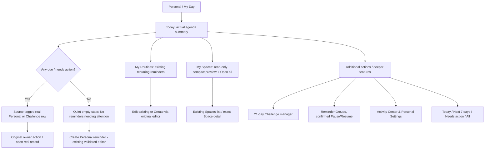

# Backlot UX07A — Approved Personal experience contract and narrow UX07B brief

**Date:** 2026-11-17. **State:** DESIGN/SOURCE CONTRACT ONLY, not a shipped UI change.
**Parent:** UX06F draft #409 at `528f22334beb83f6c0a39199699c2ea216329b5e`.
**Design direction:** preserve the approved Backlot Director's Cut character, deep capability with a calm surface, accessible controls and truthful feedback. No new visual system, account, subscription or backend without founder approval.

## 1. Personal product hierarchy, refined rather than replaced

**Intended daily experience:**
- Personal opens to **My Day**, not to a dense settings dashboard.
- Top region answers: **What matters now?** Use actual scheduled Personal reminders and eligible 21-day Challenge agenda entries; show a truthful "nothing needs attention" state.
- Second region: **Your Rhythm** summarizing genuine existing recurring reminders; create/edit through existing owner editor, not a fabricated routine engine.
- Third region: **My Spaces**, using existing Space preview/entry: soft, compact, personal, safe to navigate. A selected Home Space must open the exact owner record, never an unrelated fallback.
- Bottom/deeper navigation: upcoming, Needs Attention, next 7 days, reminder groups, Challenge manager, progress and Personal settings. Keep everything reachable, with no silent deletion of an existing button.

The screen should feel authored rather than box-heavy. Use visual grouping, whitespace, refined typography and subtle separators instead of repetitive strong borders; preserve touch targets, focus order and legibility. This matches the separately approved UX10 global density/border pass, without prematurely replacing global design primitives.

## 2. UX07B target composition (source and no-code mock definition)

**Do not build another canonical Today record.** `V337UnifiedPersonalAgenda` already joins Personal plus current alert-enabled single-activity Challenge rows by read-only projection. The existing Creator area is a separate workspace.

**Suggested visual rhythm:**
1. Title row: "My day", current date from device, restrained single primary "+" shortcut; retain Activity and Settings access.
2. Small "Next moment" focus with exact due time, source label and accessible action; no fake 100% daily rating.
3. Compact row "My routines" (real recurring Personal reminder items); no duplicative second scroll-list of all reminders.
4. "My Spaces" list/preview with compact photo-free default and direct link to the same Space screens; do not create DB/scan photos unnecessarily while merely rendering Home.
5. A visually quieter secondary line for "21-day challenges", "Reminder groups", "More reminders"; hide complexity progressively rather than remove functions.
6. Existing filters, bulk selection, import/export, archive and advanced settings remain in their original owner surfaces and must remain accessible.

## 3. UX07B implementation boundaries and exact evidence desired

| Source candidate | Permissible change | Guard |
|---|---|---|
| `ui/V2232PersonalReminderHub.kt` | Presentation grouping, concise context and route affordances | Preserve deep links, scopes, bulk selection, Personal edit/Done/Snooze/Pause/delete, challenge manager, Settings and Activity |
| `ui/V288PersonalTodayCard.kt` | Refinement of current next-action summary, graceful status copy | Real delivery/response source; no backdated receipt, no fake progress |
| `ui/V295UniversalPersonalRoutines.kt` | Compact genuine recurring reminders preview | Does not create a new routines engine or mutate recurrence |
| `ui/V340HomeSpacesEntry.kt` | Better visible Space preview/entry, optional presentational polish | Respect failed/stale Space id and no-data-creation Home behavior |
| New `ui/UX07BPersonalOverviewUi.kt` (only if justified) | Stateless/presentation-only composables and read-only prepared view data | No DataStore/Room/AlarmManager writers or extra backend |
| `docs/product/` and `docs/qa/` | Source contract and deferred tests | No premature certification claims |

**No source changes authorized by this UX07A PR.** UX07B should produce its own isolated child draft after maintaining source ancestry and founder-approved scope. Avoid touching `Phase1HabitCodec`, the actual scheduler, Room schema, encrypted private photos, notification receivers, permission manifest, shared project services, global theme settings and cloud data for a Home layout improvement.

## 4. My Spaces UX07C/D/E forward contract

- Space index: show goal, source-verified progress summary, linked reminder count, calm creation affordance. No medical advice, promises of progress or source-less streaks.
- Space detail: **Log progress**, **Add note**, **Photo journal**, **Linked reminders**, **History**; keep Archive/Restore/Edit/Delete, local export/import and recovery available.
- Space source: notes separate from manual check-ins; photo addition does not count as a check-in; linked Personal Done receipt separate from Space Room entries. No duplicative receipt writes into Room.
- Reminder Groups: preserve group CRUD, link/unlink and **confirmed bulk Pause All/Resume All**, which deliberately changes original Personal reminders even across multiple groups.
- 21-day: preserve exact completion/Undo, manual check-ins, v1/v2→v3 voice codec, and UX06F P0 Snooze precision fix. Never count voice output as day Done.
- Template expansion: beyond existing saved enum values **requires separate schema/compatibility approval**; do not implement Rest/Relationships/Nutrition as new persisted types incidentally.
- UX08 achievements: do not trigger rewards from navigation, reflection/photo viewing or notification posting. Owner-authoritative completed actions only.

## 5. States and accessibility acceptance

| State | User-visible presentation | Required truth |
|---|---|---|
| New user, no reminder | "Start with a reminder" / link to existing wizard | Not falsely a missed alert |
| No Spaces database | "Create your first Space" | Preview does not create empty Room DB |
| Existing but no current due | Calm "Nothing needs a response now" | Does not claim every earlier notification delivered |
| Challenge no alert or archived | History remains available via Challenge manager | No imaginary upcoming alarm |
| Loading Personal data | Low-noise placeholder | No empty-state false negative before loaded |
| Personal or Space read error | Clearly distinct unavailable/retry or original recovery path | Never overwrite/initialize a corrupt store as empty |
| Permission degraded | Clear timing/heads-up caveat, optional user-opened Android settings | Never guarantee delivery/audio |
| Deep-linked deleted Space/reminder | Focus unavailable message and safe navigation back | No wrong record or unwanted response |
| 320dp/large font | One-column, scrollable cards and ≥48dp interactive targets | No clipped primary action |
| TalkBack/reduced motion | Descriptive controls, meaningful heading/focus hierarchy | No decorative companion intercept or button reveal required |

## 6. Nonnegotiable privacy, cost and continuity

- Personal note/photo/title data never included in lock-screen previews, Creator default analytics or debug telemetry.
- Private photos remain on-device only with EXIF/GPS stripping and explicit Save/Delete/Recover/Discard.
- Spaces metadata backup remains an **opt-in plaintext metadata-only owner file** and is **not** a default cloud-backup feature or full photo backup. UX09 later handles synchronization policy; no claim cross-device parity now.
- Progress Journey includes Personal only with opt-in OFF by default.
- No new paid subscriptions, subscriptions to services, server storage, paid TTS or external analytics.
- Preserve V337 internal stable and separate UX06F P0 reconciliation gate; all new code stays in draft until one post-UX10 integrated QA + owner physical review.
- Architectural decisions, schema migrations, storage relocation and release promotion remain founder-gated.

## 7. UX07B implementation acceptance checklist

- [ ] Existing Personal toolbar actions and source-aware tabs operate as before.
- [ ] Existing four-step composer validation and challenge navigation remain.
- [ ] My Day summary relies on real Personal and single-activity Challenge records.
- [ ] Archived/paused/Alert Off challenge doesn't become false next alarm.
- [ ] Existing filters, selection mode, delete gates and exact Activity focus retained.
- [ ] My Routines and Home Space navigation use existing real callbacks.
- [ ] No new record writer, schema version, permission, photo read, remote request or background worker.
- [ ] Empty/loading/error/small viewport semantics documented, tests staged after UX10.
- [ ] UX07B patch compared to exact UX07A parent; only expected UI/docs diffs.

**UX07A verdict:** UX07B has an actionable, bounded contract; it has **NOT** been implemented or tested in this audit.
