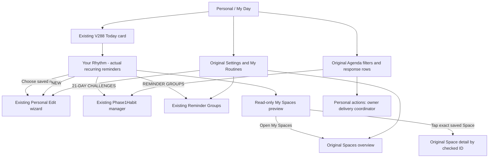

# Backlot UX07B — Personal Home / My Day presentation refinement

**Date:** 2026-11-17
**Status:** SOURCE-STAGED DRAFT — **NOT** compiled, unit-tested, UI-tested, CI-certified, merged, physically tested, or released.
**Parent:** UX07A documentation-only draft PR #410, head `d9ba477b279a94b33dd4d367cd27ce3271af4511`.
**Stable owner baseline:** V337 P0 `815ba69775f75b6e5f25bb838c2c17b4f09c203e` protected.
**Approved sequencing:** Source-stage through UX10, one consolidated QA campaign afterward.

## Goal and implementation decision

Make **My Day** a useful, calmer daily personal workspace without duplicating the existing Personal editor, altering schedules, flattening independent owners, or making the screen another overloaded settings catalogue.

The actual existing `V288PersonalTodayCard` already displays a real next Personal reminder with owner-authenticated Done/Snooze actions. We deliberately retained that UI and all original `V406ReminderScopeNavigator` controls, original agenda filters, selection modes, activity focus, Add menu, Personal/Creator tab, My Spaces entry, challenge and settings screens.

Rather than build a second "next reminder" store or another Home with duplicate buttons, the package adds a lightweight, read-only **Your Rhythm** section and reuses the established **My Spaces** preview inside My Day. Recurring reminders are filtered precisely (excluding ONCE and paused) instead of claiming every active one-off reminder is a "routine."

## Actual source changes

1. `ui/UX07BPersonalRhythmUi.kt` — small read-only `UX07BRhythmPolicy.upcoming` and `UX07BPersonalRhythm` composable.
   - Preview at most **two** actually saved active recurring Personal reminders sorted by real canonical due time then name/ID; each row navigates to the unchanged Personal Edit wizard.
   - Only actual repeat types count as recurring; paused and ONCE are excluded from this summary, not from the original agenda.
   - **NEW** opens the existing validated Personal reminder editor; **21-DAY CHALLENGES** opens the existing manager; **REMINDER GROUPS** opens the existing group owner UI including confirmed Pause/Resume All.
   - Challenge count is the number of **saved challenges**, never the number of notifications delivered, days completed, pending obligations or "active challenges." Count becomes unknown (label only) while the separate Challenge store is loading or unavailable.
   - Distinct `ux07b-*` test tags, ≥48dp controls, subdued surfaces and no large new cards or fake success values.
   - No database, sensor, notification, TTS, network, scheduler or editor call from rendering; only owner-supplied action callbacks on deliberate taps.

2. `ui/V2232PersonalReminderHub.kt` — inside **Today**, keep original `V288PersonalTodayCard` and Android access warning, then add `UX07BPersonalRhythm` followed by original `V340HomeSpacesEntry`.
   - `V340HomeSpacesEntry` is the existing safe, read-only Room observer that checks DB existence without silently initializing the Room database; it does not read private photo bytes or create a new Space.
   - Exact featured Space tap passes its stable owner ID into the existing `V289PersonalSpacesScreen`; an explicit My Spaces overview click passes null and must **not** inherit an unrelated initial Home focus.
   - Two small saveable navigation flags distinguish a recent in-app Space preview choice from a pre-existing external Home deep link; both clear when the Space screen closes or opens a linked Personal reminder for edit.
   - No scope selector, bulk delete, existing Today card action, original editor or downstream navigation hook removed.

3. `ui/V288PersonalTodayCard.kt` — two copy corrections:
   - "active reminders" instead of calling all current active reminders "active routines."
   - When there is no next *Personal* reminder, do not claim no upcoming activity in all domains; Challenge reminders have their own independent owner.

4. `app/src/test/java/com/framebynavin/app/ui/UX07BRhythmPolicyTest.kt` — pure policy unit-test **source** for active recurring selection, empty/once-only profile, and current pending exact due time. **Not executed** until consolidated UX10 gate by owner instruction.

## User flow (wiring actually present in source)

## Source truth and limitations

- **Not a separate routine engine:** existing `V295UniversalPersonalRoutines` remains in Settings and still offers its original broader Personal list. The new preview correctly selects only active recurring Personal reminders; it never schedules or "checks in" automatically.
- **Not a combined Challenge reminder action card:** Challenge manager opens via shortcut; original `V337UnifiedPersonalAgenda` below retains actual alert-enabled Challenge projection. The `V288` next-action card remains specifically Personal to keep verified response semantics.
- **Not a photo backup:** Space metadata/file handling still belongs to Room owner; My Day preview does not load photos. Existing Spaces metadata-only local export does not include photos, reminders or authenticated Done receipts.
- **No new sync/account features:** UX09 remains owner-approved separate stage. No claim that second-device login syncs Spaces or photo bytes.
- **No change to Personal/Creator/21-day completion:** Only accepted source-owned Done action produces a receipt. Rendering a routine row, opening Space, photo or Challenge does not trigger an achievement.
- **No automatic permission request:** User-opened original Settings/Android control only; no new FSI/FGS path.
- **No full UX07B visual proof yet:** Multiple existing reminder/list sections continue below the new daily preview. UX10 density optimization and real-device QA will verify actual scroll burden, test-tag collision with shared Home Space preview, large font and landscape behavior.

## Protected scope and rollback

- Only two existing UI files, one new presentation-only UI file, one new policy test source and two documents are expected in this package.
- No Room/Personal/Challenge/Creator/Idea store edits, backup codecs, services, notification keys, manifest, account data, branches main/stable, hosted deployment, credentials, APK or paid provider.
- The entire source addition can be dropped from this draft without altering canonical saved data because there are no new persistent keys or migrations.
- Accepted stable P0 extra fixes are still diverged from the UX staging tree; restore/integration reconciliation from UX06F must be completed before any certification build.

## Handoff

**Next:** UX07C — My Spaces cards/detail/journaling polish and truthful entry/linked-reminder progress, starting with the exact existing Space writer/photo recovery paths. Preserve all Space buttons and deletion rules. Do not invent additional saved Space types or perform a Room migration in the UI-only UX07C slice.

**Exit:** UX07B source staged, no runtime proof. Merges, production release and V337 stable promotion remain blocked by owner approval and consolidated post-UX10 verification.
