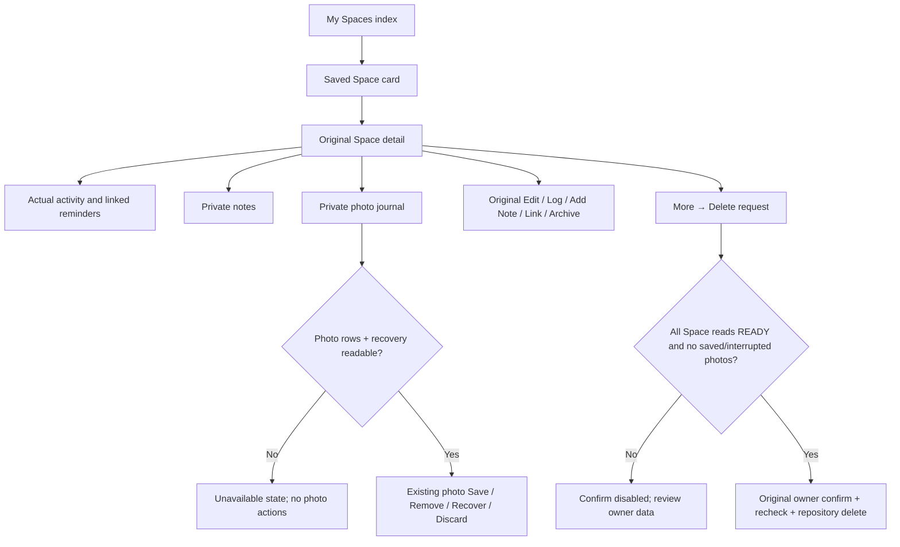

# Backlot UX07C — My Spaces, Private Journals and Honest Progress

**Date:** 2026-11-17
**State:** SOURCE-STAGED DRAFT ONLY. Not compiled, JVM-tested, instrumented, emulator-tested, physically certified, merged or released.
**Parent:** UX07B draft PR #412 at `df75d09a539a7f825d0dbfaaf8891b327fd6ce69`.
**Protected internal stable:** V337 P0 `815ba69775f75b6e5f25bb838c2c17b4f09c203e`; untouched.
**Overall rule:** staged UX01–UX10 source work, then one consolidated test/compatibility/real-device campaign. Do not override pending V337 P0 reconciliation.

## 1. User value delivered in source

### My Spaces index — richer but source-backed

- Replaced repetitive full-border, title-only Space rows with `UX07CSpaceCard`: stored title, existing category, optional saved goal, Active/Archived status and direct open. Card uses the **same original `v289-space-{id}` test tag**.
- No invented progress count, streak, photo thumbnail, remote fetch, avatar or generated content in the Space index. The existing seven persisted `V289SpaceType` enum values are kept unchanged, with a safe presentation fallback only.
- Existing **Create Space**, empty-state Create, metadata Backup/Restore button, Back, exact Home-selected Space deep links, archive/restore and edit remain on the original callback paths.
- Legacy data is never retyped or migrated just to change category display.

### Space detail — progress with provenance

- The top area identifies the actual saved Space category, owner-provided goal and archived state; edit and destructive More action remain in place.
- A restrained `UX07CSpaceProgressSummary` displays **recorded non-note logs**, **days with recorded activity in the previous seven calendar days**, and **number of Space-linked Personal reminder IDs**. These are three distinct figures, not an invented completion percentage.
- Original `V289SpaceProgressPolicy` remains the projection owner; notes and photos are excluded from the activity total, and Personal Done history stays separate.
- The existing linked Personal reminder section still shows real next-due time, Edit, Link and Unlink; it does not copy, mutate or reschedule a Personal reminder merely because it is linked. Done receipt history is shown only after the original completion flow has actually loaded.
- Full **Log Progress**, numeric optional metrics, Add Note, Notes show-all/show-less, Photo picker, prior Photo comparison, Recover/Discard, Archive/Restore, Delete, export/import metadata remain on their original owner paths.

### Notes, activity history and photos

- Notes now have a clearer **Private notes** heading, subtle separators, source-owned timestamps, and a truthful empty note message. Notes remain `NOTE` records, not activity completion.
- Activity History rows retain date, saved note, existing `V292SpaceMetricSuggestions.describe` formatting and original `v289-entry` / `v292-recorded-metric` tags, with a source-aware label (Manual Check-In / Manual Measurement / Personal Note / Recorded Milestone / Confirmed Reminder Done when this provenance actually exists).
- Private Photo Journal retains the original picker, owner Save/Cancel, optional note, verified app-private JPEG bytes, location/EXIF stripping, comparison policy, remove, interrupted recovery/owner Discard and per-photo privacy safeguards.
- Photo journal copy is clearer about **no cloud syncing of photo bytes** and uses neutral **EARLIER/LATER** comparison terminology rather than implying improvement or health outcomes. Controls retain their original `v290-*` test tags, and ADD has a 48dp minimum touch target.
- `Spaces metadata backup` remains an *explicit, local plaintext JSON metadata file*, not a photo-file backup or an account-wide cloud restore.

## 2. Important reliability improvement: no false empty journal

Original Space detail separately fetched entries, links, photo rows and interrupted-photo recovery records. In read-exception paths it replaced the corresponding *display list* with empty data and showed an error, potentially causing misleading "No notes yet", zero progress, zero links or "No photos yet" copy. This package adds four **screen-local UI availability statuses**:

| Source | LOADING | READY | UNAVAILABLE |
|---|---|---|---|
| Room `entriesForSpace` | "Loading saved activity/notes" | Accurate actual entries, notes and progress | No empty-data claim; show unavailable without deleting or writing |
| Room `linksForSpace` | Loading linked reminders | Existing ID link actions and source count | Links unavailable, Link/Unlink disabled until original records can be read |
| Room `photosForSpace` | Loading private photo journal | Original photo UI and actions | Photo UI hidden, no fabricated "no photos", no new save/delete controls |
| Owner `interruptedRecovery.find` | Loading photo recovery safety | Original Recover/Discard and photo UI | Photo UI hidden; Space delete disabled |

- These flags reset by selected `spaceId`, preserve coroutine cancellation instead of swallowing it, and are **not new persisted state or a replacement Room store**.
- Space delete requires **all four read statuses READY**, plus original **zero saved photo rows and zero interrupted recovery** checks. The existing recheck directly before deletion and `V289SpacesRepository.deleteSpaceAfterOwnerConfirmation` remain intact.
- New Log Progress and Add Note require entries ready. Linked-reminder mutations require links ready. Existing owner write/mutation guards remain.
- The original Personal completion-history observer now records a **ready signal** so a still-loading or unavailable receipt source is not displayed as `0 confirmed Done`.
- On any failure, visible wording describes unavailability and no deletion; no user records are reset. There is no new retry scheduling system, automatic destructive reconciliation or replacement of genuine missing records.

## 3. Exact source contract and intentionally untouched owners

| Owner | Changed in this UX07C stage? | Invariant |
|---|---|---|
| `ui/V289PersonalSpacesScreen.kt` | **Yes — presentation and local read-state only** | Original IDs, callbacks, input validators, photo recovery, metadata export/import and confirmation gates intact |
| `ui/V290PersonalPhotoSection.kt` | **Yes — appearance/text/touch target only** | Original Private Photo Journal storage, verified bytes and recovery unchanged |
| `ui/UX07CSpacePresentation.kt` | **New — presentation/provenance** | Stateless card/summary, read status enum and saved enum labels; no writer |
| `personal/spaces/V289SpacesDatabase.kt` | **NO** | Room v2, links, owner entries and photo rows unchanged |
| `personal/spaces/V290PrivatePhotoFiles.kt` | **NO** | Bounded sanitize/EXIF removal/checksum/private disk unchanged |
| `personal/spaces/V290InterruptedPhotoRecovery.kt` | **NO** | No automatic delete, owner confirmation/filename/UUID checks unchanged |
| `personal/spaces/V289SpacesMetadataCodec.kt` | **NO** | Version 1 checksum metadata format, no imported Done receipts |
| `PersonalReminderStore` / `PersonalCompletionJournal` | **NO** | Personal reminders and exact Done receipts are separate source owners |
| `Phase1HabitStore` / `Phase1HabitLiveDelivery` | **NO** | Single-activity Challenge and UX06F fixed P0 Snooze untouched |
| `V298ReminderGroupStore` / `FC13ReminderGroupCommands` | **NO** | Reminder Groups, confirmed bulk Pause/Resume preserved |
| `app/src/main/AndroidManifest.xml`, Supabase, account/sync | **NO** | No permissions, services, database, server, auth, uploads or cost |

## 4. UI flow and protected destructive gates

**Photo Save, Photo Delete, Space Delete, metadata import, reminders linking and genuine Done receipts remain separate actions.** Displaying a journal or receiving a notification never advances a challenge or activity.

## 5. Explicit remaining limits and UX07D handoff

- This stage is **not** a new journal editor, text search engine, photo-cloud backup, encrypted local metadata export, new Space type/template, sync schema or statistics database.
- Read-state improvement is screen-local, not a redesign of Room's repository error model or a guarantee that all callback races are solved; unavailability and cancel/reopen behavior must be verified on Android.
- Confirmation dialogues, bulk selections and all prior source controls still require the post-UX10 integrated UI + physical-device matrix.
- UX07D continues with **linked Personal reminders and Reminder Groups**: preserve ID-only groups, shared group member behavior, and confirmed Pause All/Resume All operations. Do not silently treat them as read-only.

**Exit:** UX07C is an isolated source-staged candidate; static inspection possible, runtime certification deferred. Stable V337 remains owner-accepted. Production merge/release forbidden until approved integrated evidence.
