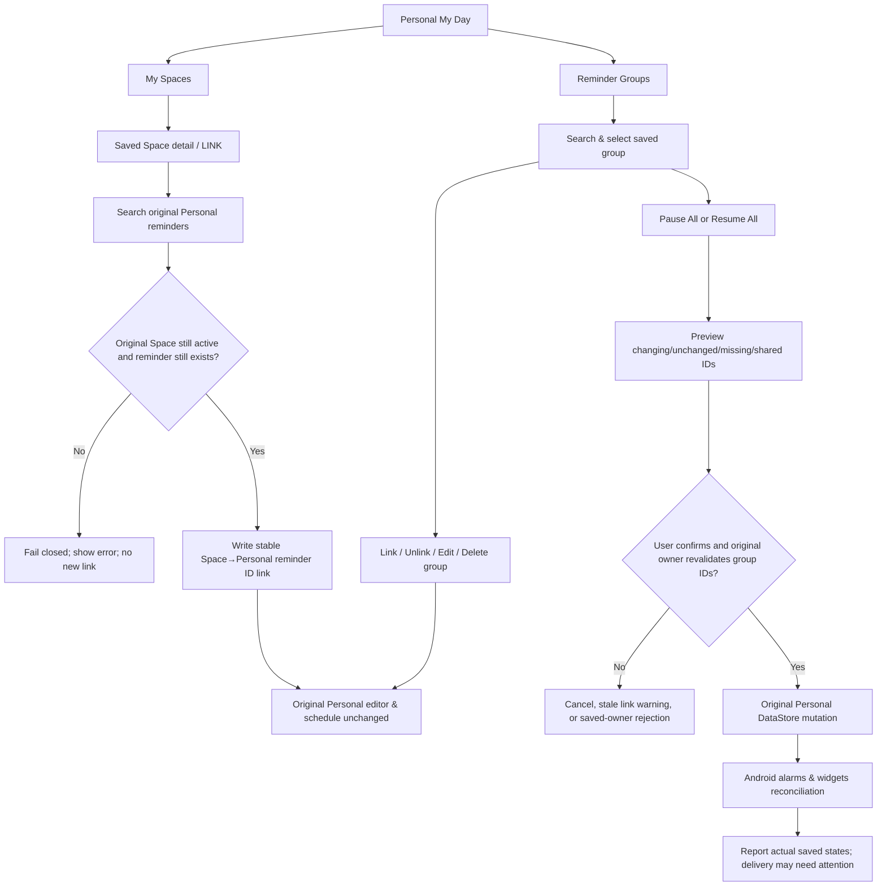

# Backlot UX07D — Connected Personal Reminders, My Spaces and Reminder Groups

**Prepared:** 2026-11-17.
**Stage:** UX07D, SOURCE-STAGED DRAFT; not compiled, unit-tested, instrumented, emulator-tested, physically validated, merged or released.
**Exact parent:** UX07C draft PR #413, head `be8f00bb86d8e9dbdf4c07bed5dbac326731fa52`.
**Protected owner stable:** V337 P0 `815ba69775f75b6e5f25bb838c2c17b4f09c203e` remains untouched; additional accepted P0 changes still require isolated reconciliation before certification.
**Founder agreement:** source-stage UX01–UX10, then ONE consolidated unit/CI/emulator/physical acceptance campaign. Do not claim any interim source is a stable APK.

## 1. The important distinction

**My Spaces link** and **Reminder Group membership** both refer to existing Personal reminder IDs. The original Personal reminder remains the only schedule, delivery and Done-history owner. A link/unlink never creates a second alarm, deletes a reminder or inserts a completion receipt.

**Pause All / Resume All is different.** This existing, explicitly confirmed group action DOES change the original Personal reminder pause states. Its effects therefore appear in every group that also references the same reminders. The authoritative code `FC13ReminderGroupCommands.setAllPaused` validates the actual saved group membership, atomically mutates the Personal owner once, then reconciles Android alarms, notifications and widgets. UX07D makes that effect and possible post-save Android reconciliation failure visible; it does NOT rewrite or bypass this owner command.

## 2. Source-scoped changes

### A. Read-only connection projection, `ui/UX07DPersonalConnectionPolicy.kt` (NEW)

- `matchingGroups(groups, query)`: case-insensitive trimmed local group-name search, without changing membership or record order.
- `availableSpaceReminders(reminders, linkedIds, query)`: excludes only IDs already linked to that Space, filters by Personal reminder title, sorts stably by title/ID. **Paused originals are linkable**, but remain paused.
- `bulkImpact(group, allGroups, reminders, targetPaused)`: reports linked count, actual changing state count, already-unchanged count, missing links and number of changing originals also referenced by other groups. Counts use real current UI store snapshots. They are **explanatory only**: the original owner command independently and authoritatively verifies and commits changes.

No writer, new identity, new shared reminder record, cached server request, account sync or database migration.

### B. Original Reminder Groups UI, `ui/V298ReminderGroupsScreen.kt` (modified)

- Added a compact group-name search to the original Groups list while preserving Create, Select, Edit, Delete, Link, Unlink, Import, Export and all existing `v298-*` controls.
- After source load error, the Groups page presents an explicit unavailable state, **not** "No groups yet", misleading progress counts or a destructive bulk action.
- Each linked reminder displays its actual canonical next due occurrence (or paused/no upcoming), and the number of other groups sharing this original reminder. A deleted/missing reminder produces an explicit stale-link explanation with safe **UNLINK**, not a fabricated new reminder.
- Existing **PAUSE ALL / RESUME ALL** buttons and `fc13-*` IDs remain. Confirmation now describes how many ORIGINAL Personal reminder states would change, how many are already in the requested state, missing links that block changes, and how many changing originals are shared with other groups.
- The confirm control is disabled for missing IDs, empty change sets or unavailable source data. The original `setAllPaused(id, expectedMemberIds, pause)` is unchanged and rechecks membership inside the original owner flow even if UI data was stale.
- On success, show a distinct **saved original reminder states** feedback message. On a post-save Android alert reconciliation failure, show the original warning and close the confirmation, without implying an unsuccessful DataStore write or pretending Android delivery succeeded.
- No group deletion or ordinary link/unlink action writes a Personal reminder. The original **group bulk Pause/Resume** intentionally does.

### C. Existing My Spaces UI, `ui/V289PersonalSpacesScreen.kt` (modified)

- The existing **LINK** control opens a search field for saved Personal reminders; filter results without cloning or rescheduling the original reminder. Display a bounded first 24 matching choices, with a prompt to search for a specific reminder in larger libraries.
- No misleading empty list if link source is unavailable. Keep the original `v295-link-available` buttons and direct **EDIT**, **UNLINK**, Notes, Photo Journal, progress history, Back, Archive/Restore and guarded Delete actions.
- After the user selects a real saved reminder, refresh canonical `PersonalReminderStore.load()` IDs immediately before calling the existing `V289SpacesRepository.linkExistingReminder`. Re-read the original Space ID and require that the Space remains unarchived. If original records vanished or are unreadable, fail closed with the existing mutation error; don't link a stale screen snapshot.
- Source-only ephemeral link query state is reset by Space ID and on re-opening LINK. No persisted preferences, new Room entities or cross-store migration.

### D. Staged source tests and documentation

- `app/src/test/java/com/framebynavin/app/ui/UX07DPersonalConnectionPolicyTest.kt`: read-only cases for case-insensitive Group search, Space ID filtering, actual shared bulk changes, missed link count, and already-in-state semantics. **Test source staged, not executed.**
- `docs/qa/UX07D_CONNECTIONS_AND_GROUP_ACTIONS_CERTIFICATION_AFTER_UX10.md`: post-UX10 functional, data, failure, Android alert, usability/privacy and cross-stage QA gate.

## 3. End-to-end flow

## 4. Preserved existing behavior and safety gates

| Component/owner | State in UX07D |
|---|---|
| `V298ReminderGroupStore`, `V298ReminderGroupCodec` and `V298ReminderGroup` | **Unchanged** — original DataStore/ID references, validated export/import and safe delete |
| `FC13ReminderGroupCommands` and `FC13ReminderGroupProgress` | **Unchanged** — explicit validated bulk change, source-verified Done receipts, original alarm reconciliation |
| `PersonalReminderStore`, `PersonalDeliveryCoordinator` | **Unchanged** — original schedule, exact occurrence/tokens, confirmed Done and Pause semantics |
| `V289SpacesDatabase` and `V289SpacesRepository` | **Unchanged** — Room v2 owner, link IDs and safe Space deletion |
| `V290PrivatePhotoFiles`, photo journal, metadata recovery | **Unchanged** — local private files, EXIF strip, recovery, metadata-only backup |
| Single-activity Challenge `Phase1HabitStore` and UX06F P0 Snooze fix | **Unchanged** — separate canonical owner and v3 archive, release gate open |
| Home, Creator, progress/achievements, widget policies | **Unchanged** by this stage; normal original group bulk command still requests widget refresh |
| Account, Supabase, notifications manifest, cloud sync and payments | **No changes**; UX09 remains separate |

## 5. Risks and explicitly deferred work

- An on-screen bulk-impact preview is not a transactional lock. Concurrent Group or Personal record changes may make the preview stale; the existing authoritative command verifies exact group membership and source reminder availability again. A requested pause/resume is not equivalent to proof of Android alarm delivery.
- Original group actions use a Personal DataStore write followed by Android reconciliation. If the latter fails, states may already be saved; show the source warning, don't ask users to create duplicate reminders.
- Group export/import is **metadata and IDs only**, not a full Personal reminder backup. Space local metadata exports do not contain photo bytes, alarms or source-owned Done history. No cloud parity promised.
- Very large Space reminder libraries use the first 24 filtered choices; users must search to find the rest. The actual UI and TalkBack suitability need hardware evidence.
- The founder-approved **UX07E** will deepen personal progress/reflections and 21-day Challenge read-only integration, without assigning rewards from navigation or notifications.
- The user-approved **UX09** auto-sync is separate, and requires own data/permission/conflict/security approval.
- No APK generation, tests, merge, deletions, release or stable change was authorized for this stage.

**Handoff verdict:** UX07D source improvements staged; end-to-end QA and accepted V337 P0 reconciliation still not completed. Proceed to UX07E source work when the exact PR is reviewed.
