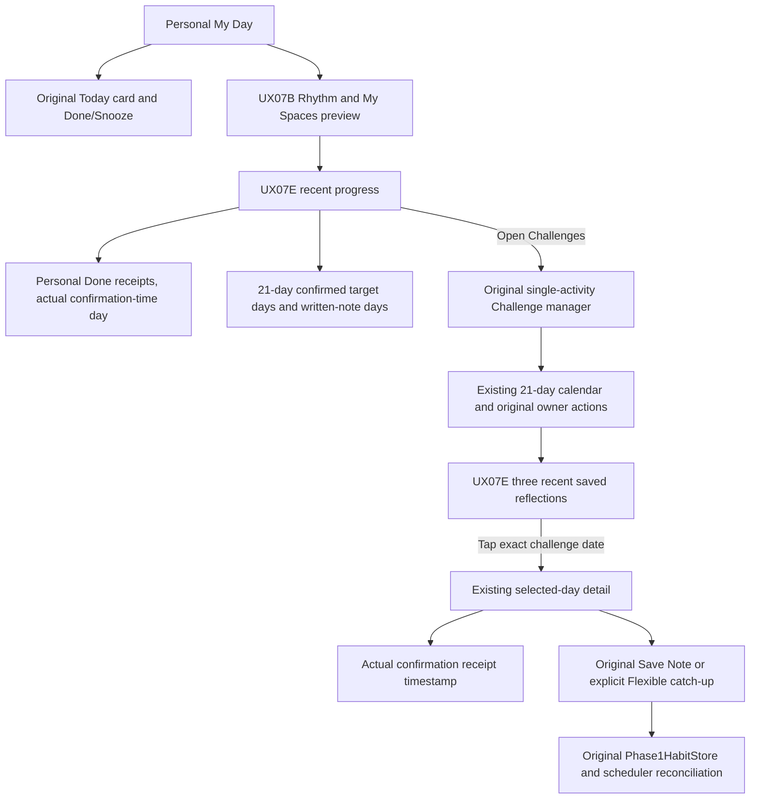

# Backlot UX07E — Source-truth Personal Progress and 21-day Reflections

**Date:** 2026-11-17. **Status:** SOURCE-STAGED DRAFT only: not compiled, unit/instrumentation-tested, device-tested, certified, merged or released.
**Exact parent:** UX07D draft PR #414, SHA `3246059706a2cc433278249fad10700142bcaa3a`.
**Protected accepted internal stable:** V337 P0 `815ba69775f75b6e5f25bb838c2c17b4f09c203e` unchanged; full accepted P0 lineage reconciliation remains required before candidate promotion.
**Owner-approved sequence:** source-stage UX01–UX10, then one integrated unit/CI/instrumentation, backup/upgrade, privacy/accessibility and physical-device campaign. All UX07E tests below are *deferred*, not PASS.

## 1. Product decision

The Personal workspace already contains a real `V288PersonalTodayCard`, a read-only `V337UnifiedPersonalAgenda`, a detailed 21-day challenge dashboard, 21 tappable calendar days, explicit Done/Undo, strict/flexible catch-up, daily notes, link navigation and a separate Creator/Personal Progress Journey. Rebuilding those would increase complexity and threaten accepted logic.

UX07E therefore adds **clear context from existing receipts** instead of a new "one-size-fits-all progress percentage" or a second completion engine:

- **My Day / Your Recent Progress**: four clearly distinct last-seven-calendar-day observations based on source-owned records.
- **Challenge / Your Reflections**: compact preview of the three latest day-dated saved notes, with an explicit indicator whether that exact day has a distinct confirmation receipt, and navigation to the existing day-detail dialog for the real timestamp and editing/confirmation controls.
- No auto-awards or misleading motivation. Saving a note, opening a journal, viewing a photo or receiving/dismissing a notification never marks a challenge or reminder Done.

## 2. Source changes and exact owner boundaries

| Source path | Action taken | Existing protected owner |
|---|---|---|
| `app/src/main/java/com/framebynavin/app/ui/UX07EPersonalProgressPolicy.kt` | NEW pure `lastSevenDays` and `recentReflections` policies | Does not write Personal DataStore, Phase1HabitStore, Room or alarms |
| `app/src/main/java/com/framebynavin/app/ui/UX07EPersonalProgressUi.kt` | NEW `UX07EPersonalProgressOverview` and `UX07EChallengeReflections` composables | Receives read-only model and existing navigation callbacks, no save actions |
| `app/src/main/java/com/framebynavin/app/ui/V2232PersonalReminderHub.kt` | Embed real-source seven-day overview in My Day below genuine routines and Spaces preview | Preserve original V288 Done/Snooze, agenda filters, edit, activity, Groups, Challenges and Spaces |
| `app/src/main/java/com/framebynavin/app/ui/Phase1HabitSharedUi.kt` | Add reflections panel immediately after the saved 21-day calendar | Preserve existing day selection, completion/Undo, strict/flexible, alert health, archive, voice, links and notes dialog |
| `app/src/test/java/com/framebynavin/app/ui/UX07EPersonalProgressPolicyTest.kt` | NEW six deferred source regression tests | No execution until post-UX10 campaign |
| `docs/qa/UX07E_PROGRESS_REFLECTION_CERTIFICATION_AFTER_UX10.md` | Deferred QA matrix and no-go conditions | No claimed runtime PASS |

No schema, migration, provider, server/account/sync, billing, app permission, launcher/receiver, scheduler, Group store, Space photo file, import/export codec, Creator analytics, release key or stable branch change.

## 3. Data contracts: four domains, never one artificial score

| Field displayed in My Day | Authoritative source | Actual time meaning | Availability |
|---|---|---|---|
| Personal Done receipts | `PersonalCompletionJournal` via `PersonalReminderStore.completionHistoryFlow` | `doneAtMillis` within the last **seven display-local calendar days**, bounded by now. Stable receipt key deduped. This is *when the user confirmed*, not when a notification fired. | `null` / em dash when journal not verified or failed, **not zero** |
| Days with Personal Done | Same verified Personal Done receipts | Distinct display-local days of actual accepted `doneAtMillis`. | `null` if receipt store unavailable |
| Challenge dates confirmed | `Phase1HabitChallenge.confirmations` | Count confirmed **challenge target dates** within last seven days in that challenge's saved zone. Flexible catch-up can be confirmed later: **target date differs from actual confirmation timestamp**. | `null` if current challenge store isn't verified, **not zero** |
| Challenge dates with notes | `Phase1HabitChallenge.dayNotes` | Distinct nonblank challenge target dates in last seven challenge-local days; these are reflections, **not progress receipts**. | `null` if Challenge store unavailable |

These counts span all saved current-format Challenges, including archived records if the confirmed target dates fall in-window. They do not merge current single-activity Challenge format with historical legacy V297 plans or include any Progress Journey Creator milestones. Zero is allowed only for an honestly loaded and empty/irrelevant source.

**Time zone:** Personal done uses the screen device display zone. Each Challenge uses its saved `zoneId` for target-day boundaries, consistent with its original confirmation logic. No new alarm is scheduled or adjusted. No inferred success from stored notes/photos.

## 4. UX wiring, preserving original owner actions

Original `Phase1HabitLocalStoreReview` owns `detailDay`, `detailNote`, `Phase1HabitStore.saveDayNote`, `confirmSelectedDay`, archive/unarchive, voice/alert scheduling and any linked Space/Group actions. UX07E **does not call** those writes and uses the existing `onDaySelected(LocalDate)` callback exclusively. A saved note without a receipt is explicitly labeled **"Note saved · no Done receipt"**; a receipt is labeled **"Day confirmed separately"** and the existing day dialog shows its actual timestamp.

Presentation in `Phase1HabitSharedUi` remains shared with its existing live/preview flows; there is no separate mock-only source. The existing 21-day calendar, 21 day buttons and `habit-day-{index}` tags remain.

## 5. Privacy, availability, accessibility, scalability

- All data remains local-first in the original personal/challenge owners. No new network request, background task, cloud upload, analytics feed, notification text or Creator visibility from this new progress panel.
- **No shared progress ledger** or duplicate persistence. Saved Challenge date notes remain in the Challenge store. Space manual check-in/note/metric remains a different Room-owned record; the My Day seven-day card does not claim to include Space check-ins.
- Unverified Personal or Challenge reads display an em dash with an "unavailable" label. A true loaded empty store shows zero.
- The reflection list shows **at most three** most recent challenge-date notes; all 21 dates remain accessible through the original calendar and day-detail dialog. The display is not a note-search engine or new editor.
- The UI uses quiet surfaces, visually distinct sections, accessible at-least-48dp tap targets, ellipsized two-line note previews and explicit purpose copy. Manual accessibility and narrow-device behavior require later testing.
- Challenge activity names, notes and confirmation history remain *inside the foreground Personal UI only*; no lockscreen, creator feed, widget or cloud publication.
- No new paid provider/cost or subscription.

## 6. Limitations, potential follow-ups and UX07F handoff

- The seven-day summary is a real source-backed **retrospective**, not a guarantee of health outcomes, successful reminders, total daily productivity or streak completion. It intentionally avoids a single combined percentage.
- The Challenge "latest" reflections are ordered by **target challenge day**, because the existing `dayNotes` schema does not track note creation/edit timestamps. Never label them as most recently edited.
- The progress card can increase vertical scroll depth; UX10 later owns global density/visual hierarchy, but must preserve these source distinctions and all buttons.
- Exact all-source loading, clock midnight changes, historical flexible catch-up, screen rotation, archive and device TalkBack still require post-UX10 certification.
- UX09 handles approved future cross-device synchronization separately; this stage never implies all Personal/Space/Challenge data syncs to a second device.
- UX07F is **source-readiness and cross-stage static integration audit**. It must review UX07A–E, compare with approved V337 P0 baseline divergence, freeze a source/QA handoff to UX08 Quick Actions, and keep all final QA gates unresolved until the owner-approved campaign.

**Decision ledger:** SOURCE-STAGED; all actual tests **NOT RUN**, stable and main untouched; next approved stage UX07F.
