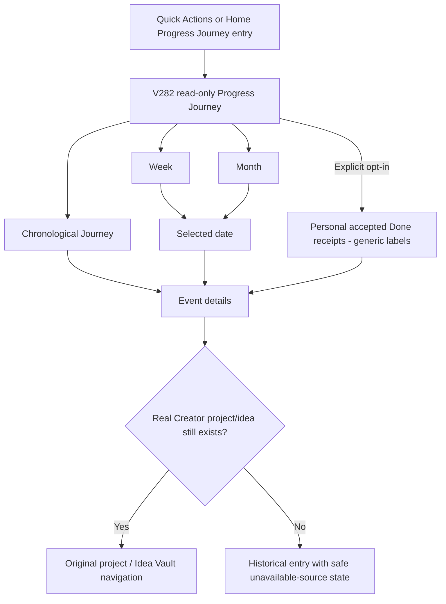

# Backlot UX08A → UX08B — Progress Journey advancement source brief

**Prepared:** 2026-11-17.  
**State:** UX08A design/source contract, **UX08B not yet implemented, compiled or tested**.  
**Exact parent:** UX08A documentation draft, stacked on UX07F PR #416 HEAD `ad8f39ea57ed5ca11b2c359cf5abdc0938220138`.  
**Stable V337 P0:** `815ba69775f75b6e5f25bb838c2c17b4f09c203e` must remain untouched.
**Founder-specified priority:** Make Progress Journey strongly meaningful, interactive, professional, coherent and truthful—preserve existing details and routes; do not restart the design direction.

## 1. Experience to improve

The existing screen `ui/V282ProgressJourneyUi.kt` already has a compact week, full month and chronological journey mode, real Creator project/idea/stage events, event selection, and optional Personal Done events. `ui/V282ProgressHomeStrip.kt` already links it from Home, and `ui/V161QuickActionsHubUi.kt` provides a direct Progress Journey shortcut. Keep all three entry points; do not replace with a new calendar database.

**Product objective:** Users should answer **what did I do, when did it happen, why does it matter, and what could I revisit?** from recorded events, not arbitrary app-use metrics or AI-generated observations.

Recommended visual hierarchy:
- Top: date-aware **Your Journey** header with simple explanatory line, screen Back and discreet privacy state.
- Second: **source-backed active days and recorded events** summary; never call every active day a productivity success or make unsupported streak claims.
- Primary navigation: **Week / Month / Journey** segmented mode using existing state and event projections; keep Today-return and month prev/next where useful.
- Calendar: subtle event indicators differentiated by source; selected day detail below with actual titles/dates from Creator sources, and Generic Private Done for opted-in Personal.
- Event detail: original source type, event time, relevant project/idea deep link (when still present), unavailability fallback if source is stale/deleted. Personal event must not open unrelated Creator work.
- Empty: first-run neutral invitation or actual zero only after successful read. Error: explanation of unavailable history with no data-erasing reset.
- Long history: list virtualization/read-only aggregation where justified, preserve sticky selected date and stable item identities; no new paid analytics provider.

## 2. UX08B exact candidate source scope

| Candidate | Permissible actions | Explicit no-go |
|---|---|---|
| `ui/V282ProgressJourneyUi.kt` | Improve source labels, read/error/loading/empty states, date navigation and selected-day event readability; maintain original project/idea callbacks and explicit Personal include toggle | No task/idea mutation, no event write, no silent publish/XP, no Personal titles |
| `data/ProgressJourneyEngine.kt` | **If necessary**, pure read-only projection helpers or deterministic ordering/timezone rules, independently reviewed | No new canonical timeline owner or data migration |
| `ui/V282ProgressHomeStrip.kt` | Compact source-backed preview, original click/route intact | No private Personal overlay on Home by default |
| New `ui/UX08BProgressPresentation.kt` | Optional stateless small reusable day/event composables and pure derived status | No hidden persistence/network calls |
| `data/CreatorWorkflowTimelineStore.kt` | **Audit only by default**: its current decode failure is silently turned into empty history. A fail-closed read result is a separate owner API/security/recovery approval decision, not an incidental UI refactor | Never auto-initialize empty timeline or rewrite corrupt legacy data |
| `app/src/test/` and `docs/qa/` | Source test cases and later cert evidence definitions | Authored tests != executed PASS |

**Known exception:** The current timeline store `load(taskId)` returns `emptyList()` on a decode exception, so UX08B cannot honestly *guarantee* corruption detection solely from the existing API. Implement visibly safer error handling for actual propagated exceptions and record this underlying limitation. A new typed read contract or recovery-copy policy requires explicit bounded scope and backup compatibility review, and cannot be claimed solved without it.

## 3. Data boundary contracts

1. **Creator project events:** `ProgressJourneyEngine.build(tasks, ideas, timeline, now)` from actual CreatorTask/CreatorIdea/CreatorWorkflowTimelineEvent, with stable `key`; new history UI never writes original tasks or changes stage state.
2. **Personal:** `PersonalReminderStore.completionHistoryFlow` stores actual accepted Done receipt. No other action is a Done. Opt-in is OFF at new screen initialization. Privacy is per-session presentation; review `rememberSaveable` restoration explicitly. Generic event label only, no original reminder/Space name.
3. **21-day Challenge:** UX07E already shows specific source-owned challenge day/notes. Do not automatically merge 21-day targets into Creator Progress Journey. If later approved, each target-day event and actual confirmation time must be labeled distinctly.
4. **Space journal:** Manual check-ins, metrics, notes and photos remain with `V289SpacesDatabase`; viewing is not an achievement, and private notes/photos are never imported into the Creator timeline by default.
5. **Creator rewards:** `CreatorRewardStore` and Progress Journey are not the same. A calendar event, screenshot or scroll is not newly earned XP. UX08C owns the celebration policy and must rely on actual newly credited event feedback, not reconstruct an award from calendar display.

## 4. Proposed flow (preserve current callbacks)

## 5. UX08B QA plan, **deferred until after UX10**

- Historic idea/project/stage events deduped by original source key; Creator deleted/trash events handled according to existing policy, never invented.
- Date correctness: local midnight, timezone change, DST, week/month boundaries, leap day, all-time Journey, short/large histories and future timestamps.
- Week/Month/Journey toggle, prev/next month, selected day, today's return, no wrong project/idea link.
- Creator timeline store read failure vs source truly empty; avoid false "nothing happened" where detectable, document swallowed decoder failures separately as blocker.
- Personal Done privacy opt-in, toggle ON/OFF while collector active, quick close/back and activity restoration: no leak of private names, no visible Personal content when OFF.
- Data projector uses source actual event date; never mint XP, check in a Challenge, update Planner, trigger a reminder or mutate Creator task by viewing.
- 320dp, 200% font, TalkBack, large event lists, tablet/landscape, reduced motion, process death and lifecycle safety.
- UI source test tags and original touch targets preserved; no inaccessible full-width overlay from companion.

## 6. Definition of source-staging done and independent blockers

UX08B can be called **SOURCE-STAGED** only after an isolated draft based on exact UX08A head, expected UI/pure-policy/test/doc diff, and source inspection of all original source-owned callback references. The stage is NOT "tested" until the final unified UX01–10 suite, P0 stable reconstruction, accessibility and owner physical APK pass.

**Separate blocker:** Accepted V337 P0 branch still has 19 commits that are not in UX staging ancestry. Preserve its ledger/readiness/restore and Android test evidence. UX08B does NOT resolve this or change P0 scheduling/backup/auth.

**Handoff beyond UX08B:** UX08C — Creator reward/Personal eligibility/selected companion three-second celebration; persistent Personal XP remains a separate founder choice with privacy/cost/trust assessment.
