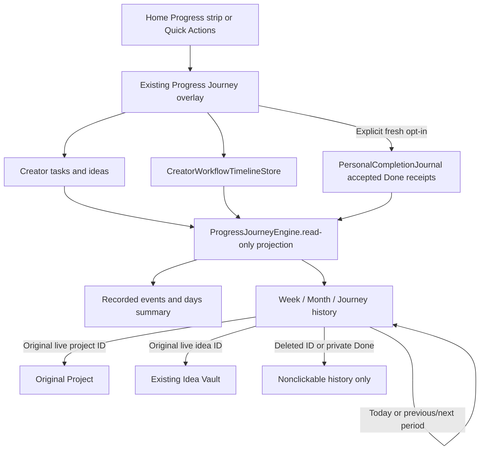

# Backlot UX08B — Progress Journey, source-backed chronology and private history

**Date:** 2026-11-17
**Stage:** UX08B **SOURCE-STAGED DRAFT** only. No Kotlin/Compose compilation, JVM tests, Android instrumentation, emulator/device proof, APK, merge or release.
**Exact parent:** UX08A draft PR #417 at `3dd611a5caf2084bfc56e46624d80d5b5c2a2e2c`.
**Protected accepted P0 owner stable:** `815ba69775f75b6e5f25bb838c2c17b4f09c203e` unchanged. Accepted 19-commit / 22-path V337 P0 delta requires separate integration reconciliation.
**Owner-approved sequence:** UX08B–F, UX09, UX10 source-staged, then consolidated Gradle/JVM/Android/physical acceptance and owner approval.

## 1. Outcome / principles

Progress Journey is **a history of actions actually recorded by Backlot**, not a work timer, health metric, manually awarded XP, future publishing calendar, or replacement CreatorTask/Idea/Timeline store. The existing `V282ProgressJourneyScreen` retains its original Week/Month/Journey modes, date taps, selected-day history, project and Idea Vault callbacks, source-specific Personal privacy toggle and full-screen Back. The Home `V282ProgressHomeStrip` still opens exactly that screen.

UX08B adds calm, useful evidence: per-record counts and number of dates with actual events, accurate week/month navigation, a Today shortcut, source/type labels, real event timestamps and unclickable historical rows when their canonical Creator origin is no longer present. It adds explicit loading and **unavailable** UI for *propagated* timeline/personal read failures without resetting persistent sources.

## 2. Exact source deltas

1. `ui/UX08BProgressPresentation.kt` **NEW**:
   - Read-only `UX08BProgressPolicy.summarize` returns distinct **Recorded Events**, **Days with Records**, **Creator events** and **Private Personal Done receipts** from the provided existing `ProgressJourneyEvent` objects. These are not scores or awards.
   - `forMonth` finds events by calendar month and display zone, rather than inferred publishing frequency.
   - `shiftPeriod` makes previous/next arrows advance **one week** when in Week mode, and one month in Month mode, retaining consistent year/month across crossovers.
   - `canOpen` gates project/idea navigation to a present exact original source ID; Personal Done can **never** be navigated to Creator project.
   - `sourceLabel` produces distinct actual event-kind chips with no invented 'project finished' for a mere stage move.
   - `UX08BJourneySummaryStrip` is compact/quiet, includes source provenance and warns if the saved timeline is partially unavailable. Private Personal receipt count appears **only if user enabled Personal and successfully loaded its journal**.

2. `ui/V282ProgressJourneyUi.kt` **presentation, existing read-state only**:
   - `includePersonal` switches from `rememberSaveable` to fresh `remember { false }`: no stale choice auto-restored after Activity recreation, consistent with user consent/privacy; switch OFF immediately clears in-memory private cache. No persistent permission or backup created.
   - Personal observer explicitly models not yet loaded vs loaded vs unavailable; cancellation is not misreported as a read error. The default Creator view is always available without reading Personal.
   - Timeline `loadAll` handles propagated IO/runtime failures with a **partial Creator-history** warning and project/idea projections; never treats such failures as a confirmed empty history or resets original data.
   - Existing date view chips and Week/Month/Journey modes retained, plus date summary, explicit Today and week-accurate navigation. Restored malformed saved date/month strings get a safe local display fallback without changing any source.
   - Rows show recorded type, title, owner description, and actual zone-formatted timestamp. Navigation is disabled when the original project/idea ID cannot be resolved. Personal Done rows are intentionally non-clickable, titleless and private.
   - Journey mode keeps the historical 100-event display limit but **clearly explains truncation** rather than implying all earlier history vanished.
   - Reduced strict borders, 49dp date targets, explicit test tags and readable fallback text. No new store, timestamp writer or navigation destination.

3. `ui/V282ProgressHomeStrip.kt` **read-only caller polish**:
   - Uses existing Creator workflow store, catches propagated read exceptions without a Home crash, and shows a 'timeline unavailable' message while keeping available project/idea history. Never includes Personal Done or private titles.
   - Keeps original `onOpen` navigation, seven actual event-day markers and no invented streak.
   - Does not alter Home architecture, widget or original Creator events.

4. `app/src/test/java/com/framebynavin/app/ui/UX08BProgressPolicyTest.kt` **NEW, NOT EXECUTED**:
   - Five source tests for recorded event/day distinction, filtered month, crossing week/month transitions, exact source route safety and truthful labels. Full original ProgressJourneyEngine tests are also required later.

5. `docs/qa/UX08B_PROGRESS_JOURNEY_CERTIFICATION_AFTER_UX10.md` **DEFERRED QA matrix**:
   - Test predicates for original source writers, timezones, privacy, errors, UI and accepted P0 reconciliation.
   - No run logs, Android release or QA pass claimed.

## 3. Actual navigation and data flow

**Action ownership is unchanged:** `ProgressJourneyEngine` only projects event metadata; Creator task and Idea mutations remain with their originals, and Personal Done is a real accepted `PersonalCompletionJournal` receipt only. Opening/viewing a Progress calendar cannot mint XP, mark Personal/21-day day Done, reschedule an alarm, create a project, publish a video, delete a photo, or create a backup.

## 4. Honest limitations and known open problem

**KNOWN P1 BLOCKER, not solved in UX08B:** Original `CreatorWorkflowTimelineStore.load(taskId)` currently does `runCatching { decode(taskId, raw) }.getOrDefault(emptyList())`. Thus a syntactically corrupt individual stored timeline segment can be silently projected as empty **inside the owner** even though UX08B detects actual `loadAll` exceptions. Fixing this robustly requires a separately reviewed, non-destructive typed read/diagnostic API with backward compatibility and restore-copy handling. Do not change storage or casually 'fix' by resetting corrupt JSON in a visual milestone.

Other deliberately unresolved limits:
- Initial Creator task/idea loading is owned by the parent VM; these UI-only changes cannot certify a loaded-vs-empty upstream VM snapshot. Source-level rendering does not prove that every historic event is complete.
- Calendar 'now', date and zone update on Compose recomposition. A screen left open over midnight/timezone change may need an explicit lifecycle refresh; **requires device verification** and a scoped future implementation if needed.
- Week and month currently mark days with any real event; they do not distinguish source types by colored dots, make health/streak predictions or claim time spent.
- Journeys show only first 100 most recent events; older events remain in the unchanged source store and need future pagination/search if the founder approves. The UI transparently states the limit.
- A deleted or trashed source can make a historical event unavailable for navigation; no fallback phantom project is created.
- The selected Personal toggle is ephemeral and OFF by default even after Activity restore. This is intentional privacy tightening, not cross-device sync. Notes, photo files and Private Challenge details never enter this journey.
- Visual accessibility and interaction semantics still need TalkBack, 320dp/200% text, tablet/landscape, lifecycle cancellation and physical device acceptance.

## 5. UX08C handoff — achievements and chosen companion celebration

Existing credible pipeline: `CreatorRewardStore.record` / source-backed `CreatorRewardReconciliation` → newly credited `CreatorViewModel.rewardFeedbackQueue` → existing `V22RewardToast`, `V127RewardAura`, stage-gated `V127StageCompletionPulse`. The current toast feedback is consumed after roughly 2.2 seconds. **UX08B does not touch that pipeline**.

For UX08C, implement the user's chosen companion's ~three-second smooth celebration **only for a newly and durably credited authoritative reward**:
- reuse the already selected companion design and settings, not a second avatar or fictitious character;
- do not mint XP from Journey events, browsing, notifications, notes, photos, challenge view, imported ledger, or app restoration;
- handle multiple new events in a bounded queue, reduced-motion, no surprise audio and avoid blocking Personal reminder Done/Snooze;
- **new persistent Personal achievement/XP policy requires founder approval**: default product option to evaluate is private, evidence-based milestones with no shared Creator XP or compulsive streak pressure.
- preserve original existing Creator reward toast, progress and reconciliation; avoid replaying imported or historical event types.

**Exit:** UX08B can be marked **source-staged** after exact stacked PR scope review. P0 branch reconciliation, all JVM/CI/UI/device tests and APK promotion remain mandatory at the post-UX10 gate.
