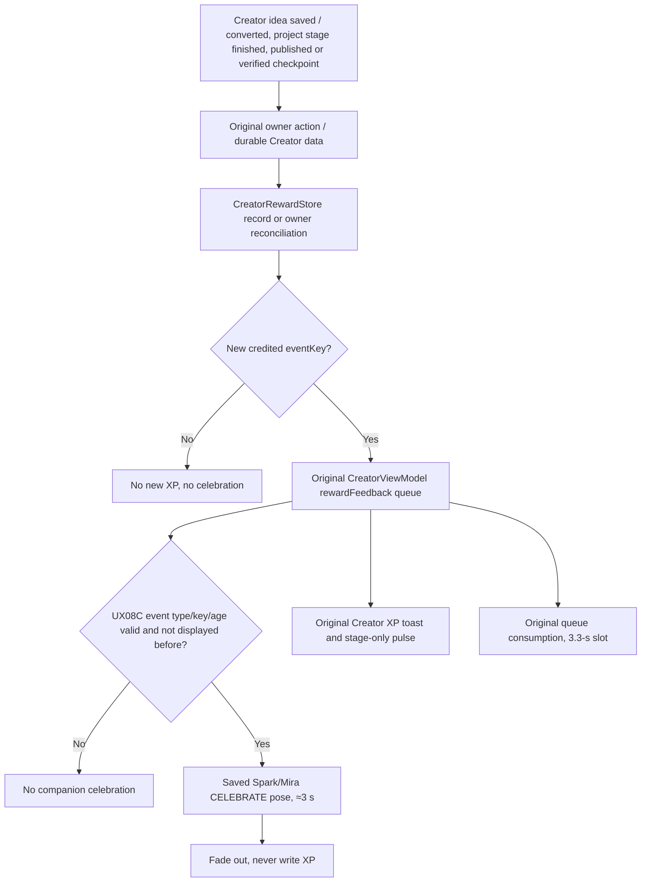

# Backlot UX08C — Credited Creator achievements and selected companion celebration

**Date:** 2026-11-17
**Stage:** UX08C, **SOURCE-STAGED / DRAFT ONLY**, not compiled, JVM-tested, instrumented, emulator-tested, physically certified, merged or released.
**Exact parent:** UX08B draft PR #418, SHA `e56f5b6df5284b88e04d4b667908af1c713a37b5`.
**Protected accepted P0 stable:** V337 at `815ba69775f75b6e5f25bb838c2c17b4f09c203e`, untouched.
**Sequence:** source-stage UX08–10, then unified CI/JVM/Android owner acceptance and **separate V337 P0 accepted 19-commit/22-path reconciliation** before any stable APK. This is a candidate, not evidence of working device animation.

## 1. Delivered source experience

- After a **new and durably credited Creator reward** enters the original `CreatorViewModel.rewardFeedback` queue, the **already selected Spark or Mira** briefly appears in the existing app UI using the original approved transparent **CELEBRATE WebP** for that saved identity. No user-specific character alteration, brand change, new sound file, image-generation asset or new companion selection account.
- Animation: a lightweight, non-modal, non-interactive lower-screen card with restrained fade/scale-in, original companion's existing celebration pose, the genuine earned reward label and XP, then smooth fade/scale-out. Active hold 2.65 seconds + 0.35 seconds exit ≈ **three seconds**. Original top reward toast/aura and stage-only check pulse are preserved.
- Reduced motion: when Android animations are disabled, render the **static approved pose** and retain a roughly three-second static hold with no new haptic, audio, particles or infinite breathing loop. The original existing stage pulse already respects its separate accessibility animation rule.
- The original root reward feedback slot is extended from 2.2 to **3.3 seconds**, so the companion can fade out before queue consumption; no new background worker or persistent event queue is introduced. The original ViewModel remains the single owner of queue size, deduplication and consumption.
- Companion is suppressed for the sensitive Reminders response flow, Quick Actions modal sheet and guided first-run tour, and does not replay later when those take priority. Other Creator screens remain able to show real new credit. The overlay uses **no click handler** and cannot change a reminder, earn XP, confirm an action, edit a project or navigate a user.
- Accessible polite live-region announcement names the selected companion and actual credited XP/label. Target and draw asset must be physically reviewed at 320dp, 200% font, TalkBack and full-screen modal boundaries before release.

## 2. Existing canonical reward pipeline is preserved

The original `CreatorRewardStore.record` uses a transaction/mutex and **stable unique `eventKey`** before accepting a new ledger credit; `CreatorRewardReconciliation` accepts only explicit source-backed project publication/stage/checkpoint evidence. `CreatorViewModel.enqueueRewardFeedback` is in-memory, rejects duplicate queued keys and bounds the queue at four events. *Only that live new-credit feedback*, not full ledger history, flows into UX08C. No new user data or Cloud Supabase changes.

Credited event types remain exactly:
- `IDEA_DAILY_CAPTURE`: original `idea-day:<localDate>` keyed **daily**, not one XP award per every added idea. Every idea-save visual celebration would require a separately reviewed non-XP acknowledgement, not a duplicate reward.
- `IDEA_CONVERTED`: original `idea-converted:<ideaId>`.
- `PROJECT_STAGE_COMPLETED`: original `stage:<projectId>:<stageId>`; only this type may produce existing "Stage Complete" pulse.
- `PROJECT_PUBLISHED`: original `published:<projectId>`.
- `POST_PUBLISH_COMPLETED`: original `post-publish:<checkpointId>`.

The new `UX08CCelebrationPolicy.verifiedFeedback` additionally requires positive XP, nonblank source IDs, matching type-specific key structure, an occurrence timestamp **no more than ten minutes old** and not in the future. These are *presentation safety/freshness checks*; they DO NOT independently prove an event was committed. Proof of new credit resides with the existing original ViewModel feedback enqueue path. The ten-minute gate may intentionally skip delayed/history-recovered feedback rather than replaying old rewards.

The renderer retains at most **32 recent event keys in saved local UI state** to suppress animation replay after configuration recreation. This is no new award ledger. Process death discards the original in-memory reward queue. Separate app starts are not rewarded by opening existing screens.

**No ghost XP or replay:** screen navigation, read-only Progress Journey, notification arrival, reminder Snooze/Dismiss, notes, photo views, opening a dashboard, importing a backup or re-rendering Compose do not enqueue a Creator reward and must never be used to summon this new celebration.

## 3. Source changes / untouched original owners

| Path | UX08C action |
|---|---|
| `ui/UX08CCelebrationPolicy.kt` | NEW pure gate and bounded idempotent recent-key policy; defines three-second timeline; no write |
| `ui/UX08CCompanionCelebrationUi.kt` | NEW nonmodal Spark/Mira celebration; safe queue presentation, saveable 32-key suppression, Android reduced-motion/static artwork |
| `ui/FrameByNavinV101BApp.kt` | Source wiring next to existing stage pulse, reward aura and reward toast. Existing original feedback queue remains primary; slot extended to 3.3 s |
| `app/src/test/java/com/framebynavin/app/ui/UX08CCelebrationPolicyTest.kt` | NEW **unexecuted** pure tests for 5 event types, forged key rejection, stale/future skip, idempotence and timeline |
| `docs/qa/UX08C_REWARD_COMPANION_POST_UX10_CERTIFICATION.md` | Deferred device/privacy/accessibility/genuine XP safety matrix |

Original owners **NOT MODIFIED**: `CreatorRewardStore`, `CreatorRewardEngine`, `CreatorRewardReconciliation`, `CreatorViewModel` and its queue, `V2284StageCelebrationPolicy`, `V127MotionUi`, `V22CreatorRewardsUi`, `V144GuidePrefs` and artwork/sprite files, Original Creator tasks, Personal stores, Spaces/Photo Journal, Groups, Challenge, Android alarm scheduling, manifests, auth/account/sync, backend, billing, backup codecs and V337 stable.

No migration, new permission, new subscription, new logging of sensitive Personal data or generated/public avatar asset.

## 4. Personal achievements — explicitly **not** silently implemented

The owner requested stronger **Creator AND Personal achievements**. UX08C safely completes the Creator new-credit celebration and **protects**, but does not mint, a new Personal reward ledger. Original independent Personal evidence sources are:
1. Exact user-confirmed `PersonalCompletionJournal` Done receipt, not notification delivery or Snooze.
2. `Phase1HabitChallenge.confirmations` per original 21-day **target date**, with true confirmation instant separate for flexible catch-up. Day notes alone NEVER mean completed.
3. Manually confirmed Space activity/metric rows from `V289SpacesDatabase`, not notes or photo views.

**PROPOSED, founder decision pending:** private, non-XP Personal milestones shown read-only from those genuine receipts, with optional muted companion acknowledgement only for **new** explicit owner-confirmed events. No automatic award for healthy/lifestyle targets, no coercive streak pressure, no sharing private titles with Creator XP, no second persistence layer unless the source/retention/privacy policy is approved. Separate Personal XP or shared Creator/Personal points would materially change canonical reward keys, backup, restore, deletion and device-sync rules and is **not authorized by this UX08C source-only PR**.

## 5. Outstanding risks / UX08D handoff

- **Visual device evidence absent:** no actual APK/frame capture yet, so verify sprite fidelity, small-device collisions, toast layering, fade, TalkBack semantics and battery/performance on physical device after UX10.
- The original `V144RasterGuideCharacter` has a subtle infinite pose animation even for existing celebrations; UX08C bypasses it with the static approved sprite when Android animation is disabled. This does not globally rewrite the existing raster animator.
- Existing Creator queue intentionally holds at most 4 events and serializes ~3.3 seconds per feedback; burst events can drop oldest when over capacity. This is unchanged except slot duration, and should receive a physical usability/latency review before any increase in queue capacity.
- `rememberSaveable` stores only bounded **Creator event keys** for on-screen replay suppression, not reward history or Personal content. Test config recreation mid-display and accessibility.
- A foreground alert or another modal arriving while celebration is active must suppress/hide the companion and never alter the original owner actions.
- All status is **SOURCE-STAGED**. Final V337 P0 accepted corrections, all post-UX10 CI/JVM/Android/physical certification and founder release permission are unresolved.
- **Next UX08D:** truthful, priority-based **Daily Brief 2.0** grounded in `CreatorDailyBriefEngine` and original `V15DailyBriefScreen`; no paid AI calls, no invented deadlines, no cloud migration.
