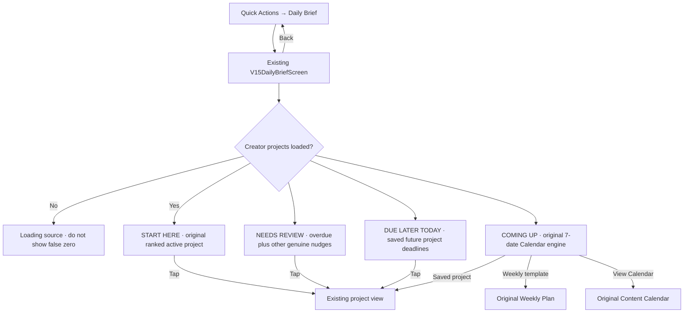

# Backlot UX08D — Daily Brief 2.0: real priority, review and upcoming work

**Prepared:** 2026-11-17.
**Stage:** UX08D **SOURCE-STAGED DRAFT**, not compiled, JVM/instrumentation-tested, visually/device validated, merged, APK-built, stable-promoted or released.
**Exact parent:** UX08C draft PR #419, head `d5d36ae335d8b04288bd956858ad6cfe5995d043`.
**Owner-accepted stable:** V337 P0 `815ba69775f75b6e5f25bb838c2c17b4f09c203e` untouched; 19 accepted P0 commits affecting 22 paths require separate final reconciliation with the staged UX stack.
**Founder direction:** source-stage each approved UX item and save the unified Gradle/CI/JVM/Android/manual physical suite until UX10, while keeping existing buttons/data owners intact.

## 1. Product outcome

Turn Daily Brief from a short count-and-card summary into a **Creator daily decision workspace** without manufacturing work or requiring a paid AI service. It must answer:

- **Where should I start?** One genuinely ranked active saved Creator project, with its original workflow next action and grounded recommendation, opening the actual project.
- **What needs review?** The real active projects past their saved deadlines, plus remaining genuine Creator context nudges. Other lists do not repeat the primary focus project.
- **What is due later today?** Original active projects whose deadlines are still ahead on the device-local date; no conflation with projects completed or archived.
- **What's coming up?** Source-backed de-duplicated Creator Calendar project and Weekly Plan occurrences after today, over the existing rolling seven-date window, with original project versus weekly-template routing.
- **What if there's no work?** Distinguish projects still loading from an actually loaded empty Creator queue; retain quick access to Weekly Plan and Content Calendar.

This is **not** a content recommendation chatbot, a publishing-status crawler, a replacement Creator analytics timeline, a new reminder scheduler or an automated task creator. The user can make genuine changes only after opening the original source.

## 2. Exact changed source and protected owners

| Path | UX08D change | Source-of-truth protection |
|---|---|---|
| `app/src/main/java/com/framebynavin/app/ui/UX08DDailyBriefPresentation.kt` | New read-only `UX08DDailyBriefPolicy.build` groups canonical ranked active tasks, real overdue work, later-today deadlines, other original nudges and original next-7-date Calendar entries, with bounded first 3/4/3/6 rows and full source counts. Stateless `UX08DBriefSectionHeading` and `UX08DBriefProjectRow` use original project IDs | No new tasks, data store, alarm, notification, score, reward or content calendar writer |
| `app/src/main/java/com/framebynavin/app/ui/V15ContextUi.kt` | Replaces **Daily Brief UI section only**, retaining `V15DailyBriefScreen` signature plus optional `projectsLoaded`, original `V15BackHeader`, metrics, Next action, nudge, calendar row and project/Weekly Plan/calendar callbacks. Includes selected focus, authentic review/today/upcoming, clear separate source/reminder meanings, bounded-list explanation and accessible tap rows | **Original Content Calendar composable and `V15CalendarRow` are untouched**, as are all original Creator project and weekly mutations |
| `app/src/main/java/com/framebynavin/app/ui/FrameByNavinV101BApp.kt` | Passes existing public `vm.tasksLoaded` status so a still-uninitialized Creator project list is not falsely displayed as a successful empty account | No new navigation destination; same `POverlay.DAILY_BRIEF`, `::openProject`, `POverlay.WEEK`, `POverlay.CALENDAR` |
| `app/src/test/java/com/framebynavin/app/ui/UX08DDailyBriefPolicyTest.kt` | NEW six source tests, **NOT RUN** until post-UX10 | Existing Creator engine tests and full device suite still required |
| `docs/qa/UX08D_DAILY_BRIEF_CERTIFICATION_AFTER_UX10.md` | Deferred owner/UI/privacy/upgrade and P0 regression cases | Documentation only |

Canonical sources are unchanged: `CreatorPriorityEngine.rankActive/recommendation`, `CreatorDailyBriefEngine.build`, `CreatorContextNudgeEngine.nudges`, `CreatorContentCalendarEngine.upcoming` with `WeeklyScheduleEngine.upcomingOccurrences`, `CreatorCalendarNavigationPolicy.isProjectLink`, actual `CreatorViewModel`, Creator tasks/ideas and Weekly Plan DataStore.

**Exact owner semantics:**

- **ACTIVE:** projects in saved PLANNED/WORKING status, not archived. DONE, SKIPPED and archived are excluded from urgent active tasks.
- **DUE DATE TODAY:** same local date as the current time; as in the existing Creator Daily Brief engine, this can include a deadline that passed earlier today. The UI says so explicitly. **PAST DEADLINE:** all active projects with a saved positive due time earlier than now. This is not proof of a missed notification.
- **START HERE:** the highest-ranked active Creator project according to the *existing* owner scoring. UX08D does not change task priority or stage.
- **NEEDS REVIEW:** saved positive deadline in the past plus original context signals. Primary focus is shown first and not duplicated as another row. If there are more than shown, the UI admits truncation instead of implying complete coverage.
- **DUE LATER TODAY:** future active deadline on the same local date, with focus excluded from secondary cards but counted in the total.
- **COMING UP:** original `CreatorContentCalendarEngine` seven-date projection, filtered to tomorrow onwards. A saved project with an occurrence key **supersedes** a weekly-plan preview with the same identity. Weekly template opening routes back to Weekly Plan and never invents a CreatorTask.
- **CREATOR REMINDERS:** the existing `brief.reminderCount` counts configured active Creator project reminder timestamps in the next 24 hours. The UI explicitly says these are *configured reminder times*, **not** confirmed Android alert delivery, Personal reminders, Challenge receipts or completed project work.

## 3. User flow and original route preservation

No new buttons delete, complete, reschedule, Snooze, skip, publish or auto-create an original project from the Daily Brief. Users must intentionally enter the existing source writer to make changes. The original Quick Actions / Daily Brief / Weekly Plan / Content Calendar entry links are preserved.

## 4. Responsiveness, loading and honesty

- The Brief uses fewer heavy boxes: compact source/status text, low-key section dividers/surfaces and task rows with minimum 54dp touch targets. The original app typography and Director's dark theme remain.
- It renders up to **3 secondary overdue**, **4 secondary due later today**, **3 remaining genuine nudges** and **6 next calendar items**; full original counts are separately provided, and the user can visit the original Project workspace or calendar. No database entries are trimmed or re-sorted in persistence.
- On an initial `vm.tasksLoaded == false` state, present a loading state rather than showing zero. **Limitation:** `CreatorViewModel.weeklyLoaded` is currently private; UX08D cannot independently prove a complete Weekly Plan read. A failed upstream Creator task read that sets `tasksLoaded=true` also needs a separately reviewed typed-error contract. No reset of missing/corrupt data or false cloud-sync promise.
- Current date and time are captured when Compose renders; expected re-open/recomposition refresh. A continuously open screen over midnight or zone change still needs the post-UX10 lifecycle/timezone device gate; it is not claimed solved by adding more UI.
- A dated publishing plan is not a confirmed published video. Progress Journey and Creator rewards are separate, and opening the Brief never grants XP.

## 5. UX08E and certification handoff

**Next UX08E: Content Calendar 2.0.** The underlying `V15ContentCalendarScreen` still uses 14-day `CreatorContentCalendarEngine.upcoming`, date chips, overdue project rows and exact Calendar Navigation policy. UX08E may improve its Month/Week/Agenda information hierarchy, active/finished source status, date selection and project versus weekly-template navigation, while protecting `scheduleOccurrenceKey` dedup and not editing tasks by viewing.

**Post-UX10 blockers:** Reconcile accepted V337 P0 corrective 19-commit/22-path branch delta; compile all Kotlin and Compose sources including UX08B–D; run owner and new source policy tests; instrument actual Creator navigation, Android alarm/notification regressions, Personal confidentiality, backup/upgrade and 320dp/200%/TalkBack; physically certify exact APK and founder authorize stable promotion.

**Current verdict:** SOURCE-STAGED / UNTESTED. No new fees or subscriptions. No merges, stable changes, user data deletion or production release.
