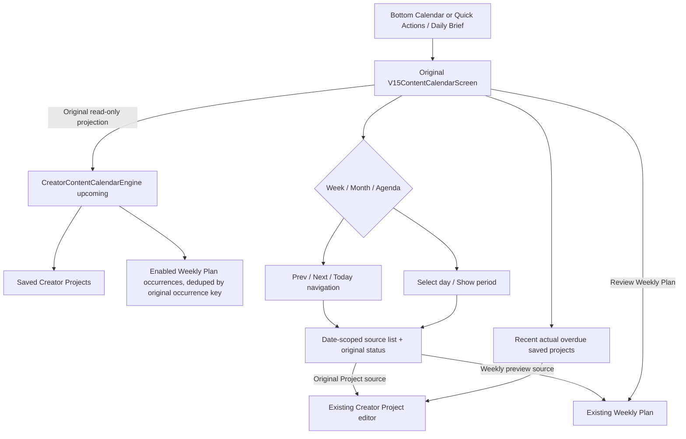

# Backlot UX08E — Source-backed Content Calendar 2.0

**Date:** 2026-11-17.
**Stage:** **SOURCE-STAGED / DRAFT ONLY**. No Kotlin or Compose compilation, Gradle/JVM suites, CI, Android instrumentation, physical device tests, APK, merge or release.
**Exact parent:** UX08D draft PR #420, head `f3e1e3882be3fafa8e563030a759c4855d101a3d`.
**Owner-accepted stable:** V337 P0 `815ba69775f75b6e5f25bb838c2c17b4f09c203e`, unchanged.
**Mandatory integration blocker:** V337 owner-accepted 19-commit / 22-path corrective delta is outside the UX draft ancestry. Do not imply it is resolved; reconcile the accepted P0 ledger/readiness/restore/Android tests at the final owner-authorized candidate gate.
**Founder workflow:** source-stage all approved UX points, then the single unified UX01–UX10 build, JVM/CI, Android, real-device and founder signoff campaign. No interim fake certification.

## 1. Scope and product decision

The original `V15ContentCalendarScreen` already showed 14 rolling date chips, original saved Creator deadlines, real weekly occurrences, recent overdue projects and original Project/Weekly Plan navigation. The existing `CreatorContentCalendarEngine.upcoming` correctly avoids displaying a weekly occurrence twice when a materialized CreatorTask owns that exact `scheduleOccurrenceKey`. UX08E **improves the presentation and navigation over that source** without creating a competing Calendar DB, inventing publication status, changing alarm schedules or duplicating weekly-plan projects.

**Delivered source experience:**
- **WEEK:** Monday–Sunday date cells with source-distinct dots, one-week previous/next buttons, direct day filter, Today reset, and the real period items below.
- **MONTH:** compact six-week Monday-first calendar grid with actual project-versus-weekly preview indicators, prev/next month bounded to the supported horizon, date selection, and original source-backed period list.
- **AGENDA:** the original rolling 14-date focus becomes a navigable 14-day window with horizontal day chips. Tapping a day filters within the **same anchored 14-day window** instead of unexpectedly sliding the entire period; the "Show period" action restores the complete window.
- **Source legend and counts:** separate real Creator project deadlines and original Weekly Plan previews; a separate count for saved projects whose *app status* is Done. Never call that an externally verified YouTube publication.
- **Overdue protection:** original `CreatorCalendarNavigationPolicy.recentOverdue` list remains a distinct "past-due projects" section (last 14 days, max six visible), never confused with future Weekly Plan templates. Original project taps and Weekly Plan taps remain.
- **Graceful empty/loading:** `vm.tasksLoaded` drives both original bottom-tab and Quick Actions overlay entry routes; unread/uninitialized Creator projects don't render as an authoritative empty calendar. No fake "zero published" result.
- **Privacy and cost:** local, read-only projection only; no new paid AI source, backend request, User Persona analytics, Creator XP award, Personal content title, cross-device sync or schema migration.

## 2. Source ownership and bounded source changes

| File | Delta | Protection |
|---|---|---|
| `ui/UX08ECalendarPolicy.kt` | NEW pure `UX08ECalendarView` WEEK/MONTH/AGENDA, planning horizon, day/month/week windows, 42-cell Month grid, safe boundary navigation, read-only Calendar source counts and selected-date filtering | Never writes tasks, schedules, alerts, weeks or Creator reward events |
| `ui/UX08ECalendarNavigationUi.kt` | NEW restrained calendar view selector, source-color day indicators, Week/Month/Agenda controls, Today/prev/next, disabled unsupported past/future dates, 48dp+ targets, accessible date/test tags | No new persisted state, no route to Personal or Creator reward writer |
| `ui/V15ContextUi.kt` | MODIFIES ONLY original `V15ContentCalendarScreen` presentation and optional `projectsLoaded`; preserves `V15CalendarRow`, overdue `V163OverdueProjectRow`, all original project/Weekly Plan callbacks, `V15DailyBriefScreen` from UX08D | All Creator core stores, Weekly Plan engine and Daily Brief priority logic unchanged |
| `ui/FrameByNavinV101BApp.kt` | Existing PTab.CALENDAR and POverlay.CALENDAR pass public `vm.tasksLoaded`; all other app routes stay as before | No new root navigation, project mutation or widget/new notification |
| `app/src/test/java/com/framebynavin/app/ui/UX08ECalendarPolicyTest.kt` | NEW 8 deferred pure policy tests | Nothing run until founder-approved final gate |
| `docs/qa/UX08E_CONTENT_CALENDAR_CERTIFICATION_AFTER_UX10.md` | Deferred acceptance matrix | Documentation, not PASS |

Unchanged original engines:
- `CreatorContentCalendarEngine.upcoming`: from current device-local date, generates actual non-archived/unskipped saved projects with valid deadlines and currently applicable enabled weekly occurrences; dedupes templates against saved `scheduleOccurrenceKey`.
- `WeeklyScheduleEngine.upcomingOccurrences`: original schedule cadence, weekly source stable IDs, real date and time, no creation on viewing.
- `CreatorCalendarNavigationPolicy.isProjectLink`: project rows use original saved task ID; weekly previews route to original Weekly Plan.
- `CreatorViewModel`, task database, V15CalendarRow and V163OverdueProjectRow, reminder scheduler, rewards, alert delivery and backup owners.

### Planned window semantics

The UI now requests a fixed, bounded **90-calendar-date projection from today** from the **existing** `upcoming` engine. It is a live planning window, **not** 90 new materialized projects, a full-history archive, or guaranteed events beyond the 90th date.

- Month view can navigate months intersecting the future 90-date horizon; past days and dates beyond the horizon are disabled/unselectable and **not marked as "no historic work"**.
- Week view uses Monday-to-Sunday local dates; previous/next only when some part of target week intersects the supported horizon. Its real filtered items still require date within the 90-date source.
- Agenda uses 14 dates anchored by period arrows / Today. A chosen day filter is separate from the period anchor; its day selection does **not** slide date chips.
- Local selected dates and mode are presentation-only Compose saveable state; original Creator task/weekly states are never modified when the user navigates or changes calendar modes.
- Calendar items are original events with source-provided timestamps. Some projects marked Done can legitimately display a same-day past deadline; this is an original engine compatibility behaviour. Past due *active* projects remain a separate last-14-day list.
- No backfill/retrieval of past publish receipts: use Progress Journey for recorded history, not this future-plan calendar. UX08E intentionally does not invent "published" based on dates alone.

## 3. Preserved end-to-end action flow

Original source routes remain: **PTab.CALENDAR and POverlay.CALENDAR**, `onClose`, `onOpenProject(taskId)`, `onOpenWeeklyPlan()`, and exact original row routing. The new navigation does not mark a project Done, create a weekly materialization, reschedule a publish time, change settings, deliver a notification, mint XP or disclose Personal Done/Space journal notes.

## 4. Honest limitations and integration risks

- **Weekly source health:** `CreatorViewModel.weeklyLoaded` remains private, and upstream Calendar/Weekly stores don't yet expose a typed "verified empty vs unavailable" result. `projectsLoaded` avoids early *project* false empty but cannot guarantee successful Weekly Plan reads. This is a reliability contract gap, not a secretly solved loader.
- **Calendar/history semantics:** the engine is intentionally upcoming-only. Dates in the past are not a historical "zero"; row completion reflects app state, not verified external publication.
- **Refresh:** current local time/date is recalculated on Compose recomposition, but an idle screen spanning midnight or device zone changes may need explicit lifecycle/clock refresh. Must be verified on Android; do not claim now-driven magic polling.
- **90-date cost:** 90-day weekly recurrence generation and Month 42 cells require benchmark on low-end devices/large week schedules; no background worker. The 90-date projection is regenerated on source recomposition and should remain reasonable. UX10 must review layout density, 320dp/200% font and tablet orientation.
- **Calendar browse versus mutating overdue actions:** the calendar's overdue rows open the original saved project; they do not bypass existing project editor/confirmation.
- **P0 integration:** accepted V337 Snooze, delivery ledger, restore and Android 15 regression paths must be reconciled separately. All project/event source history must survive upgrade/rollback and backup; no new credentials, changes to stable/main or unreviewed merge.

## 5. Next stage — UX08F

UX08F is the **bounded Quick Actions hierarchy and cross-screen integration review**, not a replacement task manager or another calendar. It should:
1. Preserve all original Quick Actions buttons and overdue `+30 min`, `New time`, `Skip` task mutations and confirmations.
2. Make Progress Journey, Creator Progress, Daily Brief 2.0 and Content Calendar 2.0 easy to find with consistent density, source labels and navigation, without adding duplicate routes.
3. Audit UX08A–E source invariants, open P0/typed-source limitations, TalkBack and empty/loading/permission cases, and prepare the UX09 multi-device sync handoff **without silently altering backend/account configuration**.
4. Keep stage draft and defer real Gradle/CI/JVM/Android physical QA, accepted V337 P0 integration and stable release until the founder-approved post-UX10 gate.

**Current verdict:** UX08E source-staged and untested, no physical APK or stable changes.
