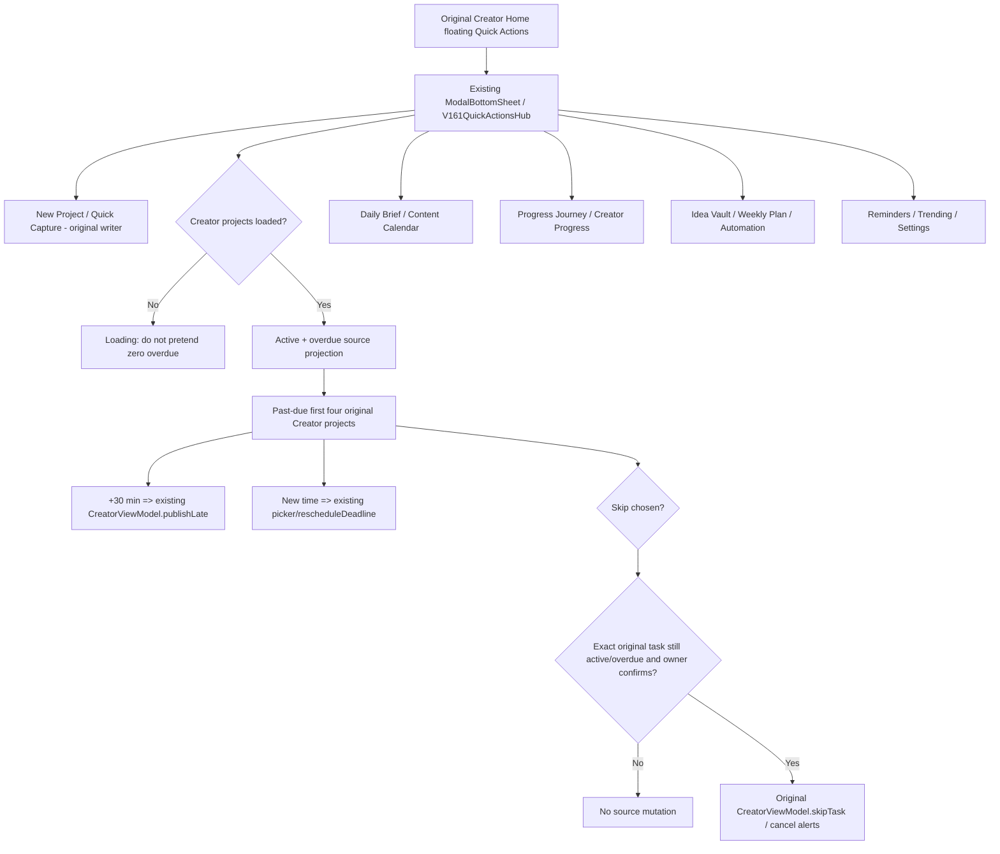

# Backlot UX08F — Quick Actions integration, source-safe actions and final UX08 handoff

**Audited / staged:** 2026-11-17
**Stage:** **SOURCE-STAGED / DRAFT ONLY**. No Kotlin/Compose build, Gradle, JVM, CI, instrumentation, emulator, physical APK certification, merge or release is claimed.
**Exact staged parent:** UX08E draft PR #421 at `a1c13694bd0ce2a546b7912c780b00a137f6732f`.
**Protected owner-accepted stable:** V337 P0 at `815ba69775f75b6e5f25bb838c2c17b4f09c203e`, unchanged.
**Blocker:** 19 accepted P0 correction commits on stable touching 22 paths remain outside cumulative UX draft ancestry and MUST be independently reconciled before an integrated APK, testing and stable release.
**Founder directive:** Source-stage approved UX01–UX10 changes in discrete drafts, THEN run the consolidated unit/CI/Android/physical certification and explicitly approve any promotion. Do not redefine source-staged as built/tested.

## 1. Product decision / finished source experience

Quick Actions is a compact **navigator + a small number of original task actions**, not a second data store or creator operating system. UX08F keeps the existing **full-height `ModalBottomSheet`** from `FrameByNavinV101BApp.kt` and original `PControlCenter` / `V161QuickActionsHub` callback chain, but makes the top choices immediately legible and connects the UX08A–E advances at their **existing** destinations.

- Top primary buttons remain **New Project** and **Quick Capture**, still opening the original composer and durable capture source.
- The top read-only status shows **active saved Creator projects** and **past-deadline active projects** from `CreatorTask` state. A still-uninitialized `vm.tasksLoaded=false` shows an honest loading message rather than authoritative zero; original quick action buttons remain available.
- If present, the existing earliest four overdue projects show their original `+30 min`, `New time`, `Skip` controls. When more than four genuine saved projects are past their deadline, an extra **Review all in Daily Brief** button opens that existing surface; no duplicate task editing workflow is introduced.
- The original `Skip` button now requires an explicit confirmation: it marks **the same exact active overdue project** as SKIPPED and disables its original Creator reminder configuration via the **existing `CreatorViewModel.skipTask`**. The dialog explains that the project is retained, not deleted. A stale, removed, archived, rescheduled, completed or duplicate-ID item cannot confirm. Dismissing the dialog makes no original write. `+30 min` and `New time` continue to use the original `publishLate` and time-picker/`rescheduleDeadline` callbacks.
- Link groups are reordered into **YOUR DAY** (Daily Brief 2.0 and Content Calendar 2.0), **CREATE & ORGANIZE** (Idea Vault, Weekly Plan, Automation), **YOUR PROGRESS** (Progress Journey and Creator Progress), **REMINDERS & RELEASE** (Reminders and Trending Moment), followed by original Settings. Every original action is visible without hidden expanders, even when no project is overdue.
- The existing route/test tags remain exactly intact; the layout keeps large 64dp shortcut row tap heights and original narrow-screen primary stacking. Secondary shortcut borders and radii are subtler without making buttons invisible. No globally changed typography/theme or new product feature.
- Progress Journey's genuine historical events/private opt-in, Creator Progress's ledger-derived XP/achievements, UX08C chosen Spark/Mira 3-second celebration, UX08D real Daily Brief priorities and UX08E Week/Month/Agenda calendar all operate through their original routes. No duplicate analytics, award or calendar engine.

**Do not confuse a polished Quick Actions shortcut with a verified app:** none of these UX08 changes have been compiled, device-tested or certified as an integrated product yet.

## 2. Source modifications and untouched code

| File | Exact change | Guard |
|---|---|---|
| `app/src/main/java/com/framebynavin/app/ui/UX08FQuickActionsPolicy.kt` | NEW pure active/overdue projection with sorted first-four preview, strict original-ID + live-task eligibility for Skip confirmation, immutable registry of the twelve required original shortcut tags | No persistence, alarm/notification/XP write, no second project owner |
| `app/src/main/java/com/framebynavin/app/ui/V161QuickActionsHubUi.kt` | MODIFY original sheet **content only**: status, loading, grouped actions, original callbacks, lightened borders, source-aware copy, original Skip confirmation | Keeps all 12 source test tags and 3 overdue action callbacks |
| `app/src/main/java/com/framebynavin/app/ui/FrameByNavinV101BApp.kt` | Passes public `vm.tasksLoaded` through existing `PControlCenter` to `V161QuickActionsHub`, with original sheet, overlays, exact route commands, reward feedback/companion overlays unchanged | No new root destination, alarm, auth or backup writes |
| `app/src/test/java/com/framebynavin/app/ui/UX08FQuickActionsPolicyTest.kt` | NEW six pure policy regression source tests; **NOT EXECUTED** | Cannot substitute for real clickable/UI/Android integration tests |
| `docs/qa/UX08F_QUICK_ACTIONS_CERTIFICATION_AFTER_UX10.md` | Deferred real-device UI/mutation/privacy/P0 regression matrix | Documentation only |
| `docs/engineering/UX08F_INTEGRATION_AUDIT_AND_UX09_SYNC_HANDOFF.md` | Full UX08A–F handoff with existing cloud synchronizer facts, unresolved source limitations and UX09 phased implementation gates | No config/credentials/sync schema changes |

**Explicitly unchanged:** `CreatorViewModel.skipTask/publishLate/rescheduleDeadline`, `CreatorPriorityEngine`, `CreatorDailyBriefEngine`, `CreatorContentCalendarEngine`, `CreatorRewardStore`, `CreatorRewardReconciliation`, Personal/Challenge/Spaces/Groups storage, manifest, Android scheduling and full-screen reminders, Creator cloud APIs, RLS, Supabase credentials, backup/restore and V337 stable/main.

## 3. Actual quick route matrix (all original test tags retained)

| Shortcut tag | Original callback | Source / user effect |
|---|---|---|
| `quick-action-new-project` | `onNewProject` | Opens original project composer; browsing does not create a project |
| `quick-action-quick-capture` | `onQuickCapture` | Opens existing idea capture and durable save owner |
| `quick-action-daily-brief` | `onDailyBrief` | Original `POverlay.DAILY_BRIEF`; UX08D source-backed focus/review/today/upcoming |
| `quick-action-content-calendar` | `onCalendar` | Original `POverlay.CALENDAR`; UX08E Week/Month/Agenda projection |
| `quick-action-idea-vault` | `onIdeas` | Original Idea Vault tab and data |
| `quick-action-weekly-plan` | `onWeek` | Original Weekly Plan; only source editor manages recurring slots |
| `quick-action-automation` | `onAutomation` | Existing Automation editor/controls |
| `quick-action-progress-journey` | `onProgressJourney` | Original UX08B historical progress; Personal Done opt-in only |
| `quick-action-creator-progress` | `onCreatorProgress` | Original ledger XP/levels/achievements and UX08C live reward celebration |
| `quick-action-reminders` | `onReminders` | Original Creator and Personal Reminders owner |
| `quick-action-trending-moment` | `onRelease` | Original release-day/trending flow |
| `quick-action-settings` | `onSettings` | Original Settings/Account/Permissions surfaces |

Overdue controls are **not** cosmetic: `onPublishLate(id)` adjusts original Creator due date and schedules appropriate reminders; `onReschedule(id)` opens the original time picker and invokes the same validation/store; `onSkip(id)` changes exact original saved task status, clears reminder configuration and cancels alerts. UX08F adds only a pre-confirmation for Skip. No new mutation endpoint.

## 4. End-to-end workflow

## 5. Known limitations, risk boundaries and next UX09

1. `vm.tasksLoaded` is public and wired. `weeklyLoaded` and independent Idea/reward-ledger readiness are not all public typed UI contracts, so Quick Actions may still show a partial Idea/XP preview during first load; don't claim complete two-device parity or true zero without owner API improvements.
2. The Quick Actions read-only status uses `System.currentTimeMillis()` at recomposition. Idle-after-midnight/timezone changes and long-open deadline transitions need owner lifecycle/device testing; no background polling service is introduced.
3. Skip confirmation rechecks exact ID, archived/active status and the overdue boundary **immediately before invoking original callback**, but concurrent asynchronous source mutation can race between the UI check and owner write. At final integration gate, test source mutation races and consider a separately approved owner-level conditional write if necessary.
4. UX08B original Creator timeline decoding may swallow corruption into a false empty history (separate typed-read contract unresolved). UX08C Composer/Recomposition/selected companion animation is source-only, not physical evidence. UX08D/E Weekly Plan read-health contract remains incomplete.
5. Personal progress/achievements currently do **not** share Creator XP. A new persistent Personal achievements ledger remains founder-gated, not implemented by the Quick Actions integration.
6. Accepted V337 P0 divergence, Challenge v3 compatibility, restore/backup, Privacy, permissions, full-screen delivery, alarms, Android 15 and physical APK QA remain NO-GO until the separate post-UX10 integrated campaign. No paid provider, subscription or external feature added by UX08F.
7. **Next UX09:** Multi-device sync. Actual existing cloud implementation is snapshot/revision-based with conflict gates, not automatically per-record two-device synchronization. UX09 starts with an exact auth/coverage/RLS/migration and cost inventory, without silently switching Supabase projects or exposing credentials. See `UX08F_INTEGRATION_AUDIT_AND_UX09_SYNC_HANDOFF.md`.

**UX08F verdict:** Quick Actions source stage ready for isolated draft review. UX08A–F source implementation is staged in drafts, **not compiled, tested, merged or released**. Founder still controls all major architecture, backend and release choices.
