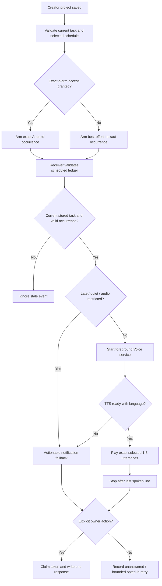
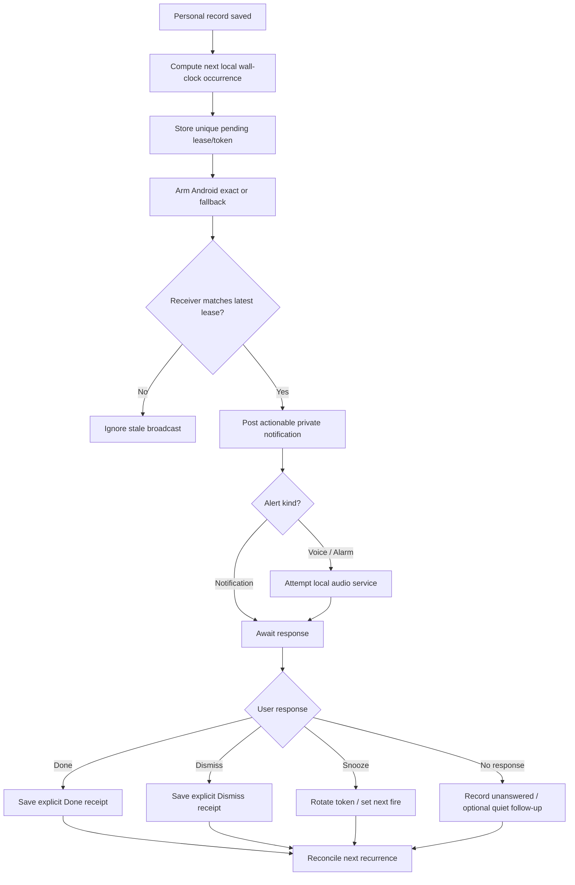
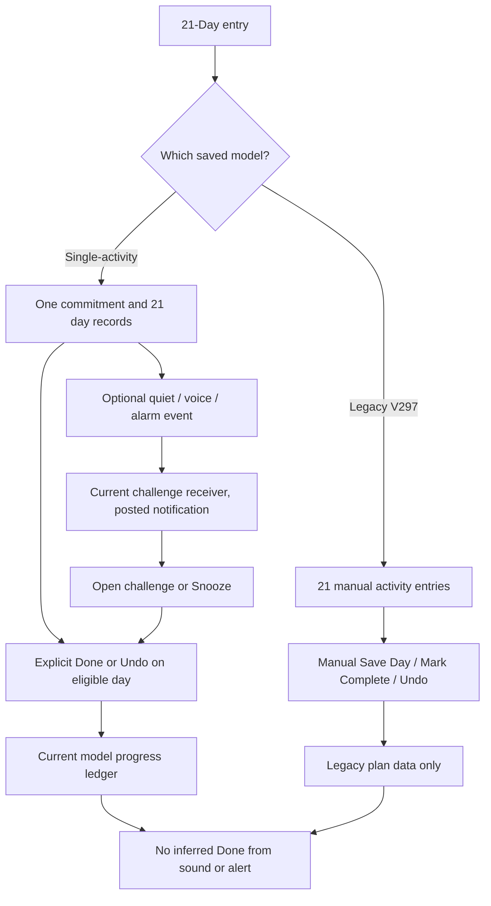

# Backlot UX06A — Reminder Actions, Delivery States and Deferred Certification Matrix

**State:** DOCUMENTED, NOT RUN — source contract and post-UX10 QA plan.
**Applicable source:** cumulative UX05.1E PR #402 at d9a4ef8271c34947ce238024dc31b9413bf47870, plus future UX06 changes.
**Protected stable:** V337 remains unchanged.
**Owner-approved test timing:** consolidated verification after UX10. Source review does not imply any runtime pass.

## A. Action outcome contract: distinguish the domain and the surface

| Domain / source | Primary action | Snooze/reschedule semantics | Dismiss/pause | History invariant |
|---|---|---|---|---|
| Creator ordinary regular alert notification | STARTED / I'M WORKING | Snooze valid project minutes; new occurrence | Dismiss reminder, never Done | One accepted explicit response; no duplicate |
| Creator stage check-in full-screen | STEP DONE only when project stage gate allows; else I'M WORKING | Live Smart stage Snooze postpones/repeats reached stage while preserving final target; regular Snooze changes reminder time | Pause Check-ins, Dismiss for Now, Reschedule when permitted | Stage completion needs authoritative workflow, publication verification, reward receipt and token |
| Creator Reminder Center pre-fire | Tap opens editor; long press selects | Snooze moves *future target* relative to current planned target and validates deadline/Smart window; Change Time is explicit | Pause for 2h where eligible, Turn Off Reminders retains project | Must not mark project working/done merely by editing |
| Personal notification / full screen | DONE | Exact pending occurrence can snooze user-selected minutes; reschedule distinct | DISMISS WITHOUT COMPLETING; Pause/Resume from hub | DONE and DISMISSED are different PersonalResponse values |
| Personal recurrence | No implicit Done at next cadence | One snoozed occurrence is distinct from future cadence | Pause blocks new eligible occurrences; no data deletion | Last acknowledged, missed and last response timestamps remain factual |
| New 21-day single-activity challenge | User confirms actual day Done in dashboard | Notification SNOOZE 10m and dashboard selected-day snooze, guarded by challenge state | Pause/Resume, archive/restore, delete with explicit confirmation | Only explicit Done creates completion receipt; Strict/Flexible mode enforces historical date rules |
| Old V297 21-day planner | Manual MARK DAY COMPLETE | No automatic alarm delivery or Snooze | Undo, Archive/Restore, private export/import | Daily activities and completion receipts distinct; no migration |
| Idea Vault | OPEN, MAKE PROJECT | Notification SNOOZE 3H, configured 3h/6h/tomorrow/daily/custom | STOP | Opening idea alone does not prove work done |

**UI guidance:** Word choices follow action meaning, not merely reusable labels. 'Snooze' on a live alarm may be appropriate; pre-fire Smart 'Move reminder target' is more truthful. Keep Back/close separate from action; closing a surface must not create a Done receipt.

## B. Truthful delivery state model for shared read-only UX

1. CONFIGURED: validated record is saved; *not* evidence that Android accepted an alarm.
2. ARMED_EXACT / ARMED_APPROXIMATE: known AlarmManager arm attempt accepted; describe approximate timing where exact permission is denied.
3. OS_FIRED: current receiver matched a live record/lease and expected schedule; *not* a notification posting or sound receipt.
4. NOTIFICATION_POSTED: NotificationManager post returned in the tracked current occurrence; not proof a person saw it.
5. AUDIO_REQUESTED: service start was attempted; not equivalent to speech output.
6. AUDIO_ACTIVE: foreground service accepted and attempted sound; distinguish from TTS SPEAKING/RINGING where evidence exists.
7. AUDIO_FINISHED: last utterance/ring timeout; not an acknowledgement or completion.
8. RESPONDED_DONE / RESPONDED_WORKING / RESPONDED_DISMISSED / RESPONDED_SNOOZED / RESPONDED_PAUSED / RESPONDED_RESCHEDULED: only after the authoritative store write and token claim have succeeded.
9. UNANSWERED: no valid response was recorded in the eligible window, including after audible playback stops. Do not call it 'ignored'.
10. DEGRADED / BLOCKED: denied notifications, no exact alarm permission, no full-screen access, channel muted, unavailable TTS/locale, FGS failure, inaccessible local music.
11. UNKNOWN: missing or corrupt evidence; never infer success from absence of an error.

**Do not replace existing local receipt formats in UX06A.** Future UX06E may project these states using a new read-only adapter after tracing all domains and defining privacy. UI should not display unimplemented states as confirmed facts.

## C. Flow A — Creator scheduled Voice with recovery

## D. Flow B — Personal recurrence and response

## E. Flow C — 21-day current vs legacy

## F. Explicit post-UX10 certification cases

| ID | Fixture / trigger | Expected behavior / failure condition | Domain |
|---|---|---|---|
| R01 | Creator repeat 1,2,3,4,5 selected and saved | VoiceService count, Intent reconstruction, Preview and Activity display agree; repeat speech exactly N times | Creator |
| R02 | Creator repeat 4/5; Activity recreate, Replay, lock/unlock | No truncation to three; replay intentionally single utterance; existing schedule unchanged | Creator |
| R03 | Negative repeat extras, old saved 3, no extra | Safely normalized within 1..5; backward compatibility | Creator |
| R04 | Global snooze chips visible | Every choice persisted exactly; no visible 20m->10m fallback | Creator |
| R05 | Explicit Creator per-project snooze default/5/10/15/30 | No mismatch between button, stored value and re-arm | Creator |
| R06 | Smart pre-fire hub vs live stage Snooze | Future target moves only in hub; reached stage snoozes without moving final target | Creator |
| R07 | Smart critical / important / normal | Expected stages only; final target cap, valid window and publication deadline remain honored | Creator |
| R08 | Same Creator action sent twice | Only one current token claim and one response history; Stage Done only once | Creator |
| R09 | Publisher stage without confirmed publication | Cannot claim Stage Done / award reward | Creator |
| R10 | Personal recurrence all eight cadence modes, DST and timezone | Valid local wall-clock future occurrences, no duplicate lease | Personal |
| R11 | Personal Done vs Dismiss vs Snooze | Correct distinct receipt; no accidental Done | Personal |
| R12 | Personal automatic retries and gentle follow-up | Off by default, bounded; stop after Done/Snooze/Dismiss; honor quiet hours | Personal |
| R13 | Personal voice custom audio URI missing | TTS and notification remain honest, fallback without data deletion | Personal |
| R14 | Personal locked phone | Generic safe overlay; sensitive notes/title hidden according to approved privacy policy | Personal |
| R15 | Single-activity challenge Voice | Post notification; TTS 3 bounded cycles; no automatic Done | Challenge |
| R16 | Challenge Quiet / Alarm | Actual current channel behavior; no false foreground-ring/full-screen claim | Challenge |
| R17 | Challenge Snooze, Pause, Edit, Archive, Restore, Delete | Correct day/occurrence, no orphan ringing, no lost explicit Done receipts | Challenge |
| R18 | Challenge Strict vs Flexible and late-day confirmation | Confirmed date and actual performed timestamp preserved; no invented history | Challenge |
| R19 | V297 legacy import/export/undo | Manual plans remain separate; no phantom schedule | Legacy |
| R20 | Idea 3h/6h/tomorrow/daily/custom, Snooze3h/Stop/Make Project | Correct idea only, never marks a project Done | Ideas |
| R21 | OS denies POST_NOTIFICATIONS | No false success claims; readiness explains limitation | All |
| R22 | Exact alarm denied/revoked/granted | Inexact fallback disclosed; grant rearm; no duplicated actions | All |
| R23 | Full-screen permission denied | User still has supported notification path; no guarantee of full-screen | Creator, Personal |
| R24 | Device in Doze, DND, battery saver, silent mode | Truthful alert readiness and channel behavior; no promises of bypass | All |
| R25 | Foreground service blocked or TTS locale unavailable | Notification fallback where possible; audio not marked heard | Voice/Alarm |
| R26 | Boot, time/timezone change, package upgrade | Independent domain reconciliation; no replay of completed occurrence | All |
| R27 | Process death while fire/action pending, duplicate broadcast | One action/lease, no data corruption or duplicate reward | All |
| R28 | Two alarms same time, rapid change/removal | One domain's action cannot stop another active occurrence | All |
| R29 | Restore V337 local fixture with old reminder values | Current timing, defaults, user music, archive and completion records unchanged | All |
| R30 | Import/restore while alarm is firing | Restore/mutation fence; old actions rejected without deleting restored data | All |
| R31 | Sound preview, selected custom music removed or invalid | Error/fallback truthful; no copying private audio | Creator, Personal |
| R32 | 320dp phone, 200% font, tablet, TalkBack, reduced motion | Controls reachable, ≥48dp touch target and semantically correct labels | All |
| R33 | Long-running alert and repeated scheduling | CPU, battery, wake-lock lifecycle, FGS lifetime bounded; no ANR | All |
| R34 | Activity Center late/missed/failed states | Distinguish evidence of no response vs delivery failure; no false 'ignored' | All |
| R35 | Existing V391 seven theme preferences and V394 Premiere opt-in | No silent theme/preference migration; no new full-screen behavior by default | All |

## G. Certification evidence required

- Complete candidate tree SHA and parent V337 digest; exact Gradle/CI run IDs.
- Source tests + instrumentation logs proving the two source-confirmed mismatches were corrected without hidden schema changes.
- Fixture before/after JSON checksums and state transition captures for R01–R35.
- Physical-device video/screen capture, notification state, tested Android versions and reminder-action logs.
- Separate QA, accessibility and owner acceptance recorded with remaining defects and severity.
- Clear declaration of environments where Android restricts full-screen, precise timing or sound.
- Nothing is 'tested' until a test executed; nothing is 'certified' until the corresponding owner/QA evidence exists.

**Sequence:** UX06A spec → separately staged narrow corrections → UX06B center/composer → UX06C scenes → UX06D audio parity → UX06E response/health → UX06F handoff → UX07–UX10 → all R01–R35 and cumulative post-UX10 release gate.
